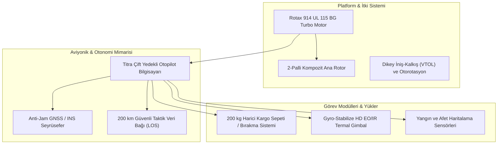

# 🚁 Proje: ALPİN (Döner Kanatlı İnsansız Helikopter Sistemi)

   

  

---

### 🛡️ Stratejik Tanım & Doktriner Öncelik
ALPİN, insanlı hafif bir helikopter platformunun gelişmiş otonom aviyonik ve uçuş kontrol algoritmalarıyla insansızlaştırılması sonucu ortaya çıkan, Türkiye'nin ilk operasyonel uzun menzilli döner kanatlı insansız hava aracıdır. Titra Teknoloji tarafından geliştirilen sistem; pist ihtiyacı olmaksızın dikey iniş-kalkış (VTOL) yapabilme yeteneği, 200 kg'a varan yüksek faydalı yük taşıma kapasitesi ve zorlu dağlık coğrafyalarda üs bölgelerine kritik askeri lojistik (mühimmat, gıda, tıbbi malzeme) sevkiyatı yapabilmesiyle öne çıkmaktadır. Ayrıca elektro-optik gimbal entegrasyonuyla taktik keşif ve Orman Genel Müdürlüğü bünyesinde yangın gözetleme/erken müdahale görevlerinde aktif olarak kullanılmaktadır.

---

### 📊 Kapsamlı Teknik Özellikler Tablosu

| Parametre | Değer / Özellik |
| :--- | :--- |
| **Maksimum Kalkış Ağırlığı (MTOW)** | 550 kg |
| **Faydalı Yük Taşıma Kapasitesi** | 200 kg (Yakıt durumuna bağlı) |
| **Boş Ağırlık** | 340 kg |
| **Motor** | 1 x Rotax 914 UL Dört Zamanlı Turbo Benzinli Motor (115 BG) |
| **Maksimum Seyir Hızı** | 160 km/s (86 Knots) |
| **Servis Tavanı** | 21.000 ft (6.400 m) |
| **Havada Kalış Süresi** | 8 - 9 saat (Ek yakıt ile) / Kargo yüküyle ~4 saat |
| **Kontrol & Veri Bağı Menzili** | 200 km (Görüş Hattı - LOS) / Uydu desteği opsiyonu |
| **Rotor Çapı** | 7.0 metre (2 Palli Ana Rotor) |
| **İniş-Kalkış Özelliği** | Hazırlıksız araziye ve gemi güvertesine tam otonom dikey iniş-kalkış (VTOL) |

---

### 🧩 Alt Sistemler ve Aviyonik/Elektronik Entegrasyonu
- **Otonom Uçuş Kontrol Süiti:** Titra tarafından geliştirilen çift yedekli tam otonom uçuş yönetim bilgisayarı (Otopilot).
- **Yedekli Seyrüsefer:** GNSS karıştırmalarına dayanıklı Anti-Jamming GNSS alıcısı, Ataletsel Seyrüsefer Sistemi (INS) ve Lidar/Radar altimetre.
- **Keşif Faydalı Yükü:** Termal ve gündüz kameralı, lazer mesafe buluculu gyro-stabilize HD Elektro-Optik Gimbal kamera.
- **Acil Durum Yönetimi:** Motor durması durumunda otomatik otorotasyon ile güvenli iniş kabiliyeti ve acil durum veri linki koruması.

---

### 🎯 Görev Profili, Muharebe Senaryoları & Mühimmat Yelpazesi
- **İleri Üs Lojistik Sevkiyatı:** Karayolu ulaşımı kesilen sarp dağlık üs bölgelerine zorlu hava koşullarında insan hayatını riske atmadan mühimmat, kan ve erzak ulaştırma.
- **Taktik Keşif ve Gözetleme:** Sınır hattında gece/gündüz termal kameralarla sızma girişimlerinin tespiti ve takibi.
- **Doğal Afet ve Yangın Yönetimi:** Orman yangınlarında alev cephelerinin havadan tespiti, koordinat aktarımı ve afet bölgelerine acil yardım malzemesi indirme.
- **Deniz Karakol Desteği:** Sahil Güvenlik ve Donanma gemilerinin helikopter pistlerinden kalkarak çevre deniz sahasında gözetleme icrası.

---

### 📐 Özel Mimari ve Görev Akış Şeması

---

### 🚀 TRL Seviyesi ve Gelişim Yol Haritası
- [x] İnsanlı Hafif Helikopterin İnsansızlaştırılması ve Tasarım
- [x] Otonom Uçuş ve Havada Asılı Kalma (Hover) Doğrulaması
- [x] 200 kg Yük Taşıma ve Bırakma Testleri
- [x] Orman Genel Müdürlüğü ile Yangın Sahalarında Operasyonel Testler
- [x] Dağlık Arazi ve Kış Şartları Askeri Lojistik Görev Denemeleri
- [ ] Deniz Platformlarına Entegrasyon ve Tam Seri Üretim

---

### 🔗 Sağlam İç Dizin Navigasyonu
[⬅️ Üst Dizine](../README.md) | [🏛️ Dominion Hub](../../README.md) | [🏠 Ana Sayfa](../../../README.md)
