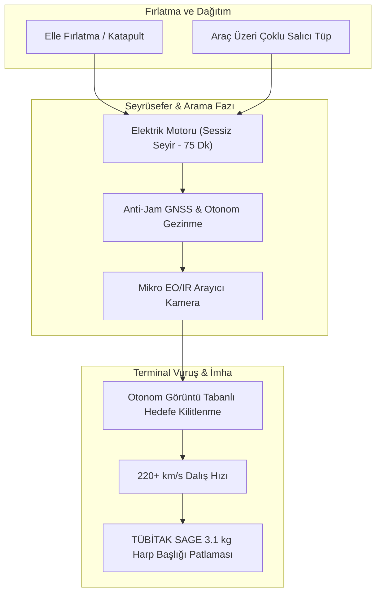

# 🦅 Proje: DELİ (Taktik Kamikaze Dolanan Mühimmat)

   

  

---

### 🛡️ Stratejik Tanım & Doktriner Öncelik
DELİ, Titra Teknoloji tarafından operasyonel birliklerin düşük maliyetli, tek er veya küçük timler tarafından kolayca konuşlandırılabilen hassas vuruş ihtiyacını karşılamak üzere geliştirilmiş taktik sınıf dolanan kamikaze mühimmatıdır (Loitering Munition). Sabit delta kanat mimarisi, katlanabilir gövde yapısı ve elden veya katapulttan fırlatılabilme kabiliyetiyle DELİ; TÜBİTAK SAGE tarafından optimize edilen yüksek parçacık tesirli harp başlığı ile düşman radar mevzilerini, hafif zırhlı araçlarını, personel toplanma alanlarını ve kritik haberleşme antenlerini nokta hassasiyetiyle imha edebilmektedir. Sistem otonom hedef tespiti ve sürü harekatı algoritmalarıyla donatılmıştır.

---

### 📊 Kapsamlı Teknik Özellikler Tablosu

| Parametre | Değer / Özellik |
| :--- | :--- |
| **Maksimum Kalkış Ağırlığı** | 13 kg |
| **Harp Başlığı Ağırlığı** | ~3.1 kg (TÜBİTAK SAGE tasarımı yüksek patlayıcılı parçacık etkili) |
| **İtki Tipi** | Fırçasız Elektrik Motoru & İtici Pervane (Düşük akustik iz) |
| **Maksimum Seyir Hızı** | 180 km/s |
| **Dalış / Vuruş Hızı** | 220+ km/s |
| **Maksimum Menzil** | 85 km operasyonel menzil |
| **Havada Kalış Süresi** | 75 dakika |
| **Servis Tavanı** | 3.500 m (~11.500 ft) |
| **Fırlatma Şekli** | Elden atış, yaylı fırlatıcı katapult veya araç üzeri çoklu tüp salıcı |
| **Güdüm Sistemi** | Optik hedef takipçisi + Anti-Jamming GNSS / Ataletsel Seyrüsefer |

---

### 🧩 Alt Sistemler ve Aviyonik/Elektronik Entegrasyonu
- **Hedef Arayıcı ve Takip:** Burun kısmında 2 eksenli yönlendirilebilir gündüz/gece mikro optik arayıcı kamera ve otomatik hedef takip yazılımı.
- **Seyrüsefer ve Karşı Tedbir:** Yoğun Elektronik Karıştırma (EW) ortamlarında dahi çalışabilen Anti-Jam GNSS alıcısı ve yedekli AHRS.
- **Otonom Karar & Sürü Yeteneği:** Hedef bölgesinde otonom daire çizerek bekleme, teyit edilen hedefe kilitlenme ve sürü halinde koordineli saldırı yapabilme algoritmaları.
- **Görev İptali:** Vuruş öncesi dost unsur tespiti halinde dalışı iptal edip yeniden yükselme ve güvenli bekleme kabiliyeti.

---

### 🎯 Görev Profili, Muharebe Senaryoları & Mühimmat Yelpazesi
- **Hassas Nokta Vuruşu:** Düşman makineli tüfek yuvaları, harici radar antenleri, komuta çadırları ve mühimmat depolarına cerrahi dalış.
- **Zırhlı Konvoy Baskını:** Hafif zırhlı personel taşıyıcılar ve yakıt tankerlerine karşı sürü dalışı ile konvoyun hareket kabiliyetini kilitleme.
- **Ön Cephe Ateş Desteği:** Topçu ve havan unsurlarının yetersiz kaldığı derin hedeflere piyadenin kendi organik kamikaze gücüyle anında müdahale etmesi.
- **Gezinerek Avlanma:** Hedef bölgesinde 1 saatten fazla tur atarak ortaya çıkacak fırsat hedeflerini anında imha etme.

---

### 📐 Özel Mimari ve Görev Akış Şeması

---

### 🚀 TRL Seviyesi ve Gelişim Yol Haritası
- [x] Aerodinamik Gövde ve Katlanır Kanat Tasarımı
- [x] TÜBİTAK SAGE Harp Başlığı Entegrasyonu
- [x] Otonom Seyrüsefer ve Uçuş Testleri
- [x] Canlı Harp Başlıklı Hedef İmha Atışları
- [x] Seri Üretim Bandının Kurulması ve Envanter Kabulü (TRL 9)
- [ ] Çoklu Araç Konteyner Fırlatıcı Entegrasyonu

---

### 🔗 Sağlam İç Dizin Navigasyonu
[⬅️ Üst Dizine](../README.md) | [🏛️ Dominion Hub](../../README.md) | [🏠 Ana Sayfa](../../../README.md)
