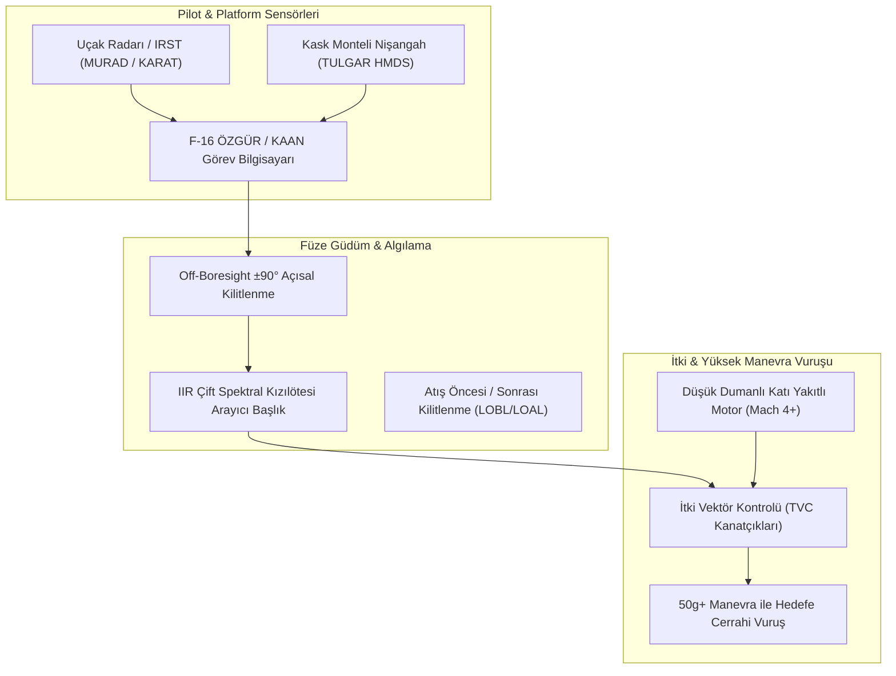

# 🦅 Proje: BOZDOĞAN (Görüş İçi Hava-Hava Füzesi - WVRAAM)

   

  

---

### 🛡️ Stratejik Tanım & Doktriner Öncelik
BOZDOĞAN, Türk Hava Kuvvetleri'nin hava-hava muharebelerinde mutlak üstünlük sağlaması amacıyla TÜBİTAK SAGE tarafından 'GÖKTUĞ' projesi kapsamında milli imkanlarla geliştirilen kısa menzilli Görüş İçi Hava-Hava Füzesidir (Within Visual Range Air-to-Air Missile - WVRAAM). ABD menşeili AIM-9X Sidewinder füzesinin yerini alan BOZDOĞAN; çift renkli Kızılötesi Görüntüleyici Arayıcı Başlığı (IIR), itki vektör kontrol sistemi (TVC) ve kaska monteli nişangah entegrasyonu sayesinde pilotun kaskıyla baktığı açıdaki en çevik düşman uçaklarını ve füzelerini 'off-boresight' (görüş ekseni dışı) kabiliyetiyle yüksek manevra yaparak avlayabilmektedir. F-16 PO-III/ÖZGÜR, KAAN, HÜRJET, AKINCI ve KIZILELMA için kritik bir caydırıcılık unsurudur.

---

### 📊 Kapsamlı Teknik Özellikler Tablosu

| Parametre | Değer / Özellik |
| :--- | :--- |
| **Füze Tipi** | Kısa Menzilli Görüş İçi Hava-Hava Füzesi (WVRAAM) |
| **Arayıcı Başlık Tipi** | Yüksek Çözünürlüklü Çift Renkli Kızılötesi Görüntüleyici (IIR - Imaging Infrared) |
| **Arayıcı Başlık Görüş Açısı** | ±90° Off-Boresight Geniş Açı Hedef Kilitlenme |
| **Maksimum Hız** | Mach 4+ (Süpersonik) |
| **Etkili Menzil** | 25+ km |
| **Manevra Kabiliyeti** | İtki Vektör Kontrolü (TVC) ile 50g+ Yüksek G Manevra |
| **İtki Motoru** | Düşük Dumanlı Katı Yakıtlı Roket Motoru |
| **Harp Başlığı** | Yüksek İnfilaklı Lazer Yaklaşma Tapalı Parçacık Tesirli Harp Başlığı |
| **Füze Ağırlığı / Çapı** | ~140 kg / 160 mm |
| **Entegrasyon Platformları** | F-16 (ÖZGÜR / CCIP), KAAN, HÜRJET, AKINCI, KIZILELMA, ANKA-3 |

---

### 🧩 Alt Sistemler ve Aviyonik/Elektronik Entegrasyonu
- **IIR Arayıcı Başlık:** ASELSAN/TÜBİTAK SAGE tasarımı çift spektral termal dedektör; flare ve kızılötesi karıştırıcılara (DIRCM) karşı üstün hedef ayırt etme algoritmaları.
- **İtki Vektör Kontrol Sistemi (TVC):** Roket motor çıkış lülesinde hareketli kanatçıklar ile fırlatma anından itibaren füzenin anında hedefe dönmesini sağlayan aşırı manevra kontrolü.
- **Kask Nişangah Entegrasyonu:** TULGAR veya kaska monteli görüş sistemleri ile pilotun hedefe sadece bakması ve kilitlenmesiyle fırlatılabilme.
- **Atış Öncesi / Sonrası Kilitlenme:** LOAL (Lock-On After Launch) ve LOBL (Lock-On Before Launch) yeteneği.

---

### 🎯 Görev Profili, Muharebe Senaryoları & Mühimmat Yelpazesi
- **İt Dalaşı (Dogfight):** Yüksek manevralı yakın hava muharebelerinde düşman savaş uçaklarının ani manevralarını TVC desteğiyle karşılayıp arkadan, önden veya yandan imha.
- **Seyir Füzesi & İHA Önleme:** Alçaktan uçan seyir füzeleri veya intihar İHA'larını yüksek termal hassasiyetle tespit edip havada parçalama.
- **SİHA Hava Savunması:** AKINCI ve KIZILELMA üzerinden fırlatılarak dost SİHA'ları düşman avcı uçaklarına karşı koruma altına alma.
- **Görüş Hattı Dışı Angajman:** Hedefin uçağın arkasında veya dik açısında olduğu durumlarda bile fırlatılıp 180 derece dönüşle hedefi vurma.

---

### 📐 Özel Mimari ve Görev Akış Şeması

---

### 🚀 TRL Seviyesi ve Gelişim Yol Haritası
- [x] GÖKTUĞ Projesi Kapsamında Tasarım ve Simülasyon
- [x] Yer ve Rüzgar Tüneli Testleri
- [x] F-16 Kanat Altından Ayrılma ve Balistik Uçuş Testleri
- [x] Canlı Hedef Uçağa (ŞİMŞEK) Karşı Güdümlü Tam İsabetli Atış Testi
- [x] Düşük Yoğunluklu Seri Üretim Sözleşmesi İmzalanması
- [x] Hava Kuvvetleri Komutanlığı Envanterine Giriş ve TRL 9 Doğrulaması

---

### 🔗 Sağlam İç Dizin Navigasyonu
[⬅️ Üst Dizine](../README.md) | [🏛️ Dominion Hub](../../README.md) | [🏠 Ana Sayfa](../../../README.md)
