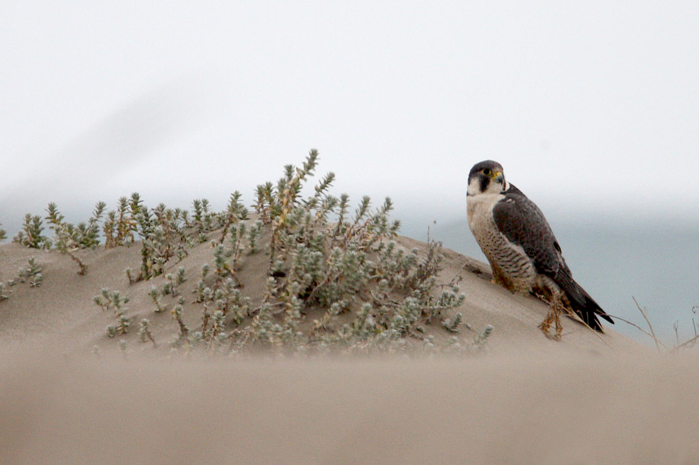
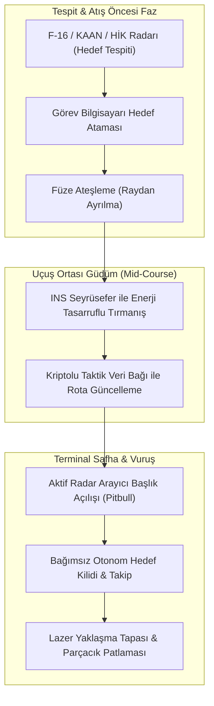

# 🏹 Proje: GÖKDOĞAN (Görüş Ötesi Hava-Hava Füzesi - BVRAAM)

   

  

---

### 🛡️ Stratejik Tanım & Doktriner Öncelik
GÖKDOĞAN, Türk Hava Kuvvetleri'nin görüş ötesi menzillerde (Beyond Visual Range - BVR) düşman hava unsurlarına karşı mutlak caydırıcılık kazanması amacıyla TÜBİTAK SAGE tarafından geliştirilen katı hal Aktif Radar Arayıcı Başlıklı milli hava-hava füzesidir. ABD menşeili AIM-120 AMRAAM füzelerinin yerli muadili olan GÖKDOĞAN; çift yönlü taktik veri bağı, at-unut (fire-and-forget), gelişmiş elektronik karşı-karşı tedbir (ECCM) kabiliyetleri ve katı yakıtlı roket motoruyla 65-100+ km menzildeki hedefleri avlayabilmektedir. F-16 ÖZGÜR filoları, 5. nesil KAAN ve HÜRJET uçaklarının yanı sıra AKINCI ve KIZILELMA SİHA'larının da uzun menzilli birincil hava muharebe yumruğudur.

---

### 📊 Kapsamlı Teknik Özellikler Tablosu

| Parametre | Değer / Özellik |
| :--- | :--- |
| **Füze Sınıfı** | Görüş Ötesi Hava-Hava Füzesi (BVRAAM) |
| **Arayıcı Başlık** | Katı Hal Aktif Radar Arayıcı Başlık (ARH - Active Radar Homing) |
| **Menzil** | 65 - 100+ km (İrtifaya bağlı) |
| **Maksimum Hız** | Mach 4+ |
| **Güdüm Sistemi** | Ataletsel Seyrüsefer (INS) + Uçuş Ortası Veri Bağı Güncellemesi + Terminal Aktif Radar |
| **Harp Başlığı** | Lazer Yaklaşma Tapalı Parçacık Tesirli Yüksek İnfilaklı Harp Başlığı |
| **Elektronik Harp Direnci** | Gelişmiş Sayısal Frekans Atlamalı Elektronik Karşı-Karşı Tedbir (ECCM) |
| **Füze Ağırlığı / Çapı** | ~180 kg / 180 mm |
| **Çoklu Hedef Angajmanı** | Aynı anda birden fazla füzeyi farklı hedeflere yönlendirebilme yeteneği |
| **Taşıyıcı Platformlar** | F-16 PO-III/ÖZGÜR, KAAN (Dahili istasyonlar), HÜRJET, AKINCI, KIZILELMA |

---

### 🧩 Alt Sistemler ve Aviyonik/Elektronik Entegrasyonu
- **Aktif Radar Arayıcı Başlık (ARH):** TÜBİTAK SAGE/ASELSAN ortaklığında geliştirilen, terminal safhada kendi radarıyla hedefi takip eden bağımsız güdüm ünitesi.
- **Çift Yönlü Güvenli Veri Bağı:** Fırlatıcı uçaktan (veya havadan erken ihbar uçağı HİK'ten) hedef koordinat güncellemelerini uçuş sırasında alma ve durum raporlama.
- **Kriptolu Ataletsel Seyrüsefer (INS):** Uçuş ortası safhasında füzenin hedef sahasına en optimum enerji tasarruflu rotada ilerlemesini sağlayan hassas jiroskopik güdüm.
- **Çoklu Angajman:** Uçağın burun radarından beslenen verilerle aynı anda birden fazla GÖKDOĞAN füzesini bağımsız hedeflere ateşleme.

---

### 🎯 Görev Profili, Muharebe Senaryoları & Mühimmat Yelpazesi
- **Görüş Ötesi Hava Muharebesi (BVR):** Düşman savaş uçaklarını görsel temas menziline girmeden onlarca kilometre öteden tespit edip imha etme.
- **Havadan Erken İhbar (AWACS) Koruması:** Barış Kartalı HİK uçağı koordinasyonunda ağ merkezli olarak düşman paket kollarına önleme yapma.
- **SİHA ile Hava Savunması:** AKINCI ve KIZILELMA SİHA'ları üzerinden ateşlenerek düşman avcı jetlerine veya bombardıman uçaklarına karşı hava sahasını savunma.
- **Elektronik Karıştırmaya Karşı Hücum:** Yoğun RF karıştırma yapan hedeflere karşı pasif 'Home-on-Jam' (karıştırıcı kaynağa kilitlenme) modu ile angajman.

---

### 📐 Özel Mimari ve Görev Akış Şeması

---

### 🚀 TRL Seviyesi ve Gelişim Yol Haritası
- [x] Proje Başlangıcı ve Katı Hal Radar Başlığı Geliştirme
- [x] Balistik ve Ayrılma Testleri
- [x] F-16 Üzerinden Uçuş Ortası Veri Bağı Testleri
- [x] Canlı Hedefe Karşı Tam İsabetli Görüş Ötesi Test Atışı
- [x] Seri Üretim Sözleşmesi İmzalanması ve Kabul Testleri
- [x] Hava Kuvvetleri Filolarına Teslimat ve TRL 9 Doğrulaması

---

### 🔗 Sağlam İç Dizin Navigasyonu
[⬅️ Üst Dizine](../README.md) | [🏛️ Dominion Hub](../../README.md) | [🏠 Ana Sayfa](../../../README.md)
