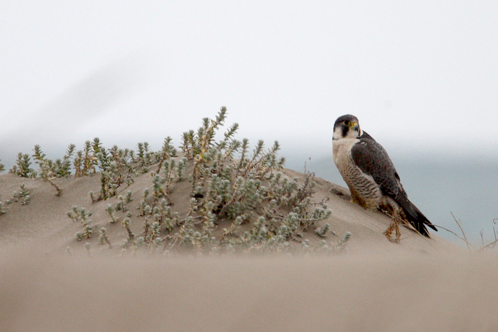
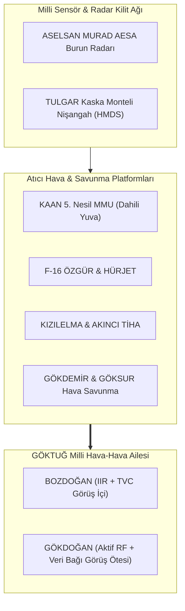

# 🚀 Proje: GÖKTUĞ / GÖKDOĞAN & BOZDOĞAN (Yeni Nesil Hava-Hava Füzeleri Ailesi)

  

> **Geliştirici:** TÜBİTAK SAGE (Savunma Sanayii Araştırma ve Geliştirme Enstitüsü)  
> **Sınıf:** Görüş İçi (WVRAAM) ve Görüş Ötesi (BVRAAM) Milli Hava-Hava Füze Sistemi Ailesi  
> **Stratejik Önem:** Türk Hava Kuvvetleri'nin ABD menşeili AIM-9X Sidewinder ve AIM-120 AMRAAM füzelerine olan dışa bağımlılığını sona erdiren; F-16 ÖZGÜR, KAAN, HÜRJET, KIZILELMA ve AKINCI platformlarına tam bağımsız hava hakimiyeti kazandıran stratejik mühimmat ailesi.

---

## 🛡️ Stratejik Tanım & Doktriner Öncelik

**GÖKTUĞ Projesi**, Türkiye'nin hava-hava muharebelerinde mühimmat bağımsızlığını kazanması amacıyla TÜBİTAK SAGE tarafından geliştirilen ve seri üretime giren milli hava-hava füzesi programıdır. Program kapsamında iki ana vurucu mühimmat ve bunların deniz/kara hava savunma türevleri (GÖKSUR / GÖKDEMİR) üretilmiştir:

1. **BOZDOĞAN (Görüş İçi - WVRAAM):** Çift renkli yüksek çözünürlüklü Görüntüleyici Kızılötesi (IIR) arayıcı başlığa ve **İtki Vektör Kontrolü (TVC - Thrust Vector Control)** kabiliyetine sahip, 65G+ manevra limitlerinde it dalaşı (dogfight) icra edebilen kısa menzilli hava-hava füzesidir.
2. **GÖKDOĞAN (Görüş Ötesi - BVRAAM):** Katı hal Aktif RF Radar Arayıcı Başlığa, iki yönlü veri bağına, "At-Unut" ve "At-Güncelle" kabiliyetine sahip, 100+ km menzil zarfında düşman savaş uçaklarını görüş ötesinden avlayan orta/uzun menzilli hava-hava füzesidir.

---

## 📊 Kapsamlı Teknik Özellikler

| Parametre | BOZDOĞAN (WVRAAM) | GÖKDOĞAN (BVRAAM) |
| :--- | :--- | :--- |
| **Füze Tipi** | Görüş İçi İt Dalaşı Hava-Hava Füzesi | Görüş Ötesi Uzun Menzilli Hava-Hava Füzesi |
| **Arayıcı Başlık** | Çift Bantlı Görüntüleyici Kızılötesi (IIR) | Katı Hal Aktif RF Radar Arayıcı Başlık |
| **Operasyonel Menzil** | 25 - 30+ Kilometre | 65 - 100+ Kilometre (İrtifaya bağlı) |
| **Uçuş Hızı** | Mach 4+ (Yüksek Süpersonik) | Mach 4+ (Yüksek Süpersonik) |
| **Manevra Kabiliyeti** | İtki Vektör Kontrolü (TVC) ile Yüksek Off-Boresight | Aerodinamik Kontrol + Yüksek G Kabiliyeti |
| **İtki Sistemi** | Az Dumanlı Kompozit Katı Yakıtlı Roket Motoru | Çift Darbeli (Dual-Pulse) Katı Yakıtlı Motor |
| **Güdüm & Veri Bağı** | Kaska Monteli Nişangah (TULGAR) Kilitlenmesi | ANS + İki Yönlü Veri Bağı + Terminal Aktif Radar |
| **Tapa & Harp Başlığı** | Lazer Yaklaşma Tapası + Yüksek İnfilaklı Parçacıklı | RF Yaklaşma Tapası + Yönlendirilmiş Parçacıklı |

---

## 🧩 Alt Sistemler ve Aviyonik / Elektronik Entegrasyonu

- **MIL-STD-1553 & MIL-STD-1760 Uyumluluğu:** Hem NATO standardı F-16 lançerleriyle (LAU-129) hem de milli uçakların görev bilgisayarlarıyla doğrudan haberleşir.
- **Elektronik Karşı-Karşı Tedbir (ECCM):** BOZDOĞAN ısı tuzaklarını (flare) ayırt ederek gerçek uçak gövdesine kilitlenirken; GÖKDOĞAN yoğun radar karıştırma (DRFM jamming) ortamında Home-on-Jam (Karıştırıcıya Güdümlenme) moduna geçer.

---

## 🎯 Görev Profili, Muharebe Senaryoları & Mühimmat Yelpazesi

1. **Görüş Ötesi Hava Hakimiyeti (BVR):** KAAN ve AKINCI üzerindeki MURAD AESA radarı ile 100+ km uzaktan tespit edilen düşman uçaklarının GÖKDOĞAN ile angajmana girmeden düşürülmesi.
2. **Yüksek Açılı İt Dalaşı (High Off-Boresight):** Pilotun TULGAR kaskıyla omzunun üzerinden bakarak kilitlendiği hedefe BOZDOĞAN'ın TVC lülesiyle 90 derece dönerek çarpması.
3. **Nokta ve Bölge Hava Savunma (GÖKDEMİR / GÖKSUR):** Aynı füzelerin kara lançerlerinden (GÖKDEMİR) ve savaş gemilerinden (GÖKSUR) seyir füzelerine karşı ateşlenmesi.

---

## 🚀 TRL Seviyesi ve Gelişim Yol Haritası

- **Mevcut Durum:** `TRL 9` (F-16 uçaklarından canlı hedeflere yapılan atışlarla kalifiye edilmiş, seri üretim sözleşmesi imzalanarak Türk Hava Kuvvetleri envanterine teslim edilmiştir).
- [x] Yerden ve F-16 uçaklarından yüksek hızlı hedef uçaklara (ŞİMŞEK) karşı tam isabetli atışlar
- [x] SSB ile Seri Üretim Sözleşmesi ve ilk kafilelerin Hava Kuvvetleri'ne teslimi (2024)
- [ ] KAAN dahili silah yuvası ve KIZILELMA süpersonik atış entegrasyonu

---

## 🔗 İç Dizin Navigasyonu

[⬅️ Üst Dizine (TÜBİTAK SAGE)](../README.md) | [🏛️ Dominion Hub (DOMINION_AEROSPACE)](../../README.md) | [🏠 Ana Sayfa](../../../README.md)
