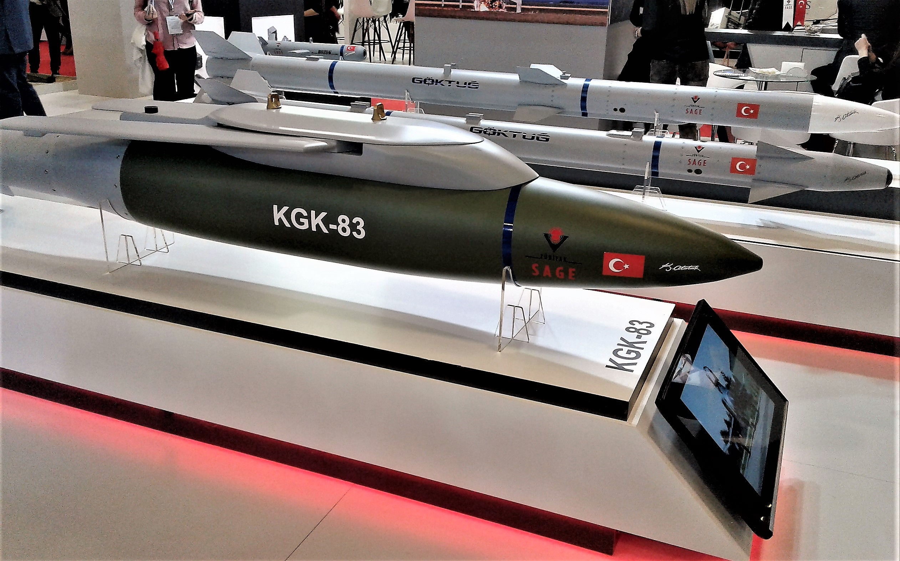
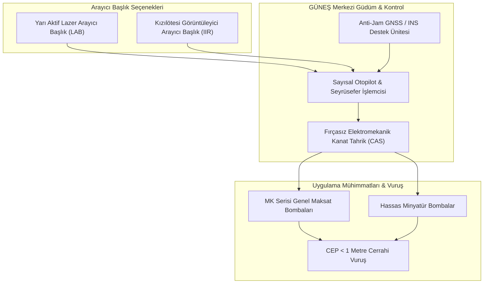

# ☀️ Proje: TÜBİTAK SAGE GÜNEŞ (Akıllı Güdüm Kiti ve Arayıcı Başlık Ailesi)

   

  

---

### 🛡️ Stratejik Tanım & Doktriner Öncelik
TÜBİTAK SAGE GÜNEŞ, Türk Silahlı Kuvvetleri'nin envanterindeki güdümsüz konvansiyonel genel maksat mühimmatlarını ve hafif hava mühimmatlarını her türlü hava koşulunda hareketli ve sabit hedeflere karşı cerrahi nokta vuruşu yapabilen akıllı füzelere dönüştürmek amacıyla geliştirilen modüler arayıcı başlık ve akıllı güdüm kiti ailesidir. Lazer Arayıcı Başlık (LAB) ve Kızılötesi Görüntüleyici (IIR) konfigürasyonlarına sahip olan GÜNEŞ mimarisi; düşmanın yoğun elektronik karıştırma ve GPS köreltmesi yaptığı zorlu harekat sahalarında dahi hedefini bağımsız olarak teşhis edip 1 metrenin altında dairesel sapma (CEP) hassasiyetiyle imha etme kabiliyeti sunmaktadır.

---

### 📊 Kapsamlı Teknik Özellikler Tablosu

| Parametre | Değer / Özellik |
| :--- | :--- |
| **Sistem Tipi** | Modüler Akıllı Güdüm Kiti ve Terminal Arayıcı Başlık |
| **Arayıcı Başlık Seçenekleri** | Yarı Aktif Lazer Arayıcı (LAB) / Soğutmalı IIR (Kızılötesi Görüntüleyici) |
| **Vuruş Hassasiyeti (CEP)** | <1 metre (Lazer / IIR terminal güdüm ile) |
| **Güdüm Algoritması** | Oransal Seyrüsefer (Proportional Navigation) ve Optimal Terminal Dalış Kontrolü |
| **Uyumlu Mühimmat Sınıfları** | MK-81, MK-82, MK-83 genel maksat bombaları ve minyatür hafif hava bombaları |
| **Elektronik Karıştırma Direnci** | GNSS köreltmesinden etkilenmeyen otonom elektro-optik hedef takibi |
| **Atış İrtifası / Bırakma Zarfı** | 5.000 ft - 40.000 ft irtifa aralığı |
| **Hedef Hızı Kapasitesi** | 100 km/s üzeri yüksek hızlı hareketli kara ve deniz hedeflerine kilitlenme |
| **Ayrılma Sonrası Kilitlenme** | Uçuş sırasında dinamik hedef yakalama ve kilitlenme (LOAL yeteneği) |
| **Entegre Platformlar** | F-16 ÖZGÜR/CCIP, KAAN, HÜRJET, AKINCI, AKSUNGUR, ANKA-3 |

---

### 🧩 Alt Sistemler ve Aviyonik/Elektronik Entegrasyonu
- **Modüler Sensör Başlığı:** Değiştirilebilir burun konisi mimarisi; lazer lekesi izleyici detektör veya termal matris arayıcı.
- **Kriptolu Otopilot ve Kanat Tahrik:** Hızlı tepki süresine sahip fırçasız DC servo motorlu yönlendirme kanatçıkları (CAS - Control Actuator System).
- **Hedef Tanıma & Karar Algoritmaları:** Hedefin kamuflaj arkasına geçmesi veya duman perdesi oluşturması durumunda son bilinen vektöre göre vuruş tamamlama yazılımı.
- **Entegre Güç Ünitesi:** Yüksek deşarjlı termal batarya ile uzun süzülüş sürelerinde kesintisiz enerji temini.

---

### 🎯 Görev Profili, Muharebe Senaryoları & Mühimmat Yelpazesi
- **Yüksek Hızlı Hareketli Hedef Vuruşu:** Seyir halindeki düşman zırhlı araçları, hücumbotlar veya terörist konvoylarına hareket halinde tam isabet.
- **GPS-Korumalı Cerrahi Taarruz:** GPS sinyallerinin tamamen kesildiği yoğun elektronik harp cephelerinde lazer veya optik güdümle tahkimatları imha.
- **Şehir İçi Hassas Operasyonlar:** Sivil yerleşim bölgelerine yakın askeri mevzilerin tali hasarsız ve sıfır yan hasar riskiyle bertaraf edilmesi.
- **SİHA Taarruzu:** AKINCI ve AKSUNGUR SİHA'lardan yüksek irtifadan bırakılarak hava savunma menzili dışından derin hedeflere angajman.

---

### 📐 Özel Mimari ve Görev Akış Şeması

---

### 🚀 TRL Seviyesi ve Gelişim Yol Haritası
- [x] Lazer ve IIR Arayıcı Başlık Algoritma Tasarımı
- [x] Rüzgar Tüneli ve Donanım-Döngüde (HIL) Testleri
- [x] F-16 ve SİHA Bırakma Testleri
- [x] Hareketli Hedeflere Karşı Canlı Atış Doğrulamaları
- [x] Seri Üretim Sertifikasyonu ve TSK Envanter Girişi (TRL 9)
- [ ] Yeni Nesil Yapay Zekalı Görüntü İşleme Yazılım Güncellemeleri

---

### 🔗 Sağlam İç Dizin Navigasyonu
[⬅️ Üst Dizine](../README.md) | [🏛️ Dominion Hub](../../README.md) | [🏠 Ana Sayfa](../../../README.md)
