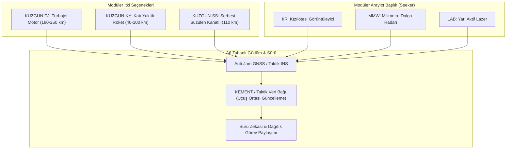

# 🐦 Proje: KUZGUN (Yeni Nesil Modüler Müşterek Mühimmat Ailesi)

   

  

---

### 🛡️ Stratejik Tanım & Doktriner Öncelik
KUZGUN, modern muharebe sahasının değişen tehdit dinamiklerine karşı TÜBİTAK SAGE tarafından geliştirilen; farklı itki sistemleri (turbojet, katı yakıtlı roket, serbest süzülen), değiştirilebilir modüler arayıcı başlıklar (IIR, MMW Radar, Lazer) ve çeşitli harp başlığı alternatifleriyle donatılabilen 'yeni nesil modüler müşterek mühimmat' ailesidir. Karadan, havadan (savaş uçakları, SİHA'lar, helikopterler) ve deniz platformlarından (hücumbot, USV, fırkateyn) ateşlenebilen KUZGUN; düşük radar kesit alanı, katlanır kanatları ve 180-250 km'ye varan stand-off menziliyle Türk Silahlı Kuvvetleri'nin mühimmat lojistiğini tek bir standart gövdede birleştiren taktik bir kuvvet çarpanıdır.

---

### 📊 Kapsamlı Teknik Özellikler Tablosu

| Parametre | Değer / Özellik |
| :--- | :--- |
| **Mühimmat Ailesi Üyeleri** | KUZGUN-SS (Serbest Süzülen) | KUZGUN-KY (Katı Yakıtlı) | KUZGUN-TJ (Turbojet İtkili) |
| **Maksimum Menzil** | KUZGUN-TJ: 180 - 250 km | KUZGUN-SS: 110 km | KUZGUN-KY: 40 - 100 km |
| **Toplam Ağırlık** | ~100 kg sınıfı hafif ve kompakt yapı |
| **Harp Başlığı** | 15 - 25 kg (Parçacık Tesirli, Zırh Delici, Termobarik veya Çok Maksatlı) |
| **Arayıcı Başlık Seçenekleri** | Modüler Burun: IIR (Kızılötesi), MMW (Milimetre Dalga Radarı), Lazer veya Çift Modlu (Dual-Seeker) |
| **Hız Profili** | KUZGUN-TJ/KY: Yüksek Subsonik (Mach 0.8+) | KUZGUN-SS: Süzülüş Hızı |
| **Güdüm Mimarisi** | INS/GPS + Karıştırmaya Dayanıklı CRPA Anten + Çift Yönlü RF Veri Bağı + Terminal Arayıcı |
| **Sürü Yeteneği** | Birden fazla mühimmatın birbiriyle haberleşerek sürü halinde hedef paylaşımı |
| **Gövde Tasarımı** | Katlanabilir kanatlar ve düşük radar kesit alanına (Stealth) sahip kompozit geometri |
| **Taşıyıcı Platformlar** | F-16 ÖZGÜR, KAAN, HÜRJET, AKSUNGUR, AKINCI, ANKA-3, TB3, MİLGEM, ULAQ İDA |

---

### 🧩 Alt Sistemler ve Aviyonik/Elektronik Entegrasyonu
- **Modüler Arayıcı Başlık Yuvası (Plug-and-Play):** Görev tipine göre dakikalar içinde sahada değiştirilebilen IIR termal, MMW radar veya Lazer arayıcı donanımı.
- **Taktik Veri Bağı:** Fırlatıcı uçak, SİHA veya yer kontrol istasyonu ile çift yönlü şifreli veri bağlantısı; havada rota/hedef güncelleme ve hasar tespit görüntüsü aktarma.
- **Gelişmiş Seyrüsefer:** CRPA kontrollü Anti-Jamming GNSS ve taktik derece lazer jiroskoplu INS.
- **Sürü Zekâsı Yazılımı:** Bir salvo halinde atılan mühimmatların hava savunma bataryasını eş zamanlı farklı yönlerden vurmak üzere koordineli uçuş yapması.

---

### 🎯 Görev Profili, Muharebe Senaryoları & Mühimmat Yelpazesi
- **Hava Savunma Bataryalarını Çökertme (SEAD/DEAD):** Düşman Pantsir, Tor veya Patriot sistemlerini 200 km öteden düşük radar iziyle süzülerek imha.
- **Hareketli Su Üstü Harp:** Hücumbotlar veya çıkartma gemilerine karşı MMW Radar / IIR arayıcı ile gemisavar taarruzu.
- **Zırhlı Birlikler ve Lojistik Hatlar:** Tank taburlarını ve mühimmat konvoylarını zırh delici ve parçacıklı harp başlıklarıyla felç etme.
- **Çoklu Platform Taşıma Avantajı:** Bir F-16 veya AKINCI'nın tek sortide 8 ila 12 adet KUZGUN mühimmatı taşıyabilmesi ile doyum taarruzu.

---

### 📐 Özel Mimari ve Görev Akış Şeması

---

### 🚀 TRL Seviyesi ve Gelişim Yol Haritası
- [x] Modüler Gövde ve Kanat Katlama Mekanizması Tasarımı
- [x] KUZGUN-SS Rüzgar Tüneli ve Bırakma Testleri
- [x] KUZGUN-KY Katı Yakıtlı Motorlu Canlı Atış Doğrulaması
- [x] KUZGUN-TJ Turbojet Motorlu Uçuş Testleri
- [ ] Çift Modlu Arayıcı Başlık ve Sürü Yazılımı Kalifikasyonu (TRL 7 -> TRL 8)
- [ ] Seri Üretim ve Çoklu Platform Envanter Kabulü

---

### 🔗 Sağlam İç Dizin Navigasyonu
[⬅️ Üst Dizine](../README.md) | [🏛️ Dominion Hub](../../README.md) | [🏠 Ana Sayfa](../../../README.md)
