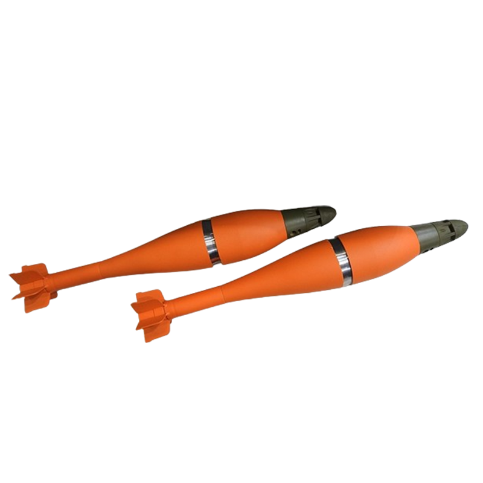
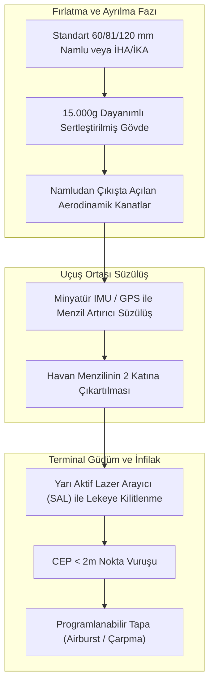

# 💥 Proje: TÜBİTAK SAGE MORS (Modüler Oturmalı Akıllı Havan ve Mini Roket)

   

  

---

### 🛡️ Stratejik Tanım & Doktriner Öncelik
MORS (Modüler Oturmalı Roket ve Akıllı Havan Mühimmatı Ailesi), ön hat piyade birliklerinin, kara araçlarının ve insansız platformların (İHA, İKA) organik ateş gücünü cerrahi hassasiyet seviyesine çıkarmak üzere TÜBİTAK SAGE tarafından geliştirilen minyatür hassas güdümlü mühimmat sistemidir. Klasik havan mühimmatlarının düşük isabet oranını ve yüksek mühimmat sarfiyatını ortadan kaldıran MORS; gövdeye entegre açılır aerodinamik kontrol kanatçıkları, GPS/INS destekli akıllı burun tapası ve yarı aktif lazer arayıcı başlığı ile menzili iki katına çıkarırken dairesel sapmayı (CEP) 2 metrenin altına indirmektedir.

---

### 📊 Kapsamlı Teknik Özellikler Tablosu

| Parametre | Değer / Özellik |
| :--- | :--- |
| **Mühimmat Kalibreleri** | 60 mm, 81 mm ve 120 mm havan uyumlu varyantlar |
| **Güdüm Tipi** | GPS / Sayısal INS + Terminal Yarı Aktif Lazer Güdümü (SAL) |
| **Vuruş Hassasiyeti (CEP)** | <2 metre (Cerrahi nokta atışı) |
| **Menzil Artışı** | Klasik havan mühimmatlarına kıyasla %80 - %120 menzil artışı (Açılır kanatlar ile süzülüş) |
| **Azami Menzil** | 81 mm için ~9 km | 120 mm için ~15+ km |
| **Harp Başlığı** | Yüksek İnfilaklı Parçacık Tesirli veya Zırh Delici Çukur İmla |
| **Tapa Seçenekleri** | Çarpmalı, Gecikmeli (Sığınak içi) ve Havada Parçalanmalı (Airburst) Yaklaşma Tapası |
| **Atıcı Platformlar** | Standart Havan Namluları, İnsansız Kara Araçları (İKA), Döner/Sabit Kanatlı SİHA'lar |
| **Kurulum ve Hazırlık** | Saniyeler içinde namluya sürülebilen tak-kullan modüler gövde |
| **Elektronik Koruma** | Kriptolu sinyal alımı ve karıştırmaya dirençli seyrüsefer |

---

### 🧩 Alt Sistemler ve Aviyonik/Elektronik Entegrasyonu
- **Akıllı Burun Tapası:** Hassas zaman ayarlı ve lazer lekesi arayan minyatür optik algılayıcı ünitesi.
- **Açılır Aerodinamik Kanatçıklar:** Namludan çıkış anında merkezkaç ve yay kuvvetiyle açılan, süzülüş açısını kontrol eden mikro kontrol kanatları.
- **Minyatür IMU ve Mikroişlemci:** Aşırı yüksek fırlatma g-kuvvetlerine (15.000g+) dayanıklı sertleştirilmiş elektronik kart mimarisi.
- **Lazer Algılama Modülü:** İHA veya yer unsurlarının lazerle işaretlediği kodlanmış lekeye yüksek hızla yönelme yeteneği.

---

### 🎯 Görev Profili, Muharebe Senaryoları & Mühimmat Yelpazesi
- **Cerrahi Piyade Desteği:** Meskun mahalde veya sarp dağlık arazide dost birliklerin hemen yakınındaki düşman mevzilerine tali hasarsız atış.
- **Sütre Gerisi Hedef İmhası:** Tepe arkasında veya mağara ağzında gizlenen roket/havan mevzilerini dik açılı terminal dalışla vurma.
- **İnsansız Sistem Entegrasyonu:** BARKAN, KAPGAN gibi İKA'lar ile BOYGA ve KARGU benzeri mini İHA'lardan bırakılarak hafif zırhlı hedefleri imha.
- **Hızlı Reaksiyonlu Karşı Batarya:** Düşman atış yaptıktan hemen sonra yer tespit radarı koordinatlarına ilk atımda tam isabetle karşılık verme.

---

### 📐 Özel Mimari ve Görev Akış Şeması

---

### 🚀 TRL Seviyesi ve Gelişim Yol Haritası
- [x] Yüksek G Dayanımlı Elektronik Mimari Geliştirme
- [x] Açılır Kanat Mekanizması Namlu Çıkış Testleri
- [x] Lazer Güdüm Kiti ve Terminal Arayıcı Doğrulaması
- [x] Canlı Atışlı Hedef İmha Kalifikasyonları (CEP < 2m)
- [x] TSK ve Özel Kuvvetler Envanterine Giriş (TRL 9)
- [ ] Mini İHA / İKA Entegrasyonlarının Çeşitlendirilmesi

---

### 🔗 Sağlam İç Dizin Navigasyonu
[⬅️ Üst Dizine](../README.md) | [🏛️ Dominion Hub](../../README.md) | [🏠 Ana Sayfa](../../../README.md)
