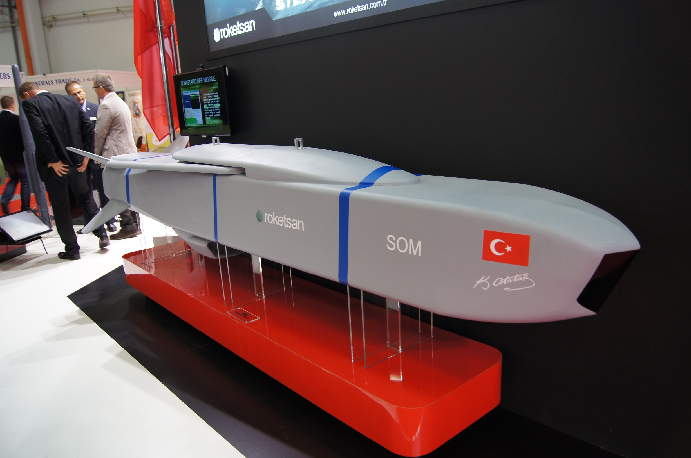
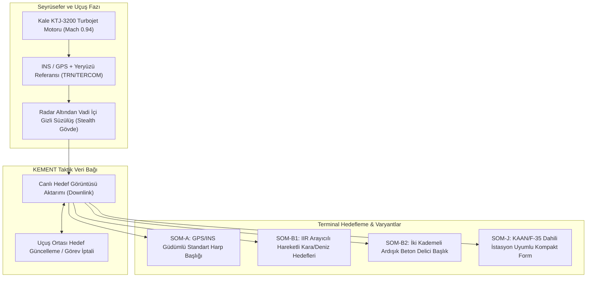

# 🦅 Proje: SOM (Satha Atılan Orta Menzilli Seyir Füzesi Ailesi)

   

  

---

### 🛡️ Stratejik Tanım & Doktriner Öncelik
SOM (Satha Atılan Mühimmat), Türk Silahlı Kuvvetleri'nin düşman hava savunma şemsiyelerinin menziline girmeden (Stand-Off), yoğun korunan stratejik kara ve deniz hedeflerini yüksek hassasiyetle vurabilmesi için TÜBİTAK SAGE tarafından tasarlanan ve ROKETSAN tarafından seri üretimi gerçekleştirilen Türkiye'nin ilk milli seyir füzesi ailesidir. Kale Havacılık üretimi KTJ-3200 milli turbojet motoruyla donatılan platform; düşük radar kesit alanı (Stealth), arazi referanslı seyrüsefer (TRN/TERCOM), görüntü referanslı seyrüsefer (IBN), kızılötesi görüntüleyici (IIR) terminal arayıcı başlık ve çift yönlü KEMENT taktik veri bağı sayesinde hedefini santimetre hassasiyetiyle imha edebilmektedir.

---

### 📊 Kapsamlı Teknik Özellikler Tablosu

| Parametre | Değer / Özellik |
| :--- | :--- |
| **Füze Tipi** | Hava-Yer / Hava-Deniz Hassas Seyir Füzesi (ALCM) |
| **Menzil** | 250+ km (Stand-off taarruz mesafesi) |
| **Maksimum Hız** | Mach 0.94 (Yüksek Subsonik) |
| **Motor** | Kale Havacılık KTJ-3200 Milli Turbojet Motoru (veya Safran TR40) |
| **Toplam Ağırlık** | ~600 kg (SOM-A/B) / ~500 kg (SOM-J) |
| **Harp Başlığı** | 230 kg Yüksek İnfilaklı Parçacık Tesirli veya Çift Kademeli Ardışık Delici (Tandem Penetrator) |
| **Güdüm Sistemi** | Ataletsel Seyrüsefer (INS) + GPS + Yeryüzü Referanslı Seyrüsefer (TRN) + Otomatik Hedef Algılama (ATA) |
| **Terminal Arayıcı** | Yüksek Çözünürlüklü Soğutmalı IIR (Kızılötesi Görüntüleyici Arayıcı Başlık) |
| **Veri Bağı** | KEMENT Taktik Veri Bağı (Uçuş ortası hedef güncelleme, yeniden hedeflendirme ve hasar tespiti) |
| **Taşıyıcı Platformlar** | F-16 PO-III/ÖZGÜR, F-4E 2020, KAAN, AKINCI, AKSUNGUR, KIZILELMA, ANKA-3 |

---

### 🧩 Alt Sistemler ve Aviyonik/Elektronik Entegrasyonu
- **IIR Terminal Arayıcı ve ATA:** Otomatik Hedef Algılama (ATA) yazılımı ile hafızasındaki 3 boyutlu hedef modeliyle görseli eşleştirerek yanıltıcı hedefleri ve sahte hedefleri eler.
- **TRN / IBN Yeryüzü Referanslı Seyrüsefer:** Radar altimetre ve sayısal harita verilerini eşleştirerek GPS sinyalinin tamamen kesildiği coğrafyalarda dahi vadi içlerinden radar kapsamasının altından gizlice ilerleme.
- **KEMENT Çift Yönlü Veri Bağı:** Füzenin kamerasındaki canlı görüntüyü pilotun veya komuta merkezinin ekranına aktarma; pilota hedef üzerinde vuruş noktasını değiştirme (örneğin binanın belirli bir penceresini seçme) yeteneği.
- **Gizlilik / Stealth Gövde:** Radar soğurucu geometrik hatlar ve kompozit kaplama ile hava savunma radarları tarafından çok geç tespit edilme.

---

### 🎯 Görev Profili, Muharebe Senaryoları & Mühimmat Yelpazesi
- **Stratejik Komuta Merkezleri ve Radar Mevzileri:** SOM-B2 ardışık delici harp başlığı ile betonla güçlendirilmiş derin yeraltı sığınaklarını delip imha etme.
- **Kritik Altyapı ve Havalimanları:** SOM-A ve B1 varyantları ile düşman hangarlarını, mühimmat depolarını ve pist kavşaklarını felç etme.
- **Hareketli Su Üstü Harp (ASuW):** SOM-J ve SOM-B1 ile firkateyn, destroyer ve amfibi çıkarma gemilerine karşı IIR güdümle cerrahi su hattı vuruşu.
- **SİHA ile Derin Darbe:** AKINCI ve KIZILELMA SİHA'ları tarafından taşınarak pilot riski olmaksızın 250+ km derinlikteki düşman unsurlarına taarruz.

---

### 📐 Özel Mimari ve Görev Akış Şeması

---

### 🚀 TRL Seviyesi ve Gelişim Yol Haritası
- [x] SOM-A ve SOM-B1 Tasarım, Atış Testleri ve Envanter Kabulü (2012)
- [x] SOM-B2 Ardışık Delici Başlık Geliştirme ve Kabul Testleri (2020)
- [x] Kale KTJ-3200 Yerli Turbojet Motoru Entegrasyonu ve Başarılı Canlı Atışı
- [x] AKINCI TİHA Üzerinden SOM Füzesi Test Atışları ve Tam İsabet
- [x] SOM-J Dahili İstasyon Seyir Füzesi Entegrasyon ve Atış Fazı
- [x] TSK Filolarında Muharebe Hazır ve Seri İmalat (TRL 9)

---

### 🔗 Sağlam İç Dizin Navigasyonu
[⬅️ Üst Dizine](../README.md) | [🏛️ Dominion Hub](../../README.md) | [🏠 Ana Sayfa](../../../README.md)
