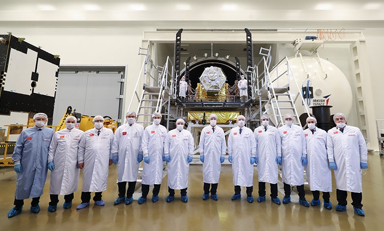
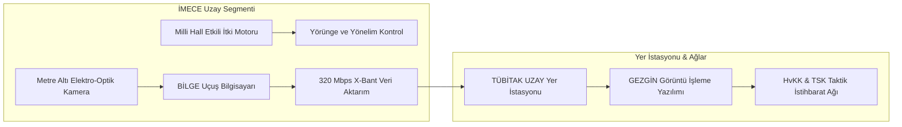

# 🛰️ Proje: İMECE (Milli Yüksek Çözünürlüklü Yer Gözlem Uydusu)

  
  
  
  

  

## 🛡️ Stratejik Tanım & Doktriner Öncelik
**İMECE**, Türkiye'nin metre altı çözünürlüklü elektro-optik kameraya sahip ilk yerli ve milli yer gözlem uydusudur. Türkiye'nin "Uzay Vatan" doktrininde bağımsız uzay gözetleme yeteneğinin en somut kilometre taşlarından birini temsil eder. TÜBİTAK UZAY yürütücülüğünde, TÜBİTAK SAGE'nin termal, yapısal ve alt sistem destekleriyle geliştirilen platform; askeri istihbarat, hassas coğrafi konumlandırma, sınır güvenliği, doğal afet hasar tespiti ve tarımsal rekolte tahminlerinde küresel bağımsızlık kazandırmıştır. Yörüngesel manevralarını yerli elektrikli Hall itki motoruyla gerçekleştiren uydu, uzay tarihçesine sahip kritik milli aviyonikleriyle Türk uzay ekosisteminin amiral gemisidir.

## 📊 Kapsamlı Teknik Özellikler

| Parametre | Değer / Açıklama |
| :--- | :--- |
| **Yörünge Tipi** | Güneş Eş Zamanlı Düşük Dünya Yörüngesi (SSO - Sun-Synchronous Orbit) |
| **Yörünge İrtifası** | 680 km |
| **Kamera Çözünürlüğü** | Metre Altı (< 0.99 m Pankromatik), 4 m Çok Bantlı (Multispectral) |
| **Faydalı Yük Ağırlığı** | ~700 - 800 kg Sınıfı |
| **Tasarım Görev Ömrü** | 5+ Yıl Asgari (Planlanan 7+ Yıl) |
| **İtki Sistemi** | Milli Hall Etkili Elektrikli İtki Motoru (HET) |
| **Veri İndirme Hızı** | 320 Mbps (Yüksek Hızlı X-Bant Sayısal Veri Bağı) |
| **Güç Üretimi** | Katlanabilir Galyum Arsenit Güneş Panelleri (~1000 W) & Li-İyon Bataryalar |
| **Yönelim Doğruluğu** | < 0.05° (Yıldız İzler ve Tepki Tekerleri ile 3 Eksen Stabilizasyon) |
| **Görüntüleme Şeridi** | 13.9 km Şerit Genişliği |

## 🧩 Alt Sistemler ve Aviyonik/Elektronik Entegrasyonu
- **Metre Altı Elektro-Optik Kamera:** TÜBİTAK UZAY tasarımı, yüksek optik hassasiyete ve termal stabiliteye sahip lens ve dedektör mimarisi.
- **BİLGE Görev ve Uçuş Bilgisayarı:** Uzay radyasyonuna dayanıklı yerli donanım mimarisi ve gerçek zamanlı uçuş yazılımı.
- **Milli HET Elektrikli İtki Sistemi:** TÜBİTAK UZAY üretimi uzay kalifiye Hall itki motoru ile yörünge koruma ve irtifa ayarlama manevraları.
- **GEZGİN & KUZGUN:** Görüntü sıkıştırma algoritmaları ve yer istasyonu telekomut/telemetri yönetim altyapısı.
- **Milli Yıldız İzler (Star Tracker) & Güneş Algılayıcılar:** Uzayda otonom yönelim kestirimi ve yüksek hassasiyetli hedefleme kabiliyeti.

## 🎯 Görev Profili, Muharebe Senaryoları & Operasyonel Yetenek
- **Stratejik Askeri İstihbarat:** Dünyanın herhangi bir coğrafyasındaki askeri üs, liman ve tahkimatların metre altı çözünürlükle haritalanması.
- **Hedef Tespiti ve Hasar Analizi:** Sınır ötesi harekatlarda vurulan düşman mevzilerinin hassas optik hasar değerlendirmesi (BDA).
- **Kriz ve Afet Yönetimi:** Deprem, orman yangınları ve su taşkınlarında anlık yüksek çözünürlüklü uydu görüntüsüyle arama-kurtarma koordinasyonu.
- **Yüksek Hızlı İndirme:** Kriptolu X-Bant veri hattı sayesinde yer istasyonu üzerinden dakikalar içinde işlenmiş veri teslimatı.

## 🚀 TRL Seviyesi ve Gelişim Yol Haritası
- **Mevcut Seviye: TRL 9 (Gerçek Sistem Kanıtlanmış Operasyonel Durumda)**
- [x] Tasarım, modelleme ve yer istasyonu altyapısının kurulması.
- [x] Uzay kalifikasyon testleri (titreşim, termal vakum, EMI/EMC).
- [x] 15 Nisan 2023 tarihinde SpaceX Falcon 9 Transporter-7 göreviyle yörüngeye fırlatılma.
- [x] İlk telemetri ve ilk yüksek çözünürlüklü görüntülerin (TOFAS Tesisi ve küresel hedefler) başarıyla indirilmesi.
- [x] Türk Silahlı Kuvvetleri ve kamu kurumlarına kesintisiz operasyonel veri servisi sağlama.
- [ ] İMECE-2 ve İMECE-3 konstelasyon uydularının geliştirilmesi ve fırlatılması.

---
[⬅️ Üst Dizine](../README.md) | [🏛️ Dominion Hub](../../README.md) | [🏠 Ana Sayfa](../../../README.md)
