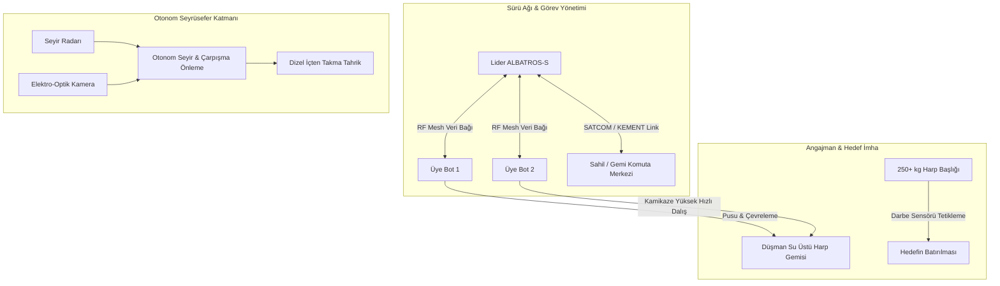

# 🛳️ Proje: ASELSAN ALBATROS-S (Sürü İnsansız Deniz Aracı)

  
  
  
  

  

## 🛡️ Stratejik Tanım & Doktriner Öncelik
**ALBATROS-S**, Türk Deniz Kuvvetleri'nin "Mavi Vatan" doktrininde asimetrik deniz harbinin kurallarını değiştiren sürü zekalı otonom insansız deniz aracıdır (S-İDA / K-İDA). Merkezi bir operatöre bağımlı kalmaksızın, kendi aralarında kurdukları kablosuz mesh ağ üzerinden dinamik görev dağılımı yapan ALBATROS-S botları; düşman su üstü filolarını çevreleme, sahil ve üs savunması ile intihar (kamikaze) dalışıyla ana muharip gemileri batırma kabiliyetine sahiptir. Dağıtık liderlik mimarisi sayesinde lider bot saf dışı kalsa dahi sürü otonom olarak yeni liderini seçerek taarruzu kesintisiz icra eder.

## 📊 Kapsamlı Teknik Özellikler

| Parametre | Değer / Açıklama |
| :--- | :--- |
| **Gövde Tipi & Boyutlar** | Kompozit V-Gövde, Boy: 7.20 m, En: 2.00 m, Draft: ~0.50 m |
| **Maksimum Sürat** | 40+ Knot (Yüksek Hızlı İntikal ve Taarruz) |
| **Operasyonel Menzil** | 200+ Deniz Mili (NM) |
| **Görev Süresi** | 10+ Saat Kesintisiz Seyir |
| **Faydalı Yük Kapasitesi** | 250+ kg (Harp Başlığı, EO/IR Keşif Gimbalı veya Elektronik Harp Yükü) |
| **Tahrik Sistemi** | Yüksek Güçlü İçten Takma Dizel Motor & Su Jeti / Pervane |
| **Otonomi Seviyesi** | Seviye-4 (Tam Otonom Formasyon, Çarpışma Önleme COLREG Uyumlu) |
| **Haberleşme Mimarisi** | Karıştırmaya Dayanıklı Sayısal RF Mesh Link + SATCOM Uydu Terminali |
| **Sürü Kapasitesi** | Tek merkezden 10+ botun tam koordineli müşterek idaresi |

## 🧩 Alt Sistemler ve Aviyonik/Elektronik Entegrasyonu
- **Sürü Zekası Algoritmaları:** Dağıtık optimizasyon, dinamik rol paylaşımı ve sürü çevreleme (flocking/swarming) matematiksel modelleri.
- **Milli Aviyonik Mimari:** ASELSAN otopilot, seyrüsefer sensör füzyonu (GNSS + INS + Doppler Velocity Log).
- **Anti-GNSS Karıştırma Sistemi:** Düşman elektronik taarruzu altında dahi konum doğruluğunu koruyan yedekli ataletsel navigasyon.
- **KEMENT ve ADVENT Entegrasyonu:** MİLGEM fırkateynleri ve kıyı gözetleme radarlarıyla eşzamanlı taktik resim paylaşımı.
- **Milli Kamikaze Harp Başlığı:** ROKETSAN / TÜBİTAK SAGE menşeli, su kesiminde zırh delici ve yüksek patlayıcı tahrip gücüne sahip özel başlık.

## 🎯 Görev Profili, Muharebe Senaryoları & Mühimmat Yelpazesi
- **Sürü Halinde Kamikaze Taarruz:** Düşman korvet veya fırkateynlerine karşı çoklu yönden eşzamanlı dalış yaparak savunma sistemlerini doyum noktasına ulaştırma.
- **Boğaz ve Liman Koruma:** Kritik deniz geçitlerinde şüpheli teknelere karşı otonom önleme, ikaz ve müdahale.
- **Elektronik Aldatma ve Yem Görevi:** Düşman radar ve kıyı bataryalarını üzerine çekerek dost hava ve deniz platformlarına operasyonel serbesti sağlama.
- **Canlı Batırma Başarısı:** Ekim 2023'te Mersin açıklarında gerçekleştirilen canlı atışlı testte 22 metrelik hedef gemiyi doğrudan vurarak başarıyla batırmıştır.

## 🚀 TRL Seviyesi ve Gelişim Yol Haritası
- **Mevcut Seviye: TRL 9 (Saha Kanıtlanmış Operasyonel Sistem - Combat Proven)**
- [x] Otonom formasyon ve dinamik sürü görev paylaşımı testleri.
- [x] Denizaltı savunma ve su üstü harbi simülasyonları.
- [x] Canlı harp başlıklı kamikaze vuruş testi ve hedef geminin batırılması (2023).
- [x] Türk Deniz Kuvvetleri Komutanlığı envanterine kabul ve çoklu bot teslimatı.
- [ ] Denizaltı tespit sonarı ve hafif torpido entegrasyonu sürü modelleri.

---
[⬅️ Üst Dizine](../README.md) | [🏛️ Dominion Hub](../../README.md) | [🏠 Ana Sayfa](../../../README.md)
