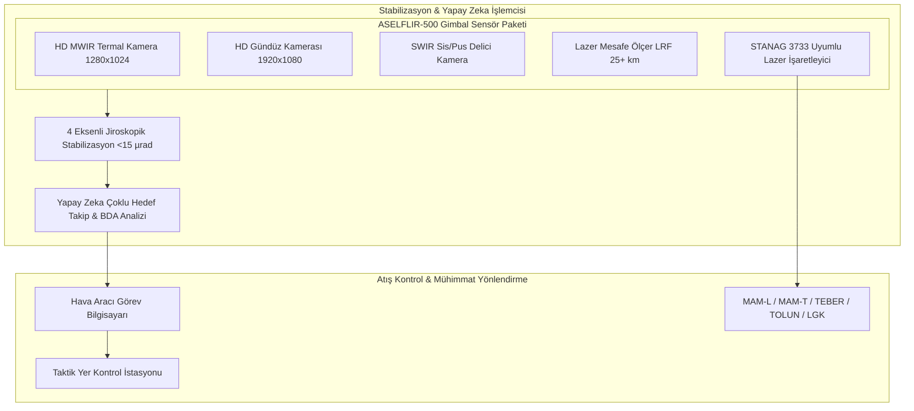

# 👁️ Proje: ASELSAN ASELFLIR-500 (Elektro-Optik Keşif ve Hedefleme Sistemi)

  
  
  
  

  

## 🛡️ Stratejik Tanım & Doktriner Öncelik
**ASELFLIR-500**, insansız hava araçları (İHA/SİHA), helikopterler, sabit kanatlı taarruz uçakları ve deniz platformları için ASELSAN tarafından geliştirilen yeni nesil yüksek çözünürlüklü elektro-optik keşif, gözetleme ve hedefleme sistemidir. Yabancı menşeili (özellikle Kanada Wescam MX-15D) optik ambargolarını kalıcı olarak tarihe gömen sistem; 52 kg altındaki kompakt hafif gövdesine entegre edilen HD MWIR termal kamera, HD gündüz kamerası, SWIR kısa dalga kızılötesi kamera ve hassas lazer hedefleme modülleriyle dünya lideri performans sunar. Bayraktar TB2, TB3, AKINCI, ANKA, AKSUNGUR ve T929 gibi hava araçlarımızın ana muharebe sensörüdür.

## 📊 Kapsamlı Teknik Özellikler

| Parametre | Değer / Açıklama |
| :--- | :--- |
| **Toplam Ağırlık** | ≤ 52 kg (Sınıfının en hafif ve kompakt mimarisi) |
| **Stabilizasyon Hassasiyeti** | < 15 µrad (Ultra yüksek optik stabilizasyon) |
| **Termal Kamera (MWIR)** | Yüksek Çözünürlüklü 1280 x 1024 Dedektör, Sürekli Optik Zoom |
| **Gündüz Kamerası** | Tam HD (1920 x 1080), Yüksek Zoom Faktörlü Renkli Kamera |
| **SWIR Kamera** | Kısa Dalga Kızılötesi (Sis, duman, toz ve pus delme kabiliyeti) |
| **Lazer Mesafe Ölçer (LRF)** | 1.064 nm / 1.54 µm dalga boyu, 25+ km menzilde ±1 m hassasiyet |
| **Lazer Hedef İşaretleyici (LTD)** | STANAG 3733 Band I/II uyumlu, NATO Band-I/II PRF kodlama |
| **Lazer Aydınlatıcı ve Pointer** | Gece görüş uyumlu lazer noktalama ve hedef aydınlatma |
| **Çalışma Sıcaklığı** | -54°C ile +70°C (MIL-STD-810G çevre dayanımı) |
| **Kapsama Açıları** | Azimut: 360° Sürekli, Elevasyon: +20° ile -105° |

## 🧩 Alt Sistemler ve Aviyonik/Elektronik Entegrasyonu
- **Dahili Ataletsel Ölçüm Birimi (IMU):** Hedef coğrafi koordinatını anlık hatasız hesaplayan entegre navigasyon sensörleri.
- **Yapay Zeka Destekli Video İzleyici:** Hareketli hedeflerin otonom kilitlenmesi, sahte hedeflerden arındırma ve kesintisiz takip.
- **Otomatik Sis ve Toz Giderme:** Zorlu meteorolojik koşullarda görüntü kontrastını katlayan sayısal görüntü işleme algoritmaları.
- **MIL-STD-1553B / Ethernet / ARINC-429 Arayüzü:** Taktik İHA görev bilgisayarları ve silah yönetim sistemleriyle tak-çalıştır entegrasyon.
- **Çoklu Mühimmat Güdüm:** Lazer güdümlü mühimmatların son safha vuruş doğruluğunu garanti altına alan hassas hüzmeleme.

## 🎯 Görev Profili, Muharebe Senaryoları & Mühimmat Yelpazesi
- **SİHA Taarruz Görevleri:** MAM-C, MAM-L, MAM-T, KUZGUN ve TOLUN mühimmatlarının lazerle hedefe yönlendirilmesi.
- **Stratejik Sınır Gözetleme:** Sınır hattında onlarca kilometre derinlikteki terör unsurlarının ve zırhlı araçların gece/gündüz tespiti.
- **Deniz Karakol ve Keşif:** Su üstü gemilerinin kimliklendirilmesi, korsanlık ve kaçakçılıkla mücadelede kızılötesi teşhis.
- **Muharebe Başarısı:** Bayraktar TB2 ve AKINCI üzerinde yapılan canlı atış testlerinde hareketli hedeflere tam isabet sağlamıştır.

## 🚀 TRL Seviyesi ve Gelişim Yol Haritası
- **Mevcut Seviye: TRL 9 (Seri Üretimde / Operasyonel Olarak Uçmakta - Combat Proven)**
- [x] Detaylı tasarım, laboratuvar ve titreşim/iklimlendirme testleri.
- [x] Bayraktar TB2 ve AKINCI TİHA ile atışlı uçuş testleri ve hedef imhası.
- [x] Seri üretim hattının kurulması ve TSK envanterine yoğun teslimatlar.
- [x] Dost ve müttefik ülkelere geniş ölçekli ihracat.
- [ ] ASELFLIR-600 geliştirme programı ile daha büyük irtifa ve menzil optimizasyonu.

---
[⬅️ Üst Dizine](../README.md) | [🏛️ Dominion Hub](../../README.md) | [🏠 Ana Sayfa](../../../README.md)
