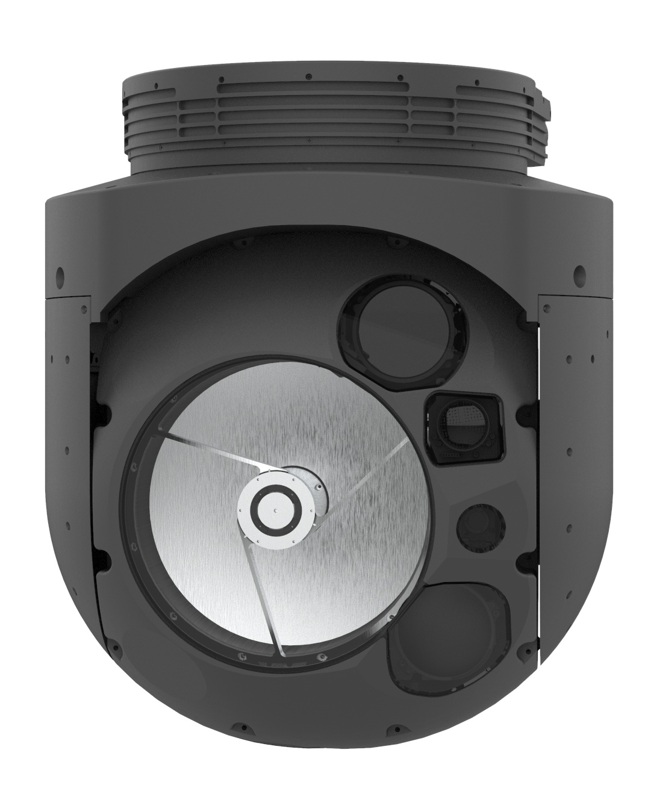
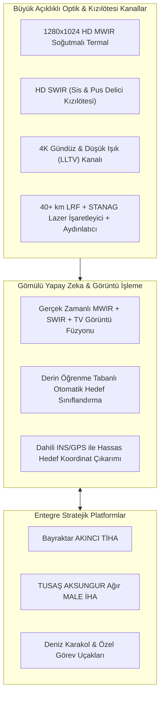

# 🎯 Proje: ASELSAN ASELFLIR-600 (HALE/TİHA Sınıfı Elektro-Optik Keşif ve Hedefleme Sistemi)

  

> **Geliştirici:** ASELSAN (Mikroelektronik Güdüm ve Elektro-Optik - MGEO Sektör Başkanlığı)  
> **Sınıf:** Ağır Sınıf (20 İnç) Yüksek İrtifa Uzun Menzilli Elektro-Optik Keşif, Gözetleme ve Hedefleme Sistemi  
> **Stratejik Önem:** AKINCI TİHA ve AKSUNGUR gibi yüksek irtifa (HALE/Ağır MALE) platformlarına 40.000+ feet irtifadan ve 150-200 km uzaktan yüksek çözünürlüklü teşhis ve çoklu lazer işaretleme kabiliyeti kazandıran en büyük açıklıklı milli optik sistem.

---

## 🛡️ Stratejik Tanım & Doktriner Öncelik

**ASELFLIR-600**, ASELSAN'ın küresel ölçekte rakiplerini geride bırakan 15 inçlik ASELFLIR-500 sisteminin ardından, özellikle **Bayraktar AKINCI TİHA**, **TUSAŞ AKSUNGUR**, **ANKA-3** ve deniz karakol uçakları (MELTEM) gibi yüksek faydalı yük kapasiteli stratejik platformlar için geliştirdiği **20 inç çapında ağır sınıf elektro-optik keşif ve hedefleme gimbal sistemidir**.

ASELFLIR-500'e kıyasla çok daha geniş optik mercek açıklığına (Big Aperture) sahip olan ASELFLIR-600; 35.000 - 45.000 feet gibi düşman hava savunma menzilinin dışındaki yüksek irtifalardan uçarken dahi atmosferik bozulmaları aşarak çok uzun menzillerden (Stand-Off) milimetrik hedef teşhisi ve lazer işaretlemesi yapar. İçerisinde barındırdığı HD MWIR, HD SWIR, HD Gündüz ve Düşük Işık (LLTV) kameraları ile yoğun sis, duman, pus ve bulut altı zorlu hava şartlarında kesintisiz görüntü üretir.

---

## 📊 Kapsamlı Teknik Özellikler

| Parametre | Değer / Özellik | Açıklama |
| :--- | :--- | :--- |
| **Sistem Sınıfı** | 20 İnç Ağır Sınıf HALE/TİHA Elektro-Optik Gimbal | Büyük optik açıklıklı stratejik ISR podu |
| **Termal Kamera (MWIR)** | 1280x1024 (Gerçek HD) Soğutmalı Kızılötesi Dedektör | Sürekli optik yakınlaştırma (Continuous Zoom) |
| **Kısa Dalga Kızılötesi (SWIR)** | Yüksek Çözünürlüklü HD SWIR Kamera | Sis, pus, duman ve deniz nemi arkasını görme |
| **Gündüz Görüş (Day TV)** | 4K / Full HD Renkli + Düşük Işık (Low-Light) Kamera | Çok dar görüş açısı (Ultra-Narrow FOV) |
| **Lazer Hedef İşaretleyici** | NATO STANAG 3733 Uyumlu Çift Dalga Boylu Lazer | 35+ km menzilden MAM-T, LGK, GÖKÇE işaretleme |
| **Lazer Mesafe Ölçer (LRF)** | Göze Zararsız 40+ km Hassas Mesafe Ölçümü | Yüksek irtifa balistik hesaplama girdisi |
| **Lazer Nokta İzleyici (LST)** | Dost Unsurların Lazer İشارetini Otomatik Yakalama | Müşterek ateş desteği koordinasyonu |
| **Stabilizasyon Hassasiyeti** | < 5 Mikroradyan (4 Eksenli Aktif Jiroskopik) | Maksimum zumda dahi sıfır titreşimli görüntü |
| **Yapay Zeka & Takip** | Çoklu Hedef Takibi (MTT), Otomatik Plaka/Siluet Tanıma | Hareketli deniz ve kara hedeflerine otonom kilit |

---

## 🧩 Alt Sistemler ve Aviyonik / Elektronik Entegrasyonu

- **Çoklu Spektral Görüntü Füzyonu:** Termal (MWIR), kısa dalga kızılötesi (SWIR) ve görünür bant (TV) görüntülerini tek bir karede gerçek zamanlı birleştirerek kamuflajlı hedefleri anında açığa çıkarır.
- **4 Eksenli Ultra-Hassas Gimbal:** Yüksek irtifa rüzgar türbülanslarında ve uçağın sert kaçınma manevralarında bile lazer noktasını hedefin üzerinde milimetrik olarak sabit tutar.
- **Akıllı Mühimmat Senkronizasyonu:** MAM-T, TOLUN-IIR, TEBER ve HGK-84 gibi uzun menzilli mühimmatlara uçuş öncesi ve terminal safhada hedef koordinat ve lazer kodu aktarır.

---

## 🎯 Görev Profili, Muharebe Senaryoları & Mühimmat Yelpazesi

1. **Yüksek İrtifa Stand-Off Keşif (HALE ISR):** Düşman orta menzilli hava savunma sistemlerinin (SAM) menziline girmeden 40.000 ft irtifadan sınır ötesi derinlikleri gözetleme.
2. **Mavi Vatan Geniş Alan Deniz Gözetleme:** SWIR kamera kanalı ile deniz yüzeyindeki nem ve pus tabakasını delerek ufuk ötesi savaş gemilerini teşhis etme.
3. **Uzun Menzilli Lazer Güdüm:** AKINCI TİHA üzerinden atılan MAM-T ve LGK-82 mühimmatlarını 30+ km mesafeden nokta hassasiyetiyle hedefe yönlendirme.

---

## 🚀 TRL Seviyesi ve Gelişim Yol Haritası

- **Mevcut Durum:** `TRL 8` (Prototip üretimi, laboratuvar kalifikasyonu ve yüksek irtifa uçuş doğrulama testleri başarıyla tamamlanmıştır).
- [x] Büyük açıklıklı optik mercek ve 1280x1024 HD MWIR/SWIR dedektör entegrasyonu
- [x] Çevresel kalifikasyon ve titreşim testlerinin tamamlanması
- [x] Hava platformları üzerinde yüksek irtifa uçuş ve hedefleme testleri (2024-2025)
- [ ] AKINCI ve AKSUNGUR filolarına seri üretim teslimatlarının yaygınlaştırılması

---

## 🔗 İç Dizin Navigasyonu

[⬅️ Üst Dizine (ASELSAN)](../README.md) | [🏛️ Dominion Hub (DOMINION_ELECTRONICS)](../../README.md) | [🏠 Ana Sayfa](../../../README.md)
