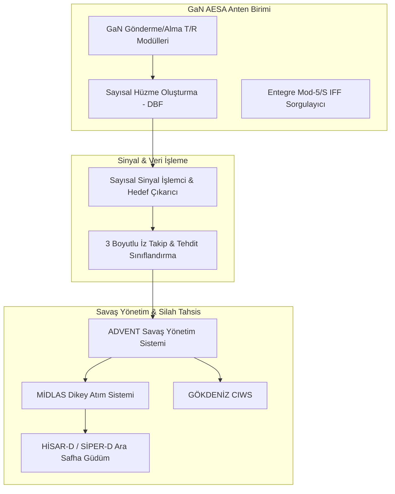

# 📡 Proje: ASELSAN CENK-350N (3 Boyutlu AESA Erken İhbar ve Silah Tespit Radarı)

  
  
  
  

  

## 🛡️ Stratejik Tanım & Doktriner Öncelik
**CENK-350N** (MAR-D türevi gelişmiş deniz radarı), Türk Deniz Kuvvetleri'nin modern fırkateyn ve hava savunma muhripleri için geliştirilen çok fonksiyonlu, katı hal (Solid-State) GaN aktif faz dizinli (AESA) 3 boyutlu arama ve hedef takip radarıdır. Başta MİLGEM İ-Sınıfı fırkateynler (TCG İSTANBUL vb.) ve TF-2000 Hava Savunma Harbi Muhribi olmak üzere su üstü muharip unsurlarının durumsal farkındalığını en üst seviyeye taşır. Deniz yüzeyine çok yakın uçan (sea-skimming) süpersonik gemisavar füzelerini, hayalet hava unsurlarını ve asimetrik hedefleri 350+ km menzilde tespit ederek MİDLAS dikey atım sistemi ve HİSAR-D / SİPER-D füzelerine hassas ara safha güdüm desteği sağlar.

## 📊 Kapsamlı Teknik Özellikler

| Parametre | Değer / Açıklama |
| :--- | :--- |
| **Radar Tipi** | 3 Boyutlu Çok Fonksiyonlu Aktif Faz Dizinli Radar (AESA) |
| **Yarıiletken Teknolojisi** | Galyum Nitrür (GaN) Katı Hal Bileşenler |
| **Çalışma Frekans Bandı** | S-Bant (E/F Bant) - Deniz ortamına optimize atmosferik geçirgenlik |
| **Maksimum Tespit Menzili** | 350+ km (Büyük boyutlu hava hedefleri ve balistik nesneler) |
| **Savaş Uçağı Tespit Menzili**| 250+ km (Düşük RCS'li hedefler dahil) |
| **Dönüş Hızı** | 15 / 30 RPM (İhtiyaca göre arama ve yüksek yenileme modu) |
| **Eşzamanlı İz Kapasitesi** | 1.000+ Hava ve Su Üstü Hedefi |
| **İrtifa Kapsaması** | 0 ile 30+ km (Balistik füze ve dik dalış yapan tehditler) |
| **Silah Yönlendirme** | RF Veri Bağı ile füzelere anlık ara safha rota düzeltme |
| **Elektronik Koruma (ECCM)** | Sayısal hüzme sıfırlama, yan kulakçık bastırma (SLB), frekans atlama |

## 🧩 Alt Sistemler ve Aviyonik/Elektronik Entegrasyonu
- **GaN T/R Modül Blokları:** Yüksek güç yoğunluğuna ve düşük enerji tüketimine sahip ASELSAN üretimi yarıiletkenler.
- **Sayısal Hüzme Şekillendirme (DBF):** Çoklu hüzmeyle aynı anda arama, takip ve füze aydınlatma yeteneği.
- **Entegre IFF Mod-5/S:** NATO ve milli standartlarda dost-düşman tanıma sorgulayıcı anteni ve kripto entegrasyonu.
- **ADVENT SYS Köprüsü:** HAVELSAN ADVENT ağ merkezli savaş yönetim sistemiyle doğrudan fiber optik ara yüz.
- **Dahili Test ve Arıza Bulma (BITE):** Operasyon sırasında arızalı modülleri tespit edip performanstan ödün vermeden çalışmayı sürdürme (Graceful Degradation).

## 🎯 Görev Profili, Muharebe Senaryoları & Operasyonel Yetenek
- **Görev Grubu Hava Savunması:** Donanma görev birliklerini düşman doyum saldırılarına, seyir füzelerine ve İHA akınlarına karşı koruma.
- **Deniz Yüzeyi Gözetleme:** Dalga yansımalarını (clutter) filtreleyerek ufuk ötesi ve su üstü asimetrik botları anlık tespit etme.
- **Milli Silah Entegrasyonu:** MİDLAS üzerinden fırlatılan HİSAR-D RF ve SİPER Blok-1 füzelerine hedef koordinat aktarımı.
- **Ağ Merkezli Harp Paylaşımı:** Taktik veri linkleri üzerinden radar izini diğer gemiler ve HAKİM hava komuta kontrol sistemine aktarma.

## 🚀 TRL Seviyesi ve Gelişim Yol Haritası
- **Mevcut Seviye: TRL 7 (Sistem Prototipi Operasyonel Ortamda Doğrulandı)**
- [x] AESA mimari tasarımı ve GaN modüllerin laboratuvar kalifikasyonu.
- [x] Karada kurulu test direğinde sinyal işleme ve hedef tespit testleri.
- [x] TCG İSTANBUL fırkateynine entegrasyon ve liman kabul testleri.
- [ ] Açık deniz testlerinde canlı füzelerle atışlı angajman doğrulama.
- [ ] MİLGEM 6, 7, 8. gemiler ile TF-2000 muhriplerine seri üretim kurulumu (TRL 8/9).

---
[⬅️ Üst Dizine](../README.md) | [🏛️ Dominion Hub](../../README.md) | [🏠 Ana Sayfa](../../../README.md)
