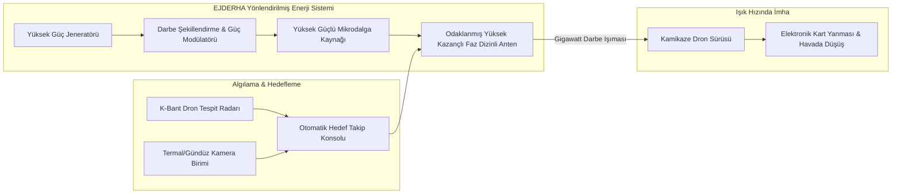

# ⚡ Proje: ASELSAN EJDERHA (Yüksek Güçlü Mikrodalga Tehdit Savunma Sistemi - HPM)

  
  
  
  

  

## 🛡️ Stratejik Tanım & Doktriner Öncelik
**ASELSAN EJDERHA**, modern asimetrik harp sahasında yaygınlaşan sürü dron saldırılarına, mini/mikro insansız hava araçlarına ve el yapımı patlayıcı (EYP) elektronik düzeneklerine karşı geliştirilen Yüksek Güçlü Mikrodalga (High Power Microwave - HPM) Yönlendirilmiş Enerji Silahıdır (DEW). Klasik hava savunma mühimmatlarının maliyet ve şarjör kısıtlarını ortadan kaldıran EJDERHA; ışık hızında yönlendirilen yoğun elektromanyetik darbelerle hedefin elektronik devrelerini saniyeler içinde kalıcı olarak yakar (hard-kill) veya kilitler (soft-kill). Türkiye'nin "Çelik Kubbe" entegre hava savunma mimarisinde son katman yönlendirilmiş enerji kalkanı olarak kritik üs, tesis ve konvoyları korur.

## 📊 Kapsamlı Teknik Özellikler

| Parametre | Değer / Açıklama |
| :--- | :--- |
| **Sistem Tipi** | Yönlendirilmiş Enerji Silahı - Yüksek Güçlü Darbeli Mikrodalga (HPM) |
| **Etkili Önleme Menzili** | 1.000+ Metre (Elektronik bileşen tahribi ve devre yakımı) |
| **Atış Kapasitesi** | Kesintisiz / Sınırsız Şarjör (Elektrik enerjisine bağımlı) |
| **Darbe Tepe Gücü** | Gigawatt (GW) Mertebesinde Anlık Elektromanyetik Alan Darbesi |
| **Işıma Tipi** | Darbeli, Dar Bantlı (Narrowband) Odaklanmış Mikrodalga Yayılımı |
| **Hedef Yelpazesi** | Mini/Mikro İHA'lar, Sürü Dronlar, Telsiz Tetiklemeli EYP Devreleri, Güdüm Başlıkları |
| **Reaksiyon Süresi** | Milisaniyeler düzeyinde ışık hızında yönlendirme ve vuruş |
| **Taşıyıcı Platform** | 4x4 / 8x8 Taktik Zırhlı Araç veya Sabit Tesis Koruma Konteyneri |
| **Soğutma Sistemi** | Gelişmiş Kapalı Devre Sıvı Soğutma Altyapısı |

## 🧩 Alt Sistemler ve Aviyonik/Elektronik Entegrasyonu
- **Mikrodalga Darbe Kaynağı:** Saniyede binlerce yüksek enerjili darbe üretebilen özel tasarım vakum tüpü / katı hal mikrodalga jeneratörü.
- **Yüksek Voltaj Modülatörü:** Kompakt hacimde devasa enerji depolayıp nanosaniye sürelerinde boşaltan darbe güç sistemi.
- **Yüksek Kazançlı Odaklayıcı Anten:** Elektromanyetik enerjiyi dağıtmadan hedef yönünde dar bir koni şeklinde yoğunlaştıran reflektör/dizin.
- **Entegre Elektro-Optik Takip Gimbalı:** Hedef dronun rotasını milimetrik izleyen termal ve gündüz nişangahı.
- **Çelik Kubbe & İHTAR Uyumluluğu:** ACAR radarı ve üs savunma yönetim merkezleriyle ortak komuta arayüzü.

## 🎯 Görev Profili, Muharebe Senaryoları & Operasyonel Yetenek
- **Sürü Dron Akınlarının Durdurulması:** Onlarca kamikaze dronun aynı anda yaklaştığı senaryoda tek bir mikrodalga demetiyle tüm sürünün motor sürücülerini ve otopilotlarını eşzamanlı felç etme.
- **Kritik Tesis & Karargah Koruması:** Radar mevzileri, mühimmat depoları ve havalimanlarının asimetrik İHA sabotajlarına karşı korunması.
- **Konvoy & VIP Savunması:** İntikal halindeki birliklere yaklaşan patlayıcı yüklü dronların havada elektronik imhası.
- **Sıfır Maliyetli Mühimmat:** Konvansiyonel hava savunma füzelerine gerek kalmaksızın atış başına sadece yakıt/elektrik maliyetiyle savunma.

## 🚀 TRL Seviyesi ve Gelişim Yol Haritası
- **Mevcut Seviye: TRL 7 (Sistem Prototipi Sahada ve Test Ortamında Doğrulandı)**
- [x] Yüksek güç mikrodalga kaynaklarının tasarımı ve laboratuvar testleri.
- [x] Araç üstü prototip entegrasyonu ve elektro-optik nişangah uyarlaması.
- [x] Statik ve dinamik hedef dronlara karşı saha imha testleri (Devre yakma doğrulaması).
- [ ] Çoklu sistem koordinasyonu ve Çelik Kubbe şebekesine seri üretim entegrasyonu (TRL 8).
- [ ] Deniz platformları için stabilize marin versiyonunun geliştirilmesi.

---
[⬅️ Üst Dizine](../README.md) | [🏛️ Dominion Hub](../../README.md) | [🏠 Ana Sayfa](../../../README.md)
