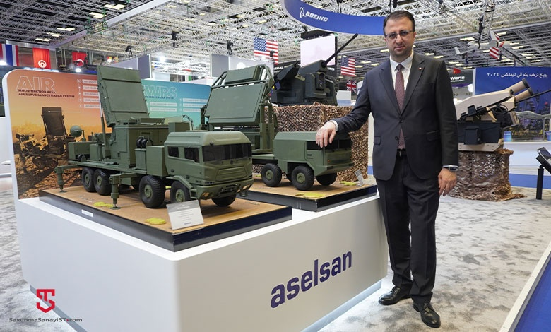
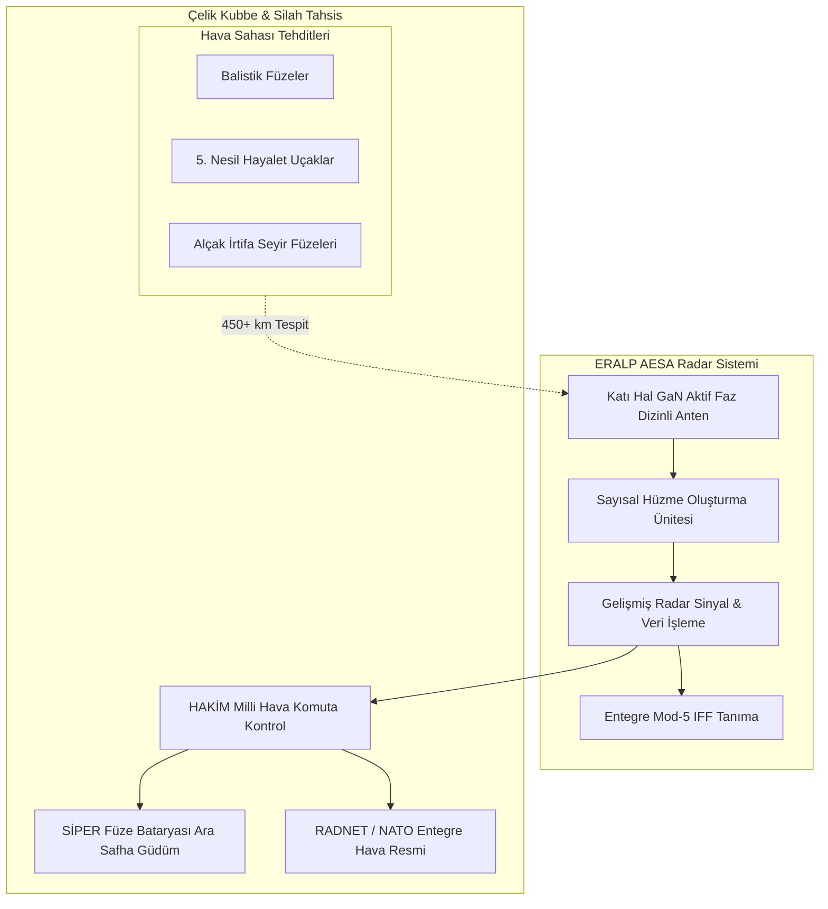

# 📡 Proje: ASELSAN ERALP (Erken İhbar Radar Sistemi - TEİRS)

  
  
  
  

  

## 🛡️ Stratejik Tanım & Doktriner Öncelik
**ASELSAN ERALP** (Taşınabilir Erken İhbar Radar Sistemi - TEİRS), Türkiye'nin hava sahasını yüzlerce kilometre derinlikten başlayarak koruyan, balistik füzeler, hayalet (stealth) uçaklar, seyir füzeleri ve anti-radyasyon mühimmatlarına karşı geliştirilmiş stratejik AESA erken ihbar radarıdır. Galyum Nitrür (GaN) teknolojisi ve sayısal hüzme oluşturma mimarisiyle donatılan ERALP; 450+ kilometre menzilden itibaren hava hedeflerini 3 boyutlu tespit eder. SİPER Uzun Menzilli Bölge Hava ve Füze Savunma Sistemi'nin ana arama radarı olarak "Çelik Kubbe" doktrininin gözü ve erken uyarı kalkanıdır.

## 📊 Kapsamlı Teknik Özellikler

| Parametre | Değer / Açıklama |
| :--- | :--- |
| **Radar Sınıfı** | Taktik Taşınabilir Erken İhbar Radarı (AESA - TEİRS) |
| **Çalışma Frekansı** | S-Bant (Uzun menzilli tespit ve zorlu hava koşullarına dayanım) |
| **Tespit Menzili** | 450+ km (Balistik füze ve standart savaş uçağı hedefleri) |
| **Düşük RCS Tespiti** | 5. Nesil hayalet uçakları ve seyir füzelerini onlarca kilometreden teşhis |
| **Anten Mimarisi** | Sayısal Hüzme Oluşturma (DBF) altyapılı Katı Hal GaN Modülleri |
| **Çalışma Modları** | 360° Sürekli Döner Arama veya Sektörel / Sabit Odaklı Takip Modu |
| **İntikal ve Kurulum** | 8x8 Taktik Askeri Şasi, < 60 dakikada hidrolik otonom kurulum |
| **Stratejik Yetenek** | Balistik füzelerin fırlatılış noktası, yörüngesi ve darbe noktası kestirimi |
| **Taşınabilirlik** | C-130 ve A400M askeri nakliye uçakları ile stratejik havadan intikal |
| **Dost-Düşman Teşhis** | NATO STANAG uyumlu entegre IFF Mod-5 / Mod-S sorgulayıcı |

## 🧩 Alt Sistemler ve Aviyonik/Elektronik Entegrasyonu
- **GaN Alıcı/Verici (T/R) Modül Dizilimi:** Yüksek ışıma gücü, termal dayanım ve modüler yedekli yapı.
- **Sayısal Hüzme Şekillendirme (Digital Beamforming):** Aynı anda yüzlerce farklı irtifa ve sektörde çoklu iz oluşturma.
- **Elektronik Harp Koruma Tedbirleri (ECCM):** Düşman karıştırmalarını anında tespit eden yan kulakçık köreltme ve frekans atlama algoritmaları.
- **HAKİM & RADNET Haberleşme Arayüzü:** Üretilen taktik hava resmini şifreli telsiz ve fiber hatlar üzerinden komuta merkezine iletme.
- **Dahili Yardımcı Güç Ünitesi (APU):** Şebekeden bağımsız, taktik sahada günlerce kesintisiz operasyon sağlayan jeneratör paketi.

## 🎯 Görev Profili, Muharebe Senaryoları & Operasyonel Yetenek
- **Balistik Füze Erken Uyarısı:** Düşman balistik füzelerini motor yanma safhasından (boost-phase) itibaren takip ederek hava savunma füzelerine önleme verisi üretme.
- **Hava Savunma Bataryası Yönetimi:** SİPER Ürün-1 ve Ürün-2 bataryaları için hedef tespit, sınıflandırma ve füze ateşleme öncesi hedef atama.
- **Milli Hava Resmi Üretimi:** NATO erken ihbar radarlarından tamamen bağımsız, milli algoritmalarla Türkiye ve çevre coğrafyanın radar resmini çıkarma.
- **Sınır Boyu Mobil Gözetleme:** Tehdit odaklı olarak ihtiyaç duyulan sınır bölgelerine saatler içinde intikal ederek erken ikaz boşluklarını kapatma.

## 🚀 TRL Seviyesi ve Gelişim Yol Haritası
- **Mevcut Seviye: TRL 9 (Envantere Kabul Edilmiş Operasyonel Sistem)**
- [x] Sistem gereksinimleri, prototip tasarımı ve GaN modül üretimi.
- [x] Fabrika kabul ve saha menzil doğrulama testleri.
- [x] SİPER uzun menzilli hava savunma atışlı testlerinde hedef takip başarısı.
- [x] Türk Hava Kuvvetleri Komutanlığı'na ilk teslimatın yapılması ve operasyonel göreve başlama.
- [ ] Seri üretim ERALP radarlarının Türkiye genelindeki radar üslerine yaygınlaştırılması.

---
[⬅️ Üst Dizine](../README.md) | [🏛️ Dominion Hub](../../README.md) | [🏠 Ana Sayfa](../../../README.md)
