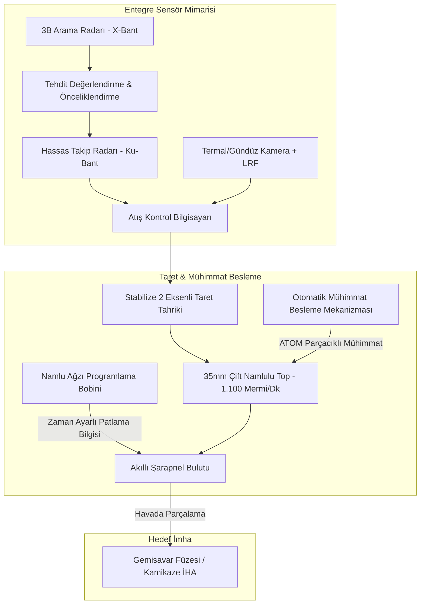

# 🛡️ Proje: ASELSAN GÖKDENİZ (Yakın Hava Savunma Sistemi - CIWS)

  
  
  
  

  

## 🛡️ Stratejik Tanım & Doktriner Öncelik
**ASELSAN GÖKDENİZ**, deniz platformlarını gemisavar füzelerine (anti-ship missiles), seyir füzelerine, insansız hava araçlarına, helikopterlere, uçaklara ve asimetrik hızlı su üstü botlarına karşı koruyan son katman Nokta Hava Savunma Sistemidir (CIWS - Close-In Weapon System). Amerikan Phalanx ve Hollanda Goalkeeper sistemlerinin modern bir muadili ve teknolojik üstünlüğe sahip versiyonudur. İkiz 35mm namlulu topu, 3 boyutlu arama radarı, atış kontrol radarı ve termal/gündüz elektro-optik sensörlerini tek bir stabilize tarette birleştiren GÖKDENİZ; ASELSAN üretimi ATOM 35mm Akıllı Parçacıklı Mühimmat ile hedefin önüne geçilmez bir çelik şarapnel bulutu örerek tehditleri havada parçalar.

## 📊 Kapsamlı Teknik Özellikler

| Parametre | Değer / Açıklama |
| :--- | :--- |
| **Silah Konfigürasyonu** | 35mm Çift Namlulu Otomatik Top (Oerlikon Lisanslı KDG Tipi) |
| **Atım Hızı** | 1.100 Mermi / Dakika (2 x 550 mermi/dk eşzamanlı) |
| **Mühimmat Yelpazesi** | 35mm ATOM (Akıllı Parçacıklı Mühimmat) ve Yüksek Patlayıcı Yangın (HEI) |
| **Etkili Menzil** | 4.000 Metre (ATOM mühimmatı ile yüksek önleme başarısı) |
| **Arama Radarı** | 3 Boyutlu Katı Hal Arama Radarı (X-Bant, taret üstü entegre) |
| **Takip Radarı** | Hassas Atış Kontrol ve Hedef Takip Radarı (Ku-Bant) |
| **Elektro-Optik Paket** | Yüksek Çözünürlüklü Termal Kamera, TV Kamera ve Göz Güvenli Lazer Mesafe Ölçer |
| **Mühimmat Besleme** | Bağlantısız Otomatik Mühimmat Besleme Mekanizması (AMMB) |
| **Hazır Mühimmat** | Taret içinde yüzlerce hazır atış mermisi |
| **Gemi Entegrasyonu** | Güverte altı penetrasyon gerektirmeyen veya asgari delik gerektiren esnek mimari |

## 🧩 Alt Sistemler ve Aviyonik/Elektronik Entegrasyonu
- **Namlu Ağzı Hız ve Programlama Bobini:** ATOM mühimmatının namludan çıkış anındaki hızını milimetrik ölçerek hedefin önünde patlayacağı anı mikrosaniye seviyesinde kapsüle kodlayan elektronik bobin.
- **ATOM 35mm Parçacıklı Mühimmat:** İçerisinde yüzlerce tungsten bilye barındıran ve belirlenen mesafede patlayarak tehdidin kontrol yüzeylerini ve arayıcı başlığını parçalayan mühimmat.
- **İki Eksenli Stabilize Taret:** Geminin yalpa ve dalga hareketlerini kompanse eden yüksek torklu fırçasız motor tahrikleri.
- **ADVENT Savaş Yönetim Arayüzü:** Geminin genel radar resmi ve taktik komuta konsollarıyla tam çift yönlü veri entegrasyonu.
- **Otonom Angajman Modu:** İnsan müdahalesine gerek kalmaksızın tespit, izleme ve ateşleme döngüsünü 2-3 saniyede tamamlayabilme yeteneği.

## 🎯 Görev Profili, Muharebe Senaryoları & Operasyonel Yetenek
- **Anti-Gemi Füzesi Önleme (Anti-Ship Cruise Missile Defense):** Ses hızına yakın veya süpersonik hızla deniz yüzeyini yalayarak gelen füzeleri 1.5 - 3 km mesafede parçalayarak patlatma.
- **Kamikaze SİDA ve İHA Koruması:** Asimetrik sürü dron saldırılarını ve patlayıcı yüklü hücumbotları yüksek atış hızıyla suya gömme.
- **Kıyı Bombardımanı ve Yüzey Hedefleri:** Gerektiğinde HEI klasik mühimmat moduna geçerek su üstü ve sahil hedeflerine zırh delici ateş baskısı kurma.
- **Uluslararası Başarı:** Pakistan Donanması için inşa edilen BABUR sınıfı MİLGEM korvetlerine ve Türk Deniz Kuvvetleri fırkateynlerine takılarak ihraç başarısı yakalamıştır.

## 🚀 TRL Seviyesi ve Gelişim Yol Haritası
- **Mevcut Seviye: TRL 9 (Seri Üretimde, Envanterde ve İhraç Edilmiş Durumda)**
- [x] Prototip atış testleri ve ATOM mühimmat programlama doğrulaması.
- [x] TCG SOKULLU MEHMET PAŞA okul gemisinde deniz atışlı testleri.
- [x] TCG İSTANBUL (F-515) fırkateynine entegrasyon ve başarılı kabul atışları.
- [x] Pakistan MİLGEM korvetlerine entegre edilerek uluslararası envantere giriş.
- [ ] Yeni nesil İ-Sınıfı devam fırkateynleri ve açık deniz karakol gemilerine (ADKG) montaj.

---
[⬅️ Üst Dizine](../README.md) | [🏛️ Dominion Hub](../../README.md) | [🏠 Ana Sayfa](../../../README.md)
