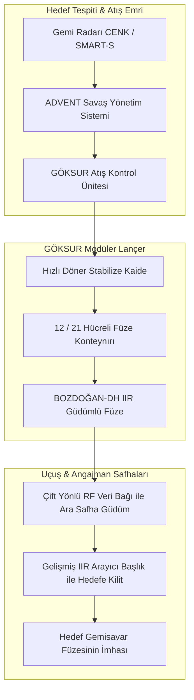

# 🛡️ Proje: ASELSAN GÖKSUR (Yakın Hava Savunma Füze Sistemi - PDMS)

  
  
  
  

  

## 🛡️ Stratejik Tanım & Doktriner Öncelik
**ASELSAN GÖKSUR**, deniz platformlarının gemisavar füzeleri, seyir füzeleri, İHA'lar, savaş uçakları ve helikopterler gibi havadan gelen tehditlere karşı son katmanda füze tabanlı savunmasını sağlayan Nokta Hava Savunma Füze Sistemidir (PDMS - Point Defense Missile System). Amerikan Raytheon üretimi RIM-116 RAM (Rolling Airframe Missile) sistemine milli alternatif olarak ASELSAN ve TÜBİTAK SAGE iş birliğiyle geliştirilmiştir. TÜBİTAK SAGE'nin hava-hava füzesi tecrübesiyle optimize edilen BOZDOĞAN-DH (Denizaltı/Gemi Hava Savunma) IIR güdümlü füzesini kullanan GÖKSUR; 360 derece hızlı reaksiyon taret mimarisi ve çift yönlü veri bağıyla gemiyi eşzamanlı doyum saldırılarına karşı korur.

## 📊 Kapsamlı Teknik Özellikler

| Parametre | Değer / Açıklama |
| :--- | :--- |
| **Sistem Tipi** | Füze Tabanlı Yakın Savunma Sistemi (PDMS) |
| **Kullanılan Füze** | BOZDOĞAN-DH (Geliştirilmiş Deniz Konfigürasyonu) |
| **Güdüm Mimarisi** | Yüksek Çözünürlüklü Kızılötesi Görüntüleyici (IIR) + Sayısal RF Veri Bağı |
| **Etkili Önleme Menzili** | 15+ km (Ufuk ötesi ve ufuk içi kademeli önleme) |
| **Lançer Kapasitesi** | 12 veya 21 Hücreli Modüler Lançer Konfigürasyonları |
| **Taret Kapsama Açısı** | Azimut: 360° Sürekli, Elevasyon: -10° ile +80° |
| **Tepki ve Reaksiyon Süresi** | < 3 saniye (Tehdit bildiriminden fırlatmaya kadar) |
| **Hedef Hız Kabiliyeti** | Süpersonik (Mach 2+) ve Yüksek Manevralı Dalış Yapan Tehditler |
| **Arayıcı Başlık Özelliği** | Karıştırmaya dayanıklı soğutmalı IIR başlık, sahte flare aldatmalarına bağışık |
| **Platform Uyumluluğu** | Korvetler, fırkateynler, hücumbotlar ve amfibi çıkarma gemileri |

## 🧩 Alt Sistemler ve Aviyonik/Elektronik Entegrasyonu
- **BOZDOĞAN-DH Füzesi:** TÜBİTAK SAGE üretimi, katı yakıtlı roket motoruna, itki vektör kontrolüne (TVC) ve yüksek manevra kabiliyetine sahip hava savunma füzesi.
- **Çift Yönlü Güvenli Veri Bağı:** Fırlatıldıktan sonra hedefin rota değişikliklerini füzeye anlık aktaran gemi-füze iletişim terminali.
- **Hafif ve Düşük Radar Kesit Alanlı Taret:** Stealth gemi tasarımlarına uygun açılı kompozit gövde yapısı.
- **ADVENT SYS ve KEMENT Arayüzü:** Hedef tahsisinin milli savaş yönetim sistemi tarafından otomatik yapıldığı taktik entegrasyon.
- **Entegre Elektro-Optik Nişangah:** Radar arızası veya yoğun elektronik harp ortamında optik olarak hedefe yönelim imkanı.

## 🎯 Görev Profili, Muharebe Senaryoları & Operasyonel Yetenek
- **Doyum Saldırılarının Kırılması:** Farklı yönlerden aynı anda gelen çok sayıda alçak irtifa gemisavar füzesine art arda füze ateşleyerek çoklu önleme yapma.
- **GÖKDENİZ ile Katmanlı Entegrasyon:** GÖKSUR füzeleri tehditleri 5-15 km mesafede karşılarken, füzeyi aşabilen sızıntı tehditlerin GÖKDENİZ 35mm namlulu sistemiyle 1-3 km'de yok edilmesi.
- **Hücumbot ve Karakol Gemisi Koruması:** Dikey atım sistemi (VLS) taşıyamayan hafif tonajlı gemiler için ana hava savunma kalkanı olma.
- **Kamikaze İHA İmhasi:** Geniş deniz sahalarında seyreden keşif ve kamikaze hava araçlarını maliyet-etkin menzilde düşürme.

## 🚀 TRL Seviyesi ve Gelişim Yol Haritası
- **Mevcut Seviye: TRL 7 (Sistem Prototipi Doğrulandı / Test Aşamasında)**
- [x] Konsept tasarımı, lanzar mekaniği ve füze aerodinamik uyarlama çalışmaları.
- [x] IDEF fuarında ilk prototip lançer sisteminin sergilenmesi.
- [x] BOZDOĞAN-DH füzesinin yer ve lançer çıkış testleri.
- [ ] Deniz platformunda canlı hedef gemisavar füzelerine karşı test atışları (TRL 8).
- [ ] Türk Deniz Kuvvetleri hafif muharip unsurlarına seri üretim teslimatları (TRL 9).

---
[⬅️ Üst Dizine](../README.md) | [🏛️ Dominion Hub](../../README.md) | [🏠 Ana Sayfa](../../../README.md)
