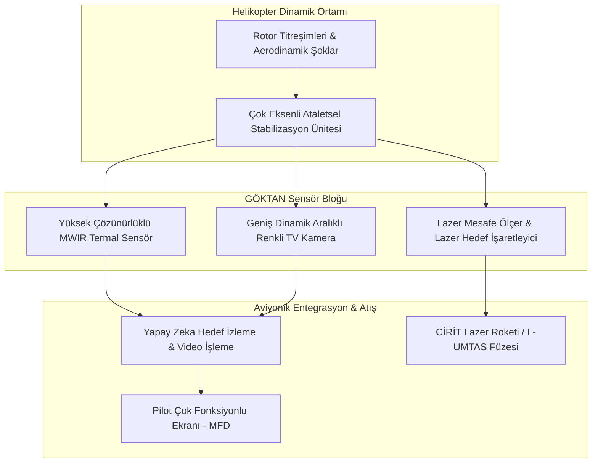

# 👁️ Proje: ASELSAN GÖKTAN (Helikopter ve Taktik Hava Platformu Keşif Sistemi)

  
  
  
  

  

## 🛡️ Stratejik Tanım & Doktriner Öncelik
**ASELSAN GÖKTAN**, taarruz, keşif ve genel maksat helikopterleri başta olmak üzere taktik hava platformları için özel olarak optimize edilmiş hafif, kompakt ve yüksek hassasiyetli elektro-optik keşif, gözetleme ve hedefleme sistemidir. T129 ATAK, T929 ATAK-II ve T625 GÖKBEY helikopterlerinin burun ve burun altı konfigürasyonlarında görev icra etmek üzere tasarlanmıştır. Yüksek titreşimli döner kanat ortamlarında mikro-radyan seviyesinde stabilizasyon sağlayan GÖKTAN; gece/gündüz termal görüntüleme ve NATO standartlarında lazer hedef işaretleme yetenekleriyle CİRİT, L-UMTAS ve UMTAS güdümlü mühimmatlarının nokta vuruş başarısını garanti eder.

## 📊 Kapsamlı Teknik Özellikler

| Parametre | Değer / Açıklama |
| :--- | :--- |
| **Sistem Sınıfı** | Döner Kanat Optimize Elektro-Optik Hedefleme Sistemi |
| **Toplam Ağırlık** | ~35 - 45 kg (Hafifletilmiş dayanıklı havacılık alaşımı) |
| **Stabilizasyon Başarımı** | < 20 µrad (Helikopter pallerinin oluşturduğu titreşimleri tamamen filtreler) |
| **Termal Kamera (MWIR)** | Soğutmalı 3-5 µm Detektör, Sürekli Optik Zoom ve Geniş/Dar FOV |
| **Gündüz Kamerası** | Yüksek Dinamik Aralıklı (HDR) Full HD Renkli Kamera |
| **Lazer İşaretleyici (LTD)** | STANAG 3733 uyumlu Band-I/II kodlu lazer hedef işaretleme |
| **Lazer Mesafe Ölçer (LRF)** | 20+ km menzilde ±1 m doğrulukla mesafe ölçümü |
| **Dönüş Limitleri** | Azimut: 360° Sürekli, Elevasyon: +20° ile -110° |
| **Aviyonik Arayüz** | MIL-STD-1553B, Ethernet, ARINC-429 ve DVI/HD-SDI video çıkışı |
| **Çalışma Sıcaklığı** | -45°C ile +60°C operasyonel sıcaklık toleransı |

## 🧩 Alt Sistemler ve Aviyonik/Elektronik Entegrasyonu
- **Döner Kanat Uyumlu Titreşim Sönümleme Şasisi:** Helikopter motor ve pallerinin yarattığı harmonik rezonansları absorbe eden elastomerik izolasyon.
- **Otomatik Hedef İzleyici (Video Tracker):** Hızlı manevra yapan kara hedeflerini görüş alanında otonom kilitleyen DSP kartları.
- **Kaska Monteli Nişangah Entegrasyonu:** Pilotun kaskına (kask vizörüne) doğrudan FLIR görüntüsü ve hedefleme artı işaretini aktarabilme.
- **Entegre Ataletsel Sensör Paketi (IMU):** Kendi dahili seyrüsefer sensörleriyle hedefin GPS koordinatlarını anında hesaplama.
- **Lazer Aydınlatma & Lazer Noktalayıcı (Pointer):** Gece operasyonlarında dost birliklerle hedef koordinasyonu sağlama.

## 🎯 Görev Profili, Muharebe Senaryoları & Operasyonel Yetenek
- **Yakın Hava Desteği (CAS):** Terörle mücadele ve sınır ötesi harekatlarda sıcak temas hattındaki dost birliklere milimetrik ateş desteği yönlendirme.
- **Zırhlı Hedef Avcılığı:** Düşman tank ve zırhlı muharebe araçlarını termal izlerinden tespit edip L-UMTAS füzelerine lazerle işaretleme.
- **Arama Kurtarma & Sınır Devriyesi:** Gece karanlığında veya sisli dağlık arazide kayıp unsurların veya sızma girişimlerinin termal tespiti.
- **Topçu Ateş Tanzimi:** Lazerle mesafe ve koordinat belirleyerek topçu bataryalarına ilk atımda tam isabet koordinatı gönderme.

## 🚀 TRL Seviyesi ve Gelişim Yol Haritası
- **Mevcut Seviye: TRL 7 (Sistem Prototipi Uçuş ve Entegrasyon Testinde)**
- [x] Sistem gereksinimleri ve optik tasarımın tamamlanması.
- [x] Titreşim tablası ve iklimlendirme kalifikasyon testleri.
- [x] Helikopter mock-up ve yer test teçhizatlarında sinyal doğrulama.
- [ ] T129 ATAK ve GÖKBEY üzerinde uçuşlu atış ve hedefleme testleri (TRL 8).
- [ ] Seri üretime geçilerek helikopter modernizasyon paketlerine dahil edilmesi.

---
[⬅️ Üst Dizine](../README.md) | [🏛️ Dominion Hub](../../README.md) | [🏠 Ana Sayfa](../../../README.md)
