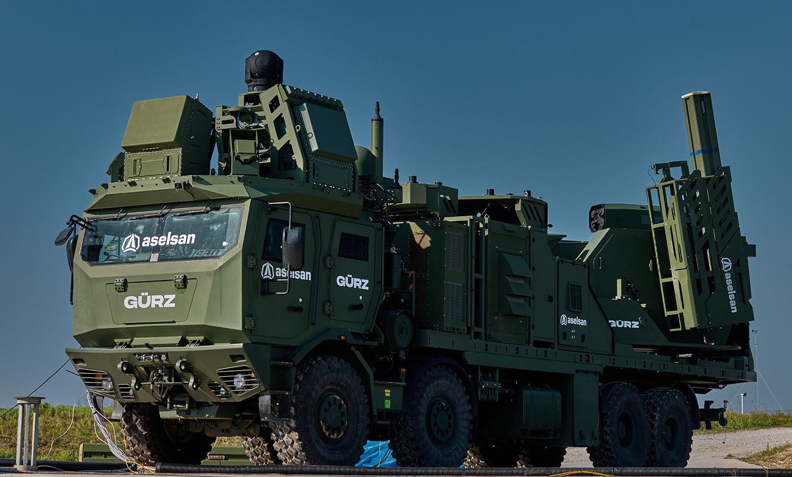
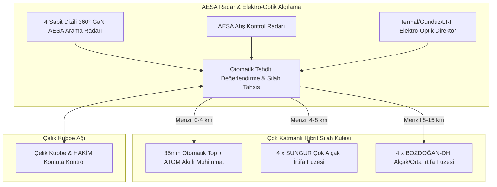

# 🌩️ Proje: ASELSAN GÜRZ (Hibrit Hava Savunma Sistemi)

  
  
  
  

  

## 🛡️ Stratejik Tanım & Doktriner Öncelik
**ASELSAN GÜRZ**, tek bir 8x8 taktik tekerlekli zırhlı araç üzerinde; 35mm akıllı parçacıklı mühimmat atan namlulu topu, 4 adet çok alçak irtifa hava savunma füzesini (VSHORAD - SUNGUR türevi), 4 adet alçak irtifa hava savunma füzesini (SHORAD - BOZDOĞAN-DH türevi), 4 panelli 360° GaN AESA arama radarını ve atış kontrol radarını birleştiren Türkiye'nin en gelişmiş mobil hibrit hava savunma sistemidir. Rus Pantsir ve Tunguska konseptlerini aşan teknolojik üstünlüğe sahiptir. Hareket halindeki mekanize zırhlı birliklerin, konvoyların ve stratejik üslerin; seyir füzelerine, kamikaze İHA'lara, savaş uçaklarına ve helikopterlere karşı çok katmanlı, otonom hava kalkanıdır.

## 📊 Kapsamlı Teknik Özellikler

| Parametre | Değer / Açıklama |
| :--- | :--- |
| **Taşıyıcı Şasi** | 8x8 Taktik Tekerlekli Yüksek Zırh Korumalı Askeri Araç |
| **Namlulu Silah** | 35mm Tek Namlulu Otomatik Top (ATOM Parçacıklı Mühimmat Uyumlu) |
| **Namlulu Silah Menzili** | 4.000 Metre Etkili İrtifa ve Menzil |
| **VSHORAD Füzeleri** | 4 Adet SUNGUR Kızılötesi Görüntüleyici (IIR) Güdümlü Füze (Menzil: ~8 km) |
| **SHORAD Füzeleri** | 4 Adet GÖKSUR / BOZDOĞAN-DH Aktif/IIR Güdümlü Füze (Menzil: 15+ km) |
| **Arama Radarı Mimarisi** | 4 Yöne Bakan Sabit GaN AESA Panelleri (Mekanik dönüşsüz 360° kesintisiz gözetleme) |
| **Atış Kontrol Radarı** | Taret Üstü AESA Yangın İdare Radarı + Entegre Elektro-Optik Direktör |
| **Arama Radarı Menzili** | 35+ km (Küçük radar kesitli İHA ve füzeler için) |
| **Hareket Halinde Atış** | Gelişmiş atış kontrol ve süspansiyon kilitleme ile intikal halindeyken angajman |
| **Mühimmat Kapasitesi** | Taret içinde hazır yüzlerce 35mm mermi + 8 adet hazır ateş füze |

## 🧩 Alt Sistemler ve Aviyonik/Elektronik Entegrasyonu
- **4 Dizili Sabit GaN AESA Radarı:** Ölü bölge bırakmaksızın 360 derece hava resmini anlık güncelleyen katı hal radar antenleri.
- **ATOM 35mm Parçacıklı Mühimmat Entegrasyonu:** Namlu çıkışında programlanan akıllı mühimmatla İHA ve seyir füzelerini kinetik parçacık bulutuyla imha etme.
- **Gelişmiş TEWA (Tehdit Değerlendirme ve Silah Tahsisi):** Tehdidin yaklaşma hızına ve irtifasına göre füzeyi mi yoksa topu mu kullanacağına mikrosaniyede karar veren yapay zeka algoritması.
- **Çift Katman Füze Entegrasyonu:** Hem çok yakın (IIR güdümlü) hem orta menzilli (veri bağı destekli) hedeflere aynı anda angaje olabilme.
- **Çelik Kubbe Komuta Kontrol Modülü:** Ağ merkezli hava savunma mimarisine bağlı olarak diğer radar ve bataryalarla iz füzyonu yapabilme.

## 🎯 Görev Profili, Muharebe Senaryoları & Operasyonel Yetenek
- **Zırhlı Kol Birliklerinin Korunması:** Tank ve mekanize piyade taburlarının intikali esnasında hava saldırılarına karşı hareketli eskort koruması.
- **Kamikaze Dron ve Seyir Füzesi Avcılığı:** Radarın alçaktan uçan hedefleri anında yakalaması ve top veya kısa menzil füze ile ilk temasta imhası.
- **Hava Üssü ve Radar Mevzi Savunması:** SİPER ve ERALP mevzilerine yapılabilecek sızma ve doyum saldırılarını son hatta bertaraf etme.
- **Otonom Muharebe Modu:** Harici radar ve komuta merkezi bağlantısı kopsa dahi kendi radar ve elektro-optiğiyle bağımsız hava savunma icra etme.

## 🚀 TRL Seviyesi ve Gelişim Yol Haritası
- **Mevcut Seviye: TRL 8 (Sistem Kalifikasyonu ve Atışlı Saha Testleri Tamamlanma Aşamasında)**
- [x] IDEF 2023'te tam donanımlı prototip lansmanı.
- [x] AESA radarları ve atış kontrol sistemlerinin entegrasyonu.
- [x] Namlulu top ve füze atış kontrol doğrulama testleri.
- [ ] Çelik Kubbe sistem entegrasyon atışları ve seri üretim hattı hazırlıkları.
- [ ] Türk Kara Kuvvetleri mekanize tugaylarına seri teslimatların başlaması.

---
[⬅️ Üst Dizine](../README.md) | [🏛️ Dominion Hub](../../README.md) | [🏠 Ana Sayfa](../../../README.md)
