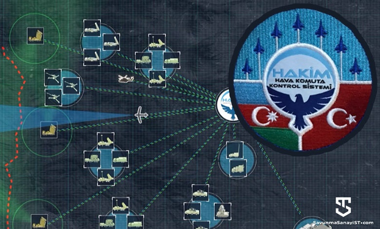
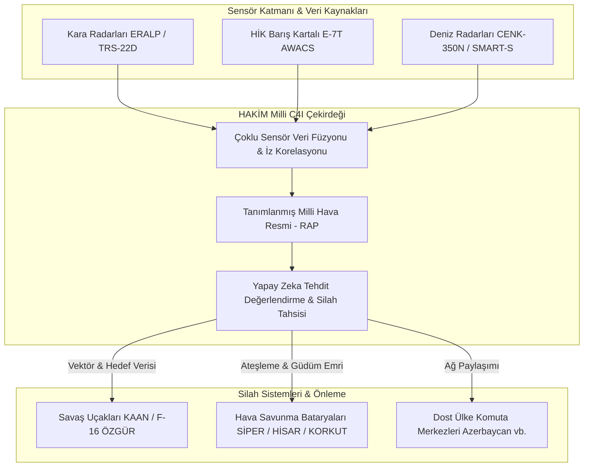

# 🏛️ Proje: ASELSAN HAKİM (Milli Hava Komuta Kontrol Sistemi)

  
  
  
  

  

## 🛡️ Stratejik Tanım & Doktriner Öncelik
**ASELSAN HAKİM**, Türkiye'nin tüm hava sahasındaki radar sensörlerini, havadan erken ihbar uçaklarını (HİK/AWACS), karadaki ve denizdeki hava savunma füze sistemlerini, savaş uçaklarını ve insansız hava araçlarını tek bir milli durumsal farkındalık resminde birleştiren "Hava Sahasının Beyni" niteliğindeki stratejik C4I (Komuta, Kontrol, Muhabere, Bilgisayar ve İstihbarat) sistemidir. ASELSAN ve Türk Hava Kuvvetleri Komutanlığı ortaklığıyla geliştirilen HAKİM; NATO sistemlerine bağımlı kalmaksızın bağımsız milli tanımlanmış hava resmi (Recognized Air Picture - RAP) üretir, gelişmiş yapay zeka algoritmalarıyla tehdit değerlendirmesi yaparak füzelerin veya önleme uçaklarının angajmanını otomatik koordine eder.

## 📊 Kapsamlı Teknik Özellikler

| Parametre | Değer / Açıklama |
| :--- | :--- |
| **Sistem Mimarisi** | Dağıtık, Modüler, Yüksek Erişilebilirlikli ve Coğrafi Olarak Yedekli Mimari |
| **İz İşleme Kapasitesi** | 10.000+ Eşzamanlı Hava, Kara ve Deniz Hedef İzi Füzyonu |
| **Veri Bağı Protokolleri** | Link-11, Link-16, Link-22, JREAP, KEMENT ve Milli Taktik Veri Ağı |
| **Hava Resmi Doğruluğu** | Çoklu sensör iz korelasyon algoritmaları ile mikrosaniye seviyesinde zaman damgası |
| **Karar Destek Süresi** | Yapay zeka tabanlı TEWA ile milisaniyeler düzeyinde otomatik tehdit sıralaması |
| **Sensör Entegrasyonu** | Sabit/Mobil Erken İhbar Radarları, AESA Sistemleri, Pasif Radarlar ve IRST |
| **Siber Güvenlik Seviyesi** | Milli Kripto, EAL-5+ Düzeyinde Güvenlikli Donanım ve Ağ İzolasyonu |
| **Hava Görev Emri (ATO)** | Elektronik Hava Görev Emri oluşturma, dağıtma ve gerçek zamanlı takip |
| **Kullanıcı Terminalleri** | Ergonomik Çok Ekranlı Operatör Konsolları ve Geniş Durum Ekranları |

## 🧩 Alt Sistemler ve Aviyonik/Elektronik Entegrasyonu
- **Çoklu Radar Veri İşleme Sistemi (MRDPS):** Farklı frekans ve özelliklerdeki onlarca radardan gelen ham izleri tekilleştiren filtreleme motoru.
- **Yapay Zeka Destekli TEWA:** Tehdidin hızına, irtifasına, yaklaşma açısına göre en uygun savunma bataryasını (SİPER, HİSAR, GÜRZ) veya nöbetçi uçağı seçen karar motoru.
- **KEMENT & Link-16 Ağ Arayüzleri:** Savaş uçaklarına ve füzelere hava resmi ve hedef koordinatlarını havada aktaran telsiz veri bağlantı düğümleri.
- **Hava Sahası Kontrol Modülü:** Sivil ve askeri hava trafiğini çakışmasız yöneten ve dost unsurların dost ateşiyle vurulmasını önleyen IFF kontrolü.
- **Simülasyon ve Eğitim Altyapısı:** Gerçek operasyonel resmi bozmadan sanal hava senaryolarıyla operatör eğitim tatbikatları icra edebilme.

## 🎯 Görev Profili, Muharebe Senaryoları & Operasyonel Yetenek
- **Tüm Ülke Hava Sahasının 7/24 Korunması:** Barış, gerginlik ve savaş hallerinde sınır ihlallerini anında tespit edip alarm reaksiyon uçaklarını (Scramble) kaldırma.
- **Çelik Kubbe'nin Çatı Komutası:** Katmanlı hava savunma mimarisindeki tüm sensör ve füzelerin bir orkestra gibi ahenkle çalışmasını sağlama.
- **Sınır Ötesi Hava Harekatlarının Yönetimi:** Çoklu uçak paketlerinin yakıt ikmali, radar karartma ve hedef taarruzlarını anlık vektörlerle idare etme.
- **Stratejik İhracat Başarısı:** Azerbaycan Hava Kuvvetleri ile entegrasyonu tamamlanmış, iki ülkenin ortak hava resmi paylaşması sağlanmıştır (HAKİM-HAKİM Entegrasyonu).

## 🚀 TRL Seviyesi ve Gelişim Yol Haritası
- **Mevcut Seviye: TRL 9 (Tam Operasyonel / TSK ve İttifak Envanterinde)**
- [x] Milli yazılım mimarisinin geliştirilmesi ve RADNET radar ağıyla entegrasyonu.
- [x] Hava Kuvvetleri Komutanlığı bünyesinde operasyonel kabul testleri.
- [x] SİPER ve HİSAR hava savunma sistemleriyle canlı angajman yönetimi.
- [x] Azerbaycan ile ortak hava komuta kontrol entegrasyon projesinin tamamlanması.
- [ ] KAAN, ANKA-3 ve KIZILELMA MUM-T otonom hava harekat yönetim yeteneklerinin eklenmesi.

---
[⬅️ Üst Dizine](../README.md) | [🏛️ Dominion Hub](../../README.md) | [🏠 Ana Sayfa](../../../README.md)
