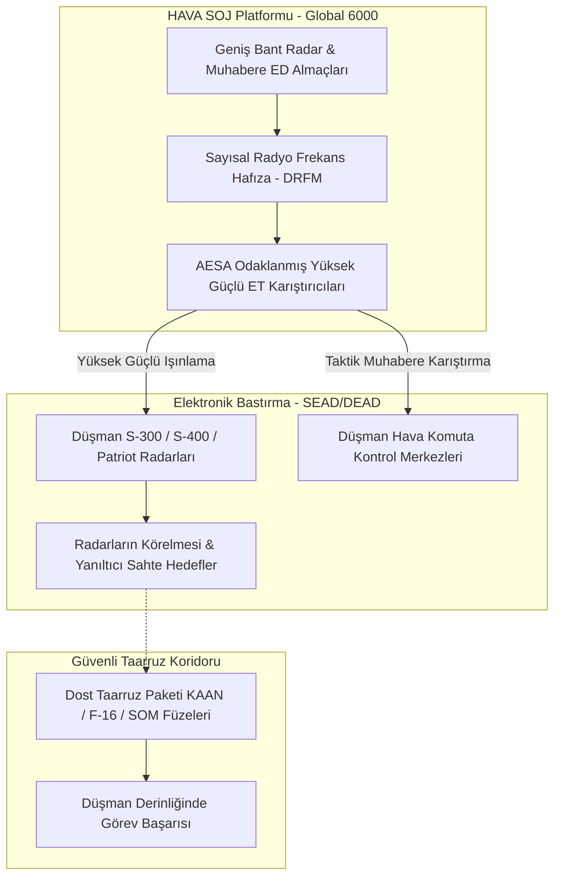

# ✈️ Proje: HAVA SOJ (Hava Konuşlu Uzaktan Elektronik Destek / Elektronik Taarruz Sistemi)

  
  
  
  

  

## 🛡️ Stratejik Tanım & Doktriner Öncelik
**HAVA SOJ** (Hava Konuşlu Uzaktan Elektronik Destek ve Elektronik Taarruz Sistemi), düşmanın hava savunma radarlarını, erken ihbar sistemlerini, füze güdüm kanallarını ve taktik haberleşme ağlarını yüzlerce kilometre öteden (Stand-Off Jammer mesafesi) tespit eden, dinleyen ve yüksek güçlü AESA karıştırma ışınlarıyla körelterek felç eden Türkiye'nin en stratejik hava harp platformudur. ASELSAN'ın geliştirdiği son teknoloji elektronik harp görev yükü, TUSAŞ tarafından modifiye edilen 4 adet Bombardier Global 6000 uzun menzilli iş jeti gövdesine entegre edilmiştir. Taarruz paketindeki dost savaş uçaklarına (KAAN, F-16, KIZILELMA) düşman hava savunma şemsiyesini delerek güvenli taarruz koridorları açar.

## 📊 Kapsamlı Teknik Özellikler

| Parametre | Değer / Açıklama |
| :--- | :--- |
| **Taşıyıcı Hava Aracı** | Modifiye Edilmiş Bombardier Global 6000 Ultra Uzun Menzilli İş Jeti |
| **Operasyonel Görev İrtifası**| 45.000 - 51.000 Feet (Düşman hava savunma menzilinin üzerinde stand-off seyir) |
| **Havada Kalış Süresi** | 10+ Saat (Kesintisiz elektronik harp devriyesi) |
| **Elektronik Harp Görev Yükü**| Geniş Bant Elektronik Destek (ED/ESM) ve Elektronik Taarruz (ET/ECM) |
| **Anten Teknolojisi** | Gövdeye Entegre Çoklu Katı Hal GaN Aktif Faz Dizinli (AESA) Antenler |
| **Karıştırma Çıkış Gücü** | Kilowattlar düzeyinde yönlendirilmiş ve odaklanmış yüksek RF tepe gücü |
| **Karıştırma Tipleri** | DRFM Tabanlı Akıllı Aldatma, Menzil/Hız Kapısı Çekme, Süpürmeli/Nokta Gürültü |
| **Menzil Kapsaması** | Düşman sınırının yüzlerce kilometre derinliğindeki radarları etkisizleştirme |
| **Uçak İçi Mürettebat** | 2 Pilot + Kabin İçi 4-6 Elektronik Harp Operatörü ve Görev Komutanı |

## 🧩 Alt Sistemler ve Aviyonik/Elektronik Entegrasyonu
- **Sayısal Radyo Frekans Hafıza (DRFM):** Düşman radar sinyalini nanosaniyeler içinde kaydedip geciktirerek veya modüle ederek ekranda yüzlerce hayali hedef oluşturan sistem.
- **AESA Yönlendirilebilir Karıştırıcı Antenler:** Gövdenin yanlarına ve burun/kuyruk radomlarına yerleştirilen, enerjiyi anlık olarak istenen düşman radarına odaklayan anten dizinleri.
- **Kritik Görev Bilgisayarları & Taktik Ekranlar:** ASELSAN tasarımı görev konsolları, tehdit kütüphanesi veri tabanı ve anlık sinyal analiz yazılımları.
- **Sıvı Soğutmalı Yüksek Güç Jeneratörleri:** Yüksek güçlü karıştırıcıların ihtiyaç duyduğu devasa elektrik enerjisini üreten yardımcı motor jeneratörleri.
- **HAKİM & KEMENT Entegrasyonu:** Gerçek zamanlı taktik hava resmi paylaşımı ve dost hava platformlarıyla ortak elektronik kalkan senkronizasyonu.

## 🎯 Görev Profili, Muharebe Senaryoları & Operasyonel Yetenek
- **SEAD/DEAD (Düşman Hava Savunmasının Bastırılması/İmhası):** Düşman uzun menzilli hava savunma bataryalarının arama ve atış kontrol radarlarını köreltip HARM ve milli anti-radyasyon füzelerine hedef kılma.
- **Hava Harekâtı Koridor Açma:** Savaş uçaklarımızın düşman derinliğindeki stratejik hedeflere kayıp vermeden ulaşıp mühimmat bırakmasını sağlama.
- **Muhabere Ağlarının Çökertilmesi:** Düşman avcı uçaklarının yer kontrol istasyonları ve AWACS uçaklarıyla yaptığı telsiz ve veri bağı irtibatını kesme.
- **Sınır Boyu Stratejik Sinyal İstihbaratı (ELINT/COMINT):** Barış zamanında potansiyel düşman radar frekanslarını haritalandırarak milli tehdit kütüphanesini güncelleme.

## 🚀 TRL Seviyesi ve Gelişim Yol Haritası
- **Mevcut Seviye: TRL 7 (Gelişmiş Görev Sistemi Uçak Entegrasyonu ve Uçuş Testleri Aşamasında)**
- [x] Bombardier Global 6000 uçaklarının temini ve TUSAŞ tesislerinde yapısal modifikasyonları.
- [x] Elektronik harp görev yüklerinin laboratuvar ve yer test ortamlarında kalifikasyonu.
- [x] İlk uçağa görev sistemlerinin montajı ve ilk uçuş testlerinin icra edilmesi.
- [ ] Sistem kalifikasyon uçuşları ve sahada gerçek radar hedeflerine karşı elektronik taarruz doğrulaması (TRL 8).
- [ ] 4 adet HAVA SOJ uçağının Türk Hava Kuvvetleri'ne tam operasyonel teslimatı (TRL 9).

---
[⬅️ Üst Dizine](../README.md) | [🏛️ Dominion Hub](../../README.md) | [🏠 Ana Sayfa](../../../README.md)
