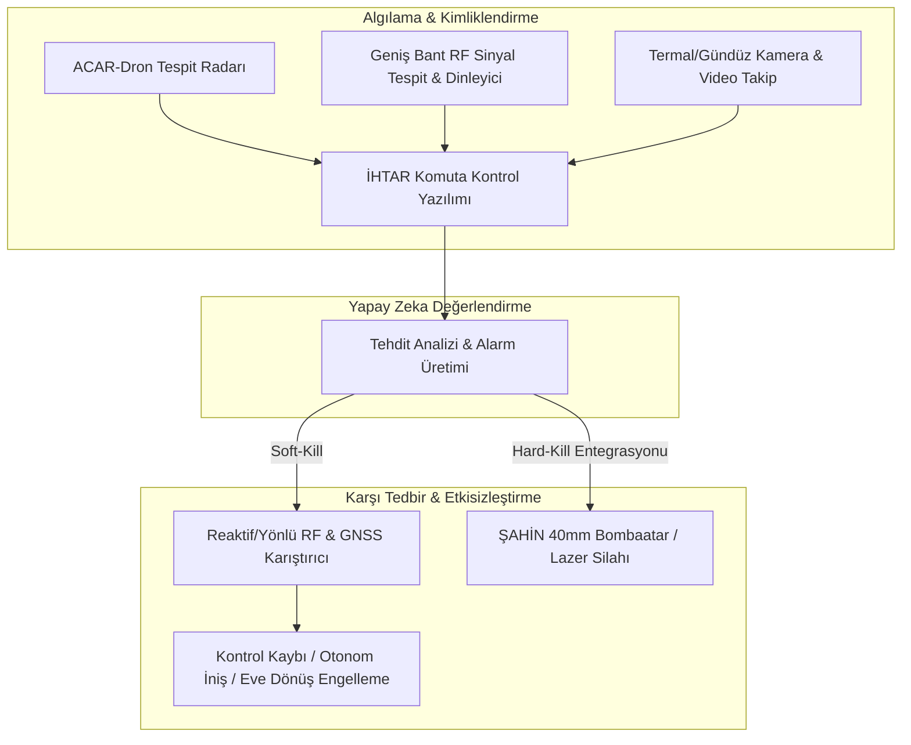

# 🦅 Proje: ASELSAN İHTAR (Anti-Dron Savunma Sistemi)

  
  
  
  

  

## 🛡️ Stratejik Tanım & Doktriner Öncelik
**ASELSAN İHTAR**, şehir merkezlerinde, askeri üslerde, havalimanlarında, sınır karakollarında ve stratejik sanayi tesislerinde mini ve mikro insansız hava araçlarının (İHA), FPV kamikaze dronların ve uzaktan komutalı hava tehditlerinin oluşturduğu tehlikeleri bertaraf etmek için geliştirilmiş entegre Anti-Dron Savunma Sistemidir. Radar, elektro-optik kamera, RF sinyal dinleme ve yönlü/omni-directional RF karıştırma (jammer) bileşenlerini tek bir komuta kontrol yazılımında birleştiren İHTAR; düşman dronlarını kilometrelerce uzaktan tespit edip GNSS ve kontrol linklerini keserek güvenli inişe veya kalkış noktasına dönmeye zorlar.

## 📊 Kapsamlı Teknik Özellikler

| Parametre | Değer / Açıklama |
| :--- | :--- |
| **Radar Tipi** | ASELSAN ACAR Dron Tespit Radarı (K-Bant, darbe doppler özellikli) |
| **Radar Tespit Menzili** | Mini/Mikro İHA'lar için 2 - 5 km (RCS = 0.01 m² hedeflerde) |
| **RF Tespit Menzili** | 5+ km (Dronun kumandası veya video vericisi yayın yaptığı anda yön kestirimi) |
| **Elektro-Optik Takip** | Yüksek Çözünürlüklü Termal ve Full HD TV Kamera + Lazer Mesafe Ölçer |
| **Karıştırma Bantları** | GNSS (GPS L1/L2, GLONASS, Galileo, BeiDou) ve ISM Bantları (433MHz, 900MHz, 2.4GHz, 5.8GHz) |
| **Karıştırma Menzili** | 1 - 3 km (Yönlü Anten ile Odaklanmış Karıştırma) / 1 km Çevresel (Omni) |
| **Konfigürasyonlar** | Sabit Direk Montajı, Römork Üstü Taşınabilir veya 4x4 Zırhlı Araç Üstü |
| **Reaksiyon Süresi** | Otonom algılama ve kilitlenmeyle < 2 saniye |
| **Çevre Şartları** | MIL-STD-810G uyumlu, her türlü hava koşulunda 7/24 çalışma |

## 🧩 Alt Sistemler ve Aviyonik/Elektronik Entegrasyonu
- **ACAR Dron Radarı:** Kuşları dronlardan ayırt edebilen gelişmiş mikrodöppler (micro-Doppler) algoritması.
- **RF Dinleme ve Yön Bulucu (DF):** Dronun havalandığı noktadaki pilotun/kumandanın yerini tespit edebilen pasif algılayıcı.
- **Sayısal Sentezörlü RF Karıştırıcı:** Düşmanın kullandığı özel ve atlamalı frekansları dahi anında baskılayan yazılım tanımlı karıştırma modülü.
- **Merkezi Komuta Kontrol Yazılımı:** Sayısal harita üzerinde radar, optik ve RF izlerini birleştirerek tek bir hedef sembolü üreten ara yüz.
- **Hard-Kill Silah Arayüzü:** Gerektiğinde ASELSAN ŞAHİN 40mm parçacıklı mühimmat atan silah kulesine veya lazer silahına hedef koordinatı devretme.

## 🎯 Görev Profili, Muharebe Senaryoları & Operasyonel Yetenek
- **Devlet Büyükleri ve Tesis Güvenliği:** Cumhurbaşkanlığı Külliyesi, Meclis, bakanlıklar ve askeri karargahların dron casusluğu ve saldırılarına karşı korunması.
- **Havalimanı ve Sınır Koruma:** Sivil uçuşları tehlikeye atan dronların tespiti ve sınır karakollarına yönelik kamikaze dron taarruzlarının kesilmesi.
- **VIP Konvoy Savunması:** Zırhlı araç üstü mobil İHTAR ile intikal halindeyken dron tehditlerine karşı elektronik kubbe oluşturma.
- **Uluslararası Başarı:** Çok sayıda NATO ve dost ülkeye ihraç edilmiş, uluslararası zirvelerde (G20, NATO Zirveleri vb.) hava güvenliğini sağlamıştır.

## 🚀 TRL Seviyesi ve Gelişim Yol Haritası
- **Mevcut Seviye: TRL 9 (Seri Üretimde / Geniş Operasyonel Kullanımda - Combat Proven)**
- [x] Sistem tasarımı, ACAR radar entegrasyonu ve karıştırıcı testleri.
- [x] TSK, EGM, Jandarma ve MİT birimlerine yüzlerce adet teslimat.
- [x] Sınır içi ve sınır ötesi harekat bölgelerinde terör dronlarına karşı yüzlerce başarılı önleme.
- [x] Çok sayıda dost ülkeye ihracat teslimatları.
- [ ] FPV dronlara karşı optimize edilmiş yeni nesil mikrodalga ve yapay zeka takip güncellemeleri.

---
[⬅️ Üst Dizine](../README.md) | [🏛️ Dominion Hub](../../README.md) | [🏠 Ana Sayfa](../../../README.md)
