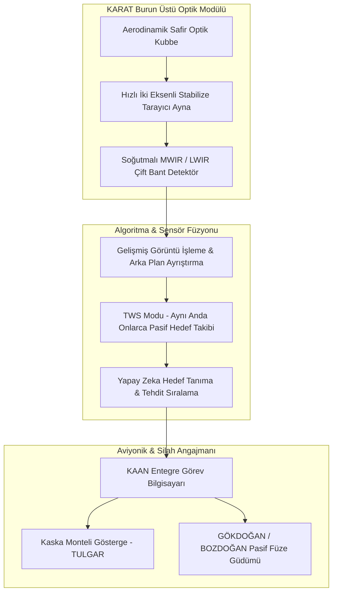

# 👁️ Proje: ASELSAN KARAT (Kızılötesi Arama ve Takip Sistemi - IRST)

  
  
  
  

  

## 🛡️ Stratejik Tanım & Doktriner Öncelik
**ASELSAN KARAT**, 5. Nesil Milli Muharip Uçak KAAN ve F-16 Blok-30 ÖZGÜR platformları için milli olarak geliştirilen yüksek performanslı Kızılötesi Arama ve Takip Sistemidir (IRST - Infra-Red Search and Track). Modern hava muharebesinde hayalet (stealth) savaş uçaklarının düşük radar kesit alanı (RCS) avantajını ortadan kaldıran KARAT; hiçbir elektromanyetik ışıma yapmaksızın (tamamen pasif modda) düşman jetlerinin motor sıcaklığı ve sürtünmeden kaynaklanan gövde ısısını onlarca kilometre öteden tespit ve takip eder. Uçağın radar suskunluğu (EMCON) durumunda bile hedefe görünmeden yaklaşmasını ve pasif kilitlenmeyle hava-hava füzelerini (GÖKDOĞAN, BOZDOĞAN) yönlendirmesini sağlar.

## 📊 Kapsamlı Teknik Özellikler

| Parametre | Değer / Açıklama |
| :--- | :--- |
| **Sistem Tipi** | Hava Konuşlu Pasif Kızılötesi Arama ve Takip Sistemi (IRST) |
| **Detektör Teknolojisi** | Çift Spektral Bantlı Soğutmalı Termal Dedektör (MWIR / LWIR) |
| **Algılama Modu** | %100 Pasif (Sıfır RF Işıması - Düşman RWR sistemleri tarafından algılanamaz) |
| **Tespit Menzili** | Geniş sektörde onlarca kilometre (Savaş uçaklarının arkadan ve önden termal tespiti) |
| **Çalışma Modları** | Geniş Alan Arama, Dar Alan Hassas Takip, TWS (Track-While-Scan) ve Tekil Hedef Kilidi |
| **Kapsama Açısı** | Azimut: ±60° Geniş Tarama, Elevasyon: +45° / -30° |
| **Optik Pencere** | Yüksek süpersonik sürtünme ısısına dayanıklı özel kaplamalı Safir Kubbe |
| **Hedef Kapasitesi** | Aynı anda onlarca hava hedefini sürekli izleme ve dinamik iz geçmişi tutma |
| **Aviyonik Arayüz** | Yüksek Hızlı Optik Veri Hattı, Fibre Channel ve MIL-STD-1553B |

## 🧩 Alt Sistemler ve Aviyonik/Elektronik Entegrasyonu
- **Geniş Dinamik Aralıklı Çift Bant Sensör:** Bulut, güneş yansıması ve yer arka planını filtreleyerek hedef uçakların zayıf termal kontrastını ayırt etme.
- **Süpersonik Aerodinamik Optik Kubbe:** Mach 2+ hızlardaki sürtünme sıcaklığında optik bozulma yaşamayan yüksek geçirgenlikli safir pencere.
- **Yüksek Hızlı Jiroskopik Ayna Stabilizasyonu:** Uçağın yüksek G manevraları esnasında hedefe kilitli kalabilen piezo/fırçasız motor tahrikleri.
- **MURAD AESA Radarı ile Sensör Füzyonu:** Radar ve IRST verilerinin KAAN görev bilgisayarında birleştirilerek tek ve kesin bir hedef izine dönüştürülmesi.
- **TULGAR Kaska Monteli Gösterge Bağlantısı:** Pilotun baktığı yöne anlık IRST hedef sembololojisinin yansıtılması.

## 🎯 Görev Profili, Muharebe Senaryoları & Operasyonel Yetenek
- **Stealth Avcılığı:** F-35, Su-57 ve benzeri 5. nesil hayalet uçakların radar kesit alanları ne kadar küçük olursa olsun kaçamayacakları kızılötesi izlerini yakalama.
- **Sessiz Yaklaşma ve BVR Saldırısı:** Radarını çalıştırmadan uçan bir avcı uçağının düşman hava sahasına sızıp KARAT ile kilit atarak GÖKDOĞAN füzesi ateşlemesi.
- **Elektronik Karıştırma Altında Görev:** Düşmanın tüm radar frekanslarını kör ettiği yoğun karıştırma ortamında elektro-optik göz olarak muharebeye devam edebilme.
- **İt Dalaşı (Dogfight) Desteği:** Yakın hava muharebesinde yüksek açılı manevralarda hedefin kaçışını önleyen optik kilit.

## 🚀 TRL Seviyesi ve Gelişim Yol Haritası
- **Mevcut Seviye: TRL 8 (Sistem Kalifikasyonu ve Uçuşlu Doğrulama Aşamasında)**
- [x] Sistem optik tasarımı, çift bant dedektör üretimi ve algoritmaların doğrulanması.
- [x] Laboratuvar ve iklimlendirme/titreşim testleri.
- [x] Test uçağı üzerinde yer ve uçuş denemelerinin gerçekleştirilmesi.
- [ ] MMU KAAN prototiplerine ve F-16 ÖZGÜR uçaklarına nihai entegrasyon (TRL 9).
- [ ] Seri üretim hattının kurularak KAAN seri üretim bloklarına montajı.

---
[⬅️ Üst Dizine](../README.md) | [🏛️ Dominion Hub](../../README.md) | [🏠 Ana Sayfa](../../../README.md)
