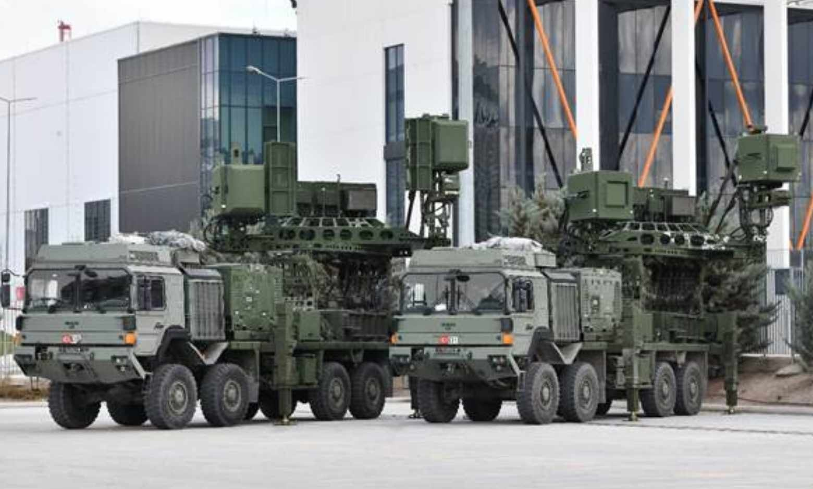
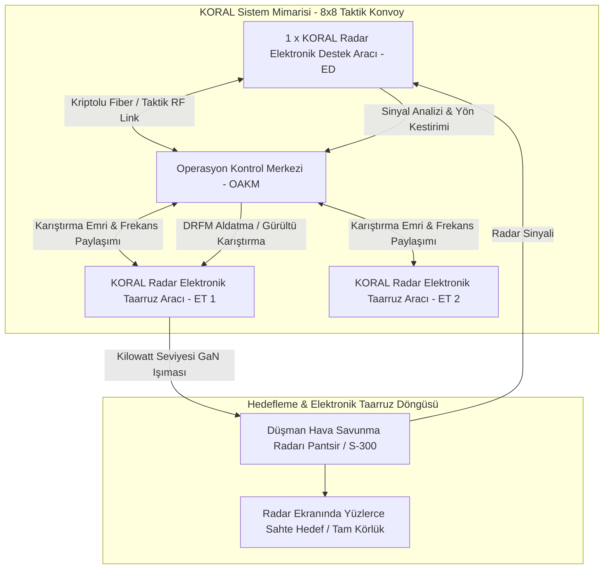

# 📡 Proje: ASELSAN KORAL (Mobil Elektronik Harp Sistemi)

  
  
  
  

  

## 🛡️ Stratejik Tanım & Doktriner Öncelik
**ASELSAN KORAL**, modern muharebe alanında düşman hava savunma radarlarını, erken ihbar istasyonlarını ve füze atış kontrol radarlarını geniş frekans bandında arayan, tespit eden, parametrelerini analiz eden ve Sayısal Radyo Frekans Hafıza (DRFM) yeteneğiyle körelten ya da aldatan Türkiye'nin milli mobil kara konuşlu Elektronik Harp Sistemidir. Fırat Kalkanı, Zeytin Dalı, Barış Pınarı, Bahar Kalkanı ve Dağlık Karabağ harekatlarında düşman radar şemsiyesini felç ederek Bayraktar TB2 SİHA'lar ve savaş uçaklarımızın tek bir kayıp dahi vermeden görev yapmasını sağlamış, dünya askeri literatürüne girmiş "Combat Proven" bir elektronik taarruz silahıdır.

## 📊 Kapsamlı Teknik Özellikler

| Parametre | Değer / Açıklama |
| :--- | :--- |
| **Sistem Yapısı** | 1 Adet Radar ED Aracı + 4 Adet Radar ET Aracı (Her biri 8x8 Askeri Şasi) |
| **Frekans Kapsaması** | Geniş Frekans Bandı (Modern hava savunma ve erken ihbar radar bantları) |
| **Karıştırma Menzili** | 150 - 200+ km Etkili Elektronik Karıştırma ve Aldatma Menzili |
| **Teknoloji Altyapısı** | Sayısal Radyo Frekans Hafıza (DRFM) ve Çoklu Sayısal Hüzme Şekillendirme |
| **Karıştırma Türleri** | DRFM Aldatma (Range Gate Pull-Off, Velocity Gate Pull-Off), Hedef Çoklama, Gürültü |
| **Reaksiyon Süresi** | Sinyal tespitinden itibaren saniyeler içinde otomatik veya manuel taarruz |
| **İntikal ve Kurulum** | Hidrolik seviyeleme ve anten yükseltme sistemleri ile < 30 dakikada göreve hazır |
| **Haberleşme Güvenliği** | Araçlar arası kriptolu taktik RF veri bağı ve güvenli fiber optik hat |
| **Görev Kabini** | KBRN (Kimyasal, Biyolojik, Radyolojik, Nükleer) korumalı zırhlı operatör kabini |

## 🧩 Alt Sistemler ve Aviyonik/Elektronik Entegrasyonu
- **Geniş Bantlı Sayısal Almaçlar:** Saniyede yüz binlerce radar darbesini tarayan ve anında sınıflandıran sinyal işlemciler.
- **Yüksek Hızlı DRFM Kartları:** Gelen düşman radar darbesini birebir kopyalayıp üzerinde faz, frekans ve zaman oynamaları yaparak geri yansıtan donanım.
- **Yüksek Çıkış Güçlü Anten Sistemleri:** Taret üzerinde otomatik yönlendirilen, mikrodalga tüplü ve GaN katı hal güç yükselteçli anten grupları.
- **Milli Tehdit Kütüphanesi:** Karşılaşılan radar sinyalini anında eşleştirip tehdidin marka, model ve fırlatma bataryasını belirleyen veri tabanı.
- **HAKİM ve TSK Taktik Veri Ağı:** Üretilen elektronik istihbarat verilerini anlık olarak genel karargaha ve hava kuvvetlerine ileten linkler.

## 🎯 Görev Profili, Muharebe Senaryoları & Operasyonel Yetenek
- **Hava Savunma Bataryalarının Kör Edilmesi:** Düşman S-300, Pantsir ve Buk bataryalarının arama ve atış kontrol radarlarını kör ederek SİHA'lara hedef haline getirme.
- **Sahte Hedef Formasyonu:** Düşman radarlarında aynı anda yüzlerce sahte savaş uçağı ve seyir füzesi izi oluşturarak düşmanın tüm hava savunma füzelerini boşluğa harcatması.
- **Sınır Ötesi Taarruz Kalkanı:** Sınır hattından derinlikteki hedeflere doğru güvenli bir elektronik kalkan yaratarak sınır ötesi operasyonları perdeleme.
- **KORAL-II Geliştirmesi:** GaN teknolojisiyle donatılan, daha geniş frekans bandı ve iki katına çıkan karıştırma gücüne sahip yeni nesil KORAL-II sahaya sürülmektedir.

## 🚀 TRL Seviyesi ve Gelişim Yol Haritası
- **Mevcut Seviye: TRL 9 (Seri Üretimde / Çok Sayıda Muharebede Kanıtlanmış - Combat Proven)**
- [x] Sistem tasarımı, saha kalifikasyonu ve TSK envanterine giriş.
- [x] Suriye sınır ötesi harekatlarında düşman hava savunmasını felç etme başarısı.
- [x] Dağlık Karabağ savaşında Azerbaycan ordusuna elektronik harp üstünlüğü sağlama.
- [x] Yeni nesil KORAL-II sisteminin kalifikasyon ve teslimat testleri.
- [ ] Otonom elektronik taarruz algoritmalarının yapay zeka ile güncellenmesi.

---
[⬅️ Üst Dizine](../README.md) | [🏛️ Dominion Hub](../../README.md) | [🏠 Ana Sayfa](../../../README.md)
