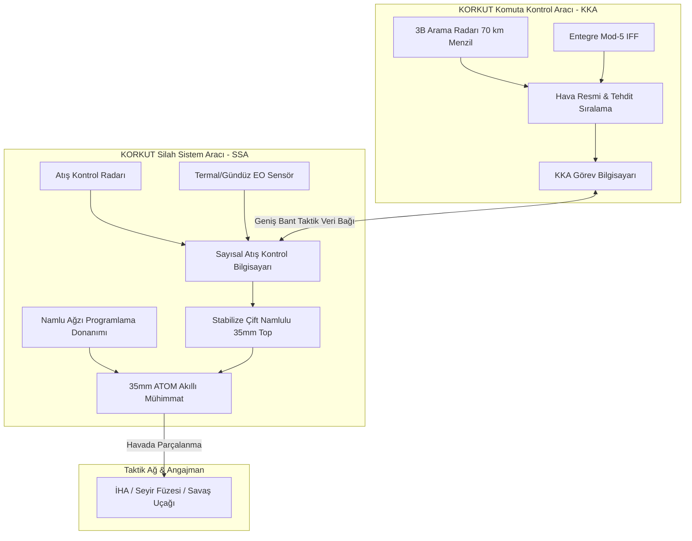

# 🛡️ Proje: ASELSAN & FNSS KORKUT (Kundağı Motorlu Hava Savunma Silah Sistemi)

  
  
  
  

  

## 🛡️ Stratejik Tanım & Doktriner Öncelik
**ASELSAN & FNSS KORKUT**, hareket halindeki mekanize ve zırhlı kara birliklerinin hava savunmasını icra etmek üzere geliştirilmiş, amfibi paletli zırhlı şasiye entegre Kundağı Motorlu Namlulu Hava Savunma Silah Sistemidir. Rus Tunguska ve Alman Gepard sistemlerinin çok ötesinde yeni nesil sayısal mimariye sahip olan KORKUT; 1 adet Komuta Kontrol Aracı (KKA) ve 3 adet Silah Sistem Aracından (SSA) oluşan takım yapısıyla çalışır. ASELSAN üretimi 35mm ATOM Akıllı Parçacıklı Mühimmatı sayesinde; havadan karaya füzeleri, alçaktan uçan seyir füzelerini, insansız hava araçlarını ve savaş uçaklarını havada oluşturduğu çelik şarapnel bulutuyla kesin olarak imha eder.

## 📊 Kapsamlı Teknik Özellikler

| Parametre | Değer / Açıklama |
| :--- | :--- |
| **Sistem Takım Mimarisi** | 1 Adet Komuta Kontrol Aracı (KKA) + 3 Adet Silah Sistem Aracı (SSA) |
| **Taşıyıcı Platform** | FNSS ZMA-30 Yüksek Hareket Kabiliyetli Amfibi Paletli Zırhlı Muharebe Aracı |
| **Ana Silah Donanımı** | 35mm Çift Namlulu Otomatik Top (2x Oerlikon Lisanslı KDG Mekanizması) |
| **Atış Sürati** | 1.100 Mermi / Dakika (Eşzamanlı çift namlu atışı) |
| **Kullanılan Mühimmat** | 35mm ATOM Parçacıklı Mühimmat ve Klasik Yüksek Patlayıcı (HEI) Mühimmat |
| **Etkili Önleme Menzili** | 4.000 Metre |
| **KKA Arama Radarı** | 3 Boyutlu Katı Hal Arama Radarı (Menzil: 70 km) |
| **SSA Takip Sensörleri** | Hassas Yangın İdare Radarı + Termal Kamera + TV Kamera + LRF Direktörü |
| **Mühimmat Besleme** | Otomatik Bağlantısız Mühimmat Besleme Mekanizması (OBMBM) |
| **Amfibi Kabiliyet** | Derin sulardan ve nehirlerden yüzerek geçebilme yeteneği |

## 🧩 Alt Sistemler ve Aviyonik/Elektronik Entegrasyonu
- **Namlu Ağzı Hız ve Kapsül Programlama Bobini:** ATOM mühimmatı namludan fırlarken hızını ölçen ve mühimmata hedef mesafesinde patlama zamanını kodlayan elektronik ünite.
- **ATOM Akıllı Mühimmat:** Hedefe yaklaştığında patlayarak yüzlerce sertleştirilmiş tungsten bilyesini konik şarapnel bulutu olarak saçan teknoloji.
- **OBMBM (Otomatik Mühimmat Besleme):** İki farklı mühimmat tipini (ATOM ve zırh delici mühimmat) aynı anda şarjörde tutarak tek tuşla 1 saniyede mühimmat tipi değiştirebilme.
- **Gelişmiş Süspansiyon ve Atış Kontrol:** Zırhlı araç engebeli arazide hareket halindeyken bile hedefe kilitli kalarak atış yapabilme kabiliyeti.
- **Çelik Kubbe & HAKİM Entegrasyonu:** Komuta kontrol aracının üst kademe hava savunma ağlarıyla taktik resim senkronizasyonu.

## 🎯 Görev Profili, Muharebe Senaryoları & Operasyonel Yetenek
- **Zırhlı Birliklerin Yakın Hava Koruması:** Tank taburlarının taarruz intikalinde düşman yakın hava desteği uçaklarına ve saldırı helikopterlerine karşı şemsiye açma.
- **Kamikaze İHA ve Füze Avcılığı:** Savaş alanında son yıllarda tehdit oluşturan kamikaze dronları ve seyir füzelerini maliyet-etkin şekilde düşürme.
- **Kara ve Zırhlı Hedeflere Karşı Öz Savunma:** Gerektiğinde zırh delici mühimmat moduna geçerek düşman piyade mevzilerini ve hafif zırhlı araçlarını saniyeler içinde delik deşik etme.
- **Muharebe Başarısı:** Libya'da Vatiyye Üssü ve sınır ötesi harekatlarda aktif olarak görev yapmış, çok sayıda düşman İHA'sını düşürmüştür.

## 🚀 TRL Seviyesi ve Gelişim Yol Haritası
- **Mevcut Seviye: TRL 9 (Seri Üretimde / TSK Envanterinde Tam Operasyonel - Combat Proven)**
- [x] Sistem tasarımı, KKA ve SSA prototiplerinin zorlu arazi testleri.
- [x] Seri üretim sözleşmesi ve Türk Kara Kuvvetleri'ne onlarca takım teslimatı.
- [x] Sınır ötesi operasyonlarda aktif muharebe kullanımı ve yüksek vuruş başarısı.
- [x] KORKUT 100/200 tekerlekli zırhlı şasi versiyonlarının geliştirilmesi.
- [ ] Yeni nesil lazer güdümlü mühimmat ve dron avcısı algoritmalarının entegrasyonu.

---
[⬅️ Üst Dizine](../README.md) | [🏛️ Dominion Hub](../../README.md) | [🏠 Ana Sayfa](../../../README.md)
