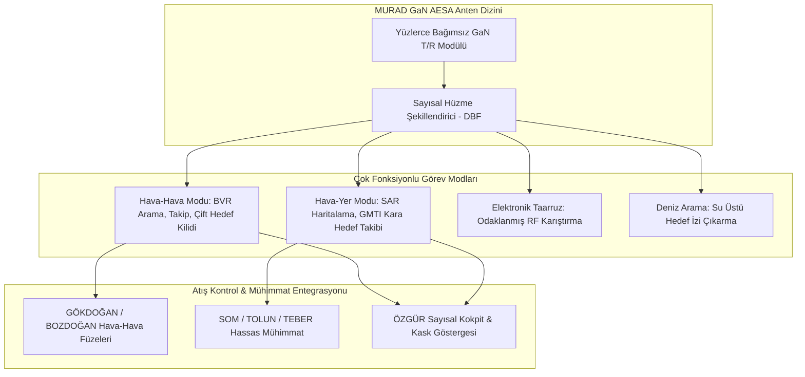

# 👁️ Proje: ASELSAN MURAD (Uçak Burun AESA Radarı)

  
  
  
  

  

## 🛡️ Stratejik Tanım & Doktriner Öncelik
**ASELSAN MURAD**, Türkiye'nin muharip uçakları ve ağır taarruz insansız hava araçları için geliştirdiği, dünyanın en ileri radar teknolojisi olan Galyum Nitrür (GaN) tabanlı Çok Fonksiyonlu Aktif Faz Dizinli (AESA) Burun Yangın Kontrol Radarıdır. F-16 Blok-30/40/50 ÖZGÜR modernizasyon projesi, Bayraktar AKINCI TİHA, KIZILELMA MİUS, HÜRJET ve Milli Muharip Uçak KAAN'ın ana aviyonik beyni ve gözüdür. Mekanik antenli klasik radarların kısıtlarını ortadan kaldıran MURAD; aynı anda hem hava-hava arama/takip, hem sentetik açıklıklı radar (SAR) yer haritalama, hem de odaklanmış elektronik taarruz yapabilen küresel çapta kritik bir güç çarpanıdır.

## 📊 Kapsamlı Teknik Özellikler

| Parametre | Değer / Açıklama |
| :--- | :--- |
| **Radar Mimarisi** | Çok Fonksiyonlu Katı Hal AESA Yangın İdare Radarı |
| **Yarıiletken Teknolojisi** | Galyum Nitrür (GaN) Bileşenler (Daha yüksek ışıma gücü ve menzil) |
| **Çalışma Frekansı** | X-Bant (Havacılık standardında yüksek çözünürlüklü hedef takibi) |
| **Hava Hedefi Tespit Menzili**| 150 - 200+ km (Hedefin radar kesit alanına bağlı olarak) |
| **Aynı Anda Takip Kapasitesi**| Onlarca hava hedefini sürekli izleme ve eşzamanlı çoklu füzeye veri aktarımı |
| **Hava-Yer Haritalama (SAR)** | Metre altı hassasiyette yüksek çözünürlüklü radar haritası çıkarma |
| **Hareketli Hedef Takibi (GMTI)**| Karada hareket eden zırhlı araçları tespit ve takip edebilme |
| **Elektronik Koruma (ECCM)** | Ultra düşük yan kulakçık seviyeleri ve çevik frekans atlama kabiliyeti |
| **Soğutma Mimarisi** | Uçak aviyonik sistemine entegre kapalı devre sıvı soğutma |

## 🧩 Alt Sistemler ve Aviyonik/Elektronik Entegrasyonu
- **GaN T/R Modül Matrisi:** Binlerce milimetrik anten elemanının mikrosaniyede yön değiştirebilen hüzmeler üretmesi.
- **Entegre IFF Mod-5 Sorgulayıcı:** Radar antenine gömülü, dost uçakları anında ayırt eden NATO standardı anten dizini.
- **SAR/ISAR Görüntü İşleme Kartları:** Gece, sis ve yoğun bulut tabakası altında yerdeki hedeflerin fotoğraf kalitesinde radar görüntüsünü üreten işlemciler.
- **ÖZGÜR Görev Bilgisayarı Arayüzü:** Uçağın milli görev bilgisayarı ve kask monteli gösterge birimiyle tam sayısal veri entegrasyonu.
- **Hava-Hava Füze Güdüm Veri Bağı:** BVR füzelerine (GÖKDOĞAN) uçuş esnasında hedefin rota değişikliklerini ileten RF veri linki.

## 🎯 Görev Profili, Muharebe Senaryoları & Operasyonel Yetenek
- **Görüş Ötesi Hava Muharebesi (BVR):** Düşman savaş uçaklarını düşman radarları bizi görmeden çok daha önce tespit edip ilk atış avantajı kazanma.
- **Aynı Anda Çift Modda Çalışma:** Bir hüzmeyle hava sahasını tararken diğer bağımsız hüzmeyle yerdeki tank konvoyunun SAR haritasını çıkarma.
- **Yönlü Elektronik Taarruz:** Düşman uçaklarının veya yer radarlarının sensörlerine doğrudan yüksek güçlü X-Bant karıştırma huzmesi yollayarak hedefi kör etme.
- **SİHA'lara Avcı Yeteneği:** Bayraktar AKINCI'ya entegre edilerek İHA'nın hava-hava füzesiyle düşman jetlerini vurabilen bir avcıya dönüşmesini sağlama.

## 🚀 TRL Seviyesi ve Gelişim Yol Haritası
- **Mevcut Seviye: TRL 7 (Uçuş Testleri ve Atışlı Doğrulama Aşamasında)**
- [x] GaN AESA anten tasarımı ve laboratuvar menzil testleri.
- [x] AKINCI TİHA üzerinde burun montajı ve başarılı test uçuşları.
- [x] F-16 ÖZGÜR uçağına entegre edilerek ilk uçuş testinin icra edilmesi (2024).
- [ ] Havadan havaya canlı hedef füze atış kalifikasyonu (TRL 8).
- [ ] F-16 ÖZGÜR filolarına ve seri üretim KAAN uçaklarına yaygın montaj (TRL 9).

---
[⬅️ Üst Dizine](../README.md) | [🏛️ Dominion Hub](../../README.md) | [🏠 Ana Sayfa](../../../README.md)
