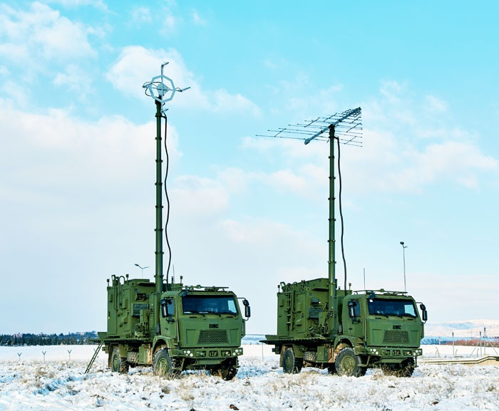
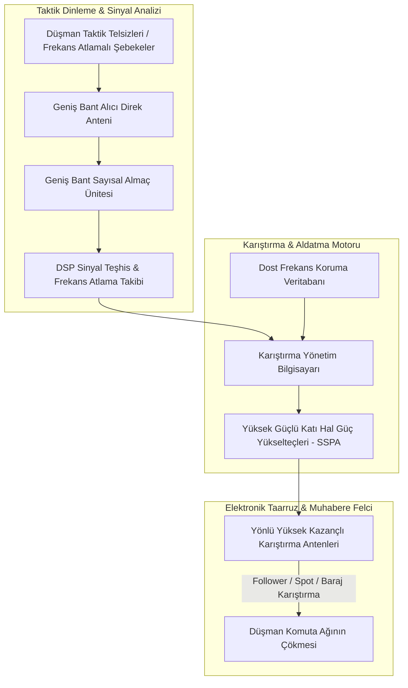

# ⚡ Proje: ASELSAN MİLKAR (Muhabere Elektronik Taarruz Ailesi)

  
  
  
  

  

## 🛡️ Stratejik Tanım & Doktriner Öncelik
**ASELSAN MİLKAR** ailesi (MİLKAR-3A3 V/UHF Elektronik Taarruz, MİLKAR-4A2 HF Elektronik Taarruz, MİLKAR-5S vb.), modern harp sahasında düşman unsurlarının taktik ve stratejik muhabere şebekelerini, komuta kontrol kanallarını, hava-yer haberleşmesini ve hücresel telsiz ağlarını felç etmek üzere geliştirilmiş yüksek güçlü mobil elektronik harp sistemleri bütünüdür. Taktik tekerlekli askeri şasiler üzerine kurulu sistemler; düşman telsiz yayınlarını saniyeler içinde tespit edip dinler, frekans atlamalı karmaşık muhabereyi anında çözümler ve yüksek RF çıkış gücüyle düşman iletişimini susturarak sahada koordinasyonu tamamen koparır.

## 📊 Kapsamlı Teknik Özellikler

| Parametre | Değer / Açıklama |
| :--- | :--- |
| **Sistem Ailesi** | MİLKAR-3A3 (V/UHF Bandı), MİLKAR-4A2 (HF Bandı), MİLKAR-5S vb. |
| **Frekans Kapsamı** | HF (3 - 30 MHz) ve V/UHF (30 - 3.000 MHz) Geniş Spektral Bant Kapsaması |
| **Karıştırma Gücü** | Kilowattlar düzeyinde ayarlanabilir yüksek RF çıkış gücü |
| **Karıştırma Teknikleri** | Takipçi (Follower Jamming), Nokta (Spot), Süpürmeli (Sweep), Sayısal Yanıltma/Aldatma |
| **Frekans Atlama Takibi** | Saniyede binlerce kez frekans değiştiren taktik telsizleri eşzamanlı karıştırabilme |
| **Taşıyıcı Platform** | 4x4 / 6x6 / 8x8 Taktik Tekerlekli Askeri Şasi (Yüksek arazi hareket kabiliyeti) |
| **Anten Direği** | Otomatik hidrolik/pnömatik yükseltilebilir mast anten sistemi |
| **Güç Kaynağı** | Araç üstü entegre bağımsız dizel jeneratör ve kesintisiz akü grubu |
| **Operasyon Modu** | Otonom, Yarı Otonom ve Çoklu MİLKAR Sistemleri Arasında Dağıtık Koordinasyon |

## 🧩 Alt Sistemler ve Aviyonik/Elektronik Entegrasyonu
- **Geniş Bantlı Sayısal Alıcı Mimarisi:** Düşmanın tüm telsiz spektrumunu anlık tarayan FFT tabanlı işlemciler.
- **Follower Jamming İşlemcisi:** Hedef telsizin bir sonraki atlayacağı frekansı mikrosaniyeler içinde kestirip enerjiyi tam o kanala yönlendiren modül.
- **Dost Frekans Koruma Filtreleri:** Kendi birliklerimizin telsiz haberleşmesini kesinlikle etkilemeyen programlanabilir çentik (notch) filtreleme mimarisi.
- **Sayısal Ses ve Veri Demodülatörü:** Düşman haberleşmesini deşifre edip dinleyen, ses kaydı alan ve istihbarat üreten yazılımlar.
- **Milli Taktik Komuta Arayüzü:** Kara Kuvvetleri Komutanlığı muhabere ve elektronik harp merkezleriyle tam veri bağı entegrasyonu.

## 🎯 Görev Profili, Muharebe Senaryoları & Operasyonel Yetenek
- **Taktik Muhabere Felci:** Düşman tabur ve tugay komuta kademesinin cephedeki birlikleriyle irtibatını keserek paniğe sürükleme.
- **Hava-Yer İletişiminin Kesilmesi:** Düşman savaş uçakları ve helikopterlerinin ileri hava kontrolörleri (FAC) ile temasını engelleyerek yakın hava desteğini engelleme.
- **Sınır Ötesi Operasyonlar:** Fırat Kalkanı, Zeytin Dalı, Barış Pınarı ve Pençe harekatlarında terör örgütünün telsiz koordinasyonunu sıfırlama.
- **Yanıltıcı Yayın (Spoofing):** Düşman telsiz frekansına girerek sahte emir ve sahte koordinat yayınlarıyla düşman birliklerini pusuya çekme.

## 🚀 TRL Seviyesi ve Gelişim Yol Haritası
- **Mevcut Seviye: TRL 9 (Seri Üretimde / Muharebe Alanında Kanıtlanmış - Combat Proven)**
- [x] MİLKAR serisi sistemlerin tasarımı, fabrika ve saha kabul testleri.
- [x] Türk Kara Kuvvetleri ve Jandarma Genel Komutanlığı'na çoklu sistem teslimatları.
- [x] Tüm sınır içi ve sınır ötesi askeri harekatlarda 7/24 kesintisiz muharebe kullanımı.
- [x] Yeni nesil yazılım tanımlı ve bilişsel (cognitive) elektronik taarruz versiyonlarının geliştirilmesi.
- [ ] Dost ve müttefik ülke ordularına ihracat teslimatları.

---
[⬅️ Üst Dizine](../README.md) | [🏛️ Dominion Hub](../../README.md) | [🏠 Ana Sayfa](../../../README.md)
