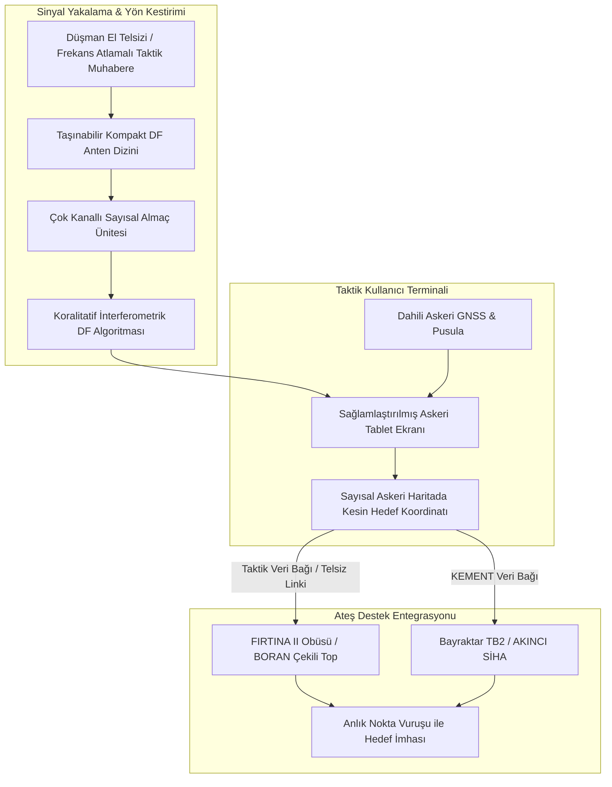

# 📻 Proje: ASELSAN PUHU (Taşınabilir Dinleme ve Kestirim Sistemi)

  
  
  
  

  

## 🛡️ Stratejik Tanım & Doktriner Öncelik
**ASELSAN PUHU**, taktik sahada en ön hatta görev yapan özel kuvvetler, komando timleri, hudut birlikleri ve istihbarat unsurları için geliştirilmiş, tek bir askerin sırt çantasında taşıyabildiği (Manpack) ya da hafif taktik araç üzerine dakikalar içinde monte edilebilen Taşınabilir V/UHF Taktik Dinleme ve Yön Kestirim Sistemidir (COMINT / Direction Finding - DF). Düşmanın telsiz konuşmalarını, frekans atlamalı yayınlarını ve el telsizlerini geniş bantta anında yakalayan PUHU; interferometrik yön bulma algoritmalarıyla konuşmanın yapıldığı coğrafi koordinatı harita üzerinde milimetrik hassasiyetle çıkararak ateş destek vasıtalarına (topçu bataryaları, SİHA'lar) anlık hedef koordinatı aktarır.

## 📊 Kapsamlı Teknik Özellikler

| Parametre | Değer / Açıklama |
| :--- | :--- |
| **Sistem Tipi** | Taşınabilir Muhabere Elektronik İstihbarat ve Yön Kestirim Sistemi (COMINT/DF) |
| **Frekans Kapsamı** | V/UHF Bantları (20 MHz - 3.000 MHz Geniş Kapsama) |
| **Yön Kestirim Doğruluğu** | < 2° RMS (Gelişmiş koralitatif interferometrik algoritmalar ile) |
| **Konfigürasyon** | Taşınabilir Sırt Çantalı (Manpack), Sabit Mevzi veya Hafif Taktik Araç Üstü |
| **Kurulum Süresi** | Tek personel tarafından 3 dakikadan kısa sürede operasyona hazır hale getirme |
| **Batarya Ömrü** | Dahili askeri lityum iyon bataryalar ile 12+ saat kesintisiz görev süresi |
| **Konumlandırma** | Entegre askeri GPS/GNSS ve dahili elektronik pusula |
| **Harita Desteği** | Sayısal taktik askeri vektörel ve uydu haritası katmanları |
| **Ağırlık** | Sınıfının en hafif manpack çözümü (< 15 kg tam sırt çantası konfigürasyonu) |
| **Çalışma Sıcaklığı** | -30°C ile +50°C (MIL-STD-810G çevre koşullarına tam uyum) |

## 🧩 Alt Sistemler ve Aviyonik/Elektronik Entegrasyonu
- **Kompakt Çok Elemanlı DF Anteni:** Hafif kompozit direk üzerine tek hareketle kilitlenen hassas anten yapısı.
- **Geniş Bant Çok Kanallı Sayısal Almaç:** Frekans atlamalı (frequency hopping) telsiz yayınlarını dahi kaçırmayan paralel dinleme mimarisi.
- **Sağlamlaştırılmış Taktik Tablet:** Güneş ışığı altında okunabilir, su geçirmez, dokunmatik askeri kullanıcı arayüzü.
- **Otomatik Ses Kayıt ve Sinyal Analizi:** Telsiz konuşmalarını otomatik kaydedip ses frekans analizini yapan sayısal işlemci.
- **Ateş İdare Sistemi Arayüzü:** Belirlenen koordinatları tek dokunuşla milli topçu atış idare yazılımlarına iletme kabiliyeti.

## 🎯 Görev Profili, Muharebe Senaryoları & Operasyonel Yetenek
- **Taktik İstihbarat ve Keşif:** Düşman unsurlarının dağlık ve ormanlık arazideki gizli mevzilerinden yaptığı telsiz yayınlarını yakalama.
- **Sensörden Silaha Anlık Angajman:** Tespit edilen telsiz koordinatını 30 saniye içinde SİHA'ya veya en yakın topçu birliğine aktararak düşmanı hareket edemeden imha etme.
- **Sınır ve Karakol Güvenliği:** Sınır hattına yaklaşan sızma gruplarının kendi aralarındaki telsiz konuşmalarını erken aşamada ikaz etme.
- **Muharebe Başarısı:** TSK ve Güvenlik Güçlerinin tüm terörle mücadele ve sınır ötesi harekatlarında yüzlerce hedef tespiti gerçekleştirmiştir.

## 🚀 TRL Seviyesi ve Gelişim Yol Haritası
- **Mevcut Seviye: TRL 9 (Seri Üretimde / Muharebe Alanında Yaygın Kullanımda - Combat Proven)**
- [x] Manpack ve araç üstü prototip tasarımları ve zorlu saha kalifikasyonları.
- [x] TSK, Jandarma Genel Komutanlığı ve Emniyet Genel Müdürlüğü'ne yüzlerce adet teslimat.
- [x] Sınır içi ve sınır ötesi operasyonlarda aktif ve kesintisiz saha kullanımı.
- [x] Yeni nesil PUHU-2 taşınabilir sisteminin geliştirilmesi ve sahaya sürülmesi.
- [ ] Yapay zeka tabanlı konuşmacı tanıma ve ses analizi modüllerinin entegrasyonu.

---
[⬅️ Üst Dizine](../README.md) | [🏛️ Dominion Hub](../../README.md) | [🏠 Ana Sayfa](../../../README.md)
