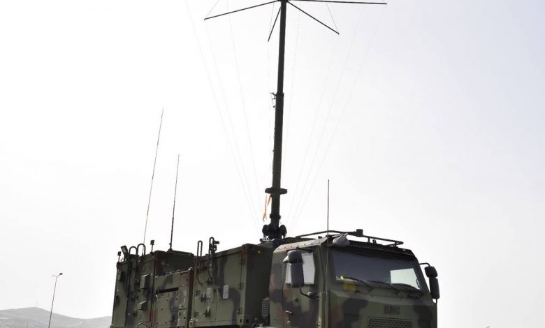
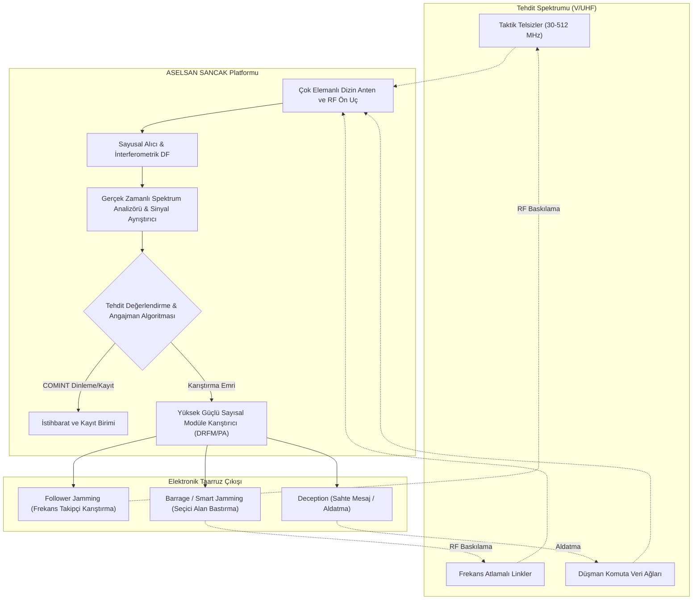

# 📻 Proje: ASELSAN SANCAK (Yeni Nesil Muhabere Elektronik Taarruz Sistemi)

  

  

> **Geliştirici:** ASELSAN  
> **Sınıf:** Yeni Nesil V/UHF Taktik Muhabere Elektronik Taarruz Sistemi (REDET II Fazı)  
> **Stratejik Önem:** Yüksek hareket kabiliyetine sahip taktik birliklerin düşman telsiz şebekelerini karıştırma, sahte emir yayma ve muhabere istihbaratı toplama kabiliyeti.

---

## 🛡️ Stratejik Tanım & Doktriner Öncelik
ASELSAN SANCAK, modern müşterek harekat sahasında düşman kuvvetlerinin komuta kontrol omurgasını oluşturan V/UHF taktik muhabere altyapısını felç etmek üzere geliştirilmiş milli yeni nesil Elektronik Taarruz (ET / Jamming) ve Elektronik Destek (ED / COMINT) platformudur. REDET-II programı kapsamında üretilen SANCAK; taktik tekerlekli zırhlı araç üzerine entegre edilmiş yüksek hareket kabiliyetiyle ön hat birliklerine refakat eder. Düşmanın frekans atlamalı (frequency hopping), kriptolu ve direkt dizi yayılı spektrum (DSSS) mimarisine sahip taktik telsiz şebekelerini mikrosaniyeler mertebesinde tespit edip yönünü kestirir (DF - Direction Finding); ardından dar ve geniş bant reaktif karıştırma teknikleriyle düşman haberleşmesini tamamen kesintiye uğratır veya sahte emir enjeksiyonuyla komuta zaafiyeti oluşturur.

---

## 📊 Kapsamlı Teknik Özellikler

| Parametre | Değer / Detay |
| :--- | :--- |
| **Çalışma Frekans Aralığı** | 30 MHz - 3000 MHz (VHF / UHF / Düşük SHF) |
| **Yön Kestirim Hassasiyeti** | < 1° - 2° RMS (Sayısal Korelasyonlu İnterferometre) |
| **Karıştırma Teknikleri** | Takipçi Karıştırma (Follower Jamming), Sayısal Modüle Gürültü, Nokta (Spot) & Süpürmeli (Sweep) Karıştırma, Sahte Mesaj Yayma |
| **Anlık Bant Genişliği** | Çok kanallı yüksek hızlı anlık spektrum tarama (Real-Time Wideband Processing) |
| **RF Çıkış Gücü** | Çoklu Kilowatt (kW) seviyesinde katı hal (SSPA) güç yükselteç dizini |
| **Taşıyıcı Platform** | 8x8 / 6x6 Taktik Tekerlekli Yüksek Zırh Korumalı Şasi (KBRN filtreli kabin) |
| **Reaksiyon Zamanı** | Milisaniye mertebesinde atlama hızındaki frekanslara dinamik kilitlenme |
| **Konuşlanma / Terk Süresi** | Hidrolik mast ve stabilizasyon ayakları ile < 5 dakika |

---

## 🧩 Alt Sistemler ve Aviyonik/Elektronik Entegrasyonu
- **Sayısal RF Hafıza (DRFM) ve Sayısal Modülatör:** Düşman telsiz modülasyonunu anında kopyalayarak aynı dalga formunda hedef odaklı enerji yönlendirme.
- **Yüksek Hızlı İnterferometrik Anten Grubu:** Araç tavanında yükseltilebilir hidrolik mast üzerine konuşlu, 360° azimut kapsayan yön kestirim ve taarruz anten dizilimi.
- **Taktik Komuta ve C4I Entegrasyonu:** TSK Taktik Veri Ağı (TAYNET / KEMENT) ve HAKİM Hava/Kara Komuta Kontrol Sistemleri ile tam entegrasyon; müşterek elektronik harp koordinasyonu.
- **Elektronik Harp Destek (ED / COMINT) Kayıt Paketi:** Dinlenen telsiz konuşmalarını otomatik yazıya dönüştürme ve kriptolu sinyal kayıt kabiliyeti.
- **KORAL ve MİLKAR Birlikteliği:** Radar karıştırma yapan KORAL ve haberleşme karıştırma yapan MİLKAR/SANCAK sistemlerinin tek bir EH harekat merkezinden koordine edilmesi.

---

## 🎯 Görev Profili, Muharebe Senaryoları & Mühimmat Yelpazesi
- **Sınır Ötesi Harekât Bastırması:** Düşman ileri hat karakolları ve komuta merkezlerinin taktik telsiz irtibatını felç ederek karşı saldırı koordinasyonunu engelleme.
- **Konvoy Refakati ve Alan Koruması:** Taktik zırhlı birlik intikallerinde geniş alan telsiz körleme şemsiyesi oluşturarak pusu koordinasyonunu kırma.
- **Sahte Emir ve Taktik Aldatma:** Düşman birliklerinin komuta şebekelerine sızıp sahte çekilme veya yanlış koordinat anonsları basarak muharebe düzenini bozma.
- **Hava Savunma Bataryası Muhabere İzolasyonu:** Düşman hava savunma radarları ile batarya kontrol merkezleri arasındaki telsiz/veri linki hatlarını kesintiye uğratma.

---

## 🚀 TRL Seviyesi ve Gelişim Yol Haritası
- **Mevcut Seviye:** **TRL 9 (Saha Kanıtlanmış Seri Üretim)**
- [x] REDET-II Fazı Kapsamında Tasarım, Prototipleme ve Kalifikasyon
- [x] TSK Envanterine Giriş ve Operasyonel Muharebe Testleri (2022+)
- [x] Sınır Güvenliği ve Muharebe Sahası Görevlerinde Fiili İcraat
- [ ] Yapay Zeka Destekli Bilişsel Elektronik Harp (Cognitive EW) Algoritma Güncellemesi
- [ ] Otonom İHA/SİHA Destekli İleri İletişim Karıştırma Röleleri ile Ağ Bütünlüğü

---

[⬅️ Üst Dizine](../README.md) | [🏛️ Dominion Hub](../../README.md) | [🏠 Ana Sayfa](../../../README.md)
