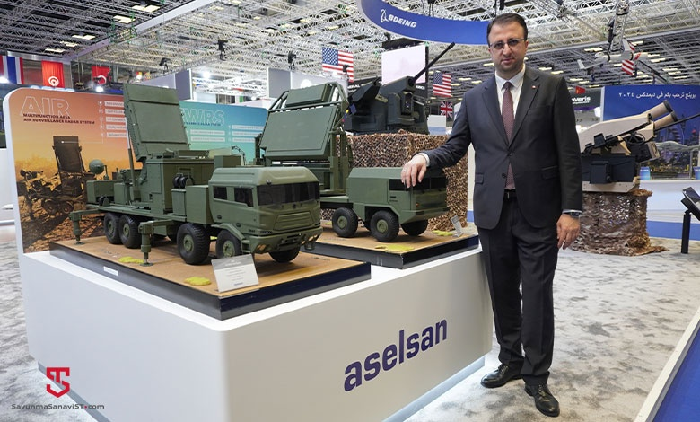
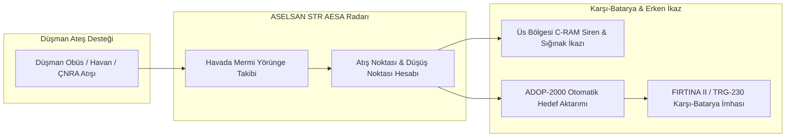

# 📡 Proje: ASELSAN STR-700G (Hava Savunma ve Topçu Tespit Radar Sistemleri)

  

> **Geliştirici:** ASELSAN (Radar ve Elektronik Harp Sistemleri - REHİS Sektör Başkanlığı)  
> **Sınıf:** Yeni Nesil GaN AESA Silah Tespit Radarı (STR) ve Alçak İrtifa Hava Gözetleme Radarı  
> **Stratejik Önem:** Düşman topçu, havan ve çok namlulu roketatar (ÇNRA) mermilerini havadayken yakalayıp atış yapılan mevziyi saniyeler içinde hesaplayarak FIRTINA II obüslerine karşı-batarya atış koordinatı aktaran taktik radar kalkanı.

---

## 🛡️ Stratejik Tanım & Doktriner Öncelik

**ASELSAN STR (Silah Tespit Radarı)** ailesi, muharebe sahasında dost birliklerin üzerine ateşlenen havan, top ve roket mühimmatlarını henüz havada uçuş halindeyken tespit eden, balistik yörüngesini geriye doğru hesaplayarak **düşman silahının ateşlendiği noktayı (Origin Point)** ve **merminin düşeceği noktayı (Impact Point)** saniyeler içinde belirleyen aktif faz dizinli (AESA) radar sistemidir.

Elde edilen düşman mevzi koordinatları, **ADOP-2000** (Ateş Destek Otomasyon Sistemi) üzerinden anında dost **FIRTINA II** obüslerine ve **ÇNRA** bataryalarına aktarılır; böylece düşman topçusu henüz mevzi değiştiremeden karşı-batarya ateşiyle imha edilir. Aynı zamanda merminin düşeceği üs bölgesindeki personele erken ikaz (C-RAM uyarısı) vererek can kaybını önler.

---

## 📊 Kapsamlı Teknik Özellikler

| Parametre | Değer / Özellik | Açıklama |
| :--- | :--- | :--- |
| **Radar Tipi** | S-Bant GaN Aktif Faz Dizinli (AESA) Silah Tespit Radarı | Elektronik taramalı yüksek hızlı hüzme yönlendirme |
| **Tespit Menzili** | 100+ Kilometre (Topçu ve Roket Mühimmatı) | Havan, Obüs ve ÇNRA balistik yörünge takibi |
| **Kapsama Açısı** | 90° Sektör / 360° Döner Mod Operasyonu | Elektronik ve mekanik hibrit tarama |
| **Çalışma Modları** | Düşman Silah Tespiti + Dost Topçu Tanzimi | Dost mermilerin hedefe düşüş sapmasını düzeltme |
| **Ağ Entegrasyonu** | ADOP-2000, HAKİM ve Çelik Kubbe C-RAM Ağı | Otomatik karşı-batarya ateş tahsisi |
| **Taşıyıcı Platform** | 6x6 / 8x8 Taktik Tekerlekli Araç (10 Dakikada Kurulum) | Yüksek hareket kabiliyeti ve "At-ve-Kaç" bekası |

---

## 🧩 Alt Sistemler ve Aviyonik / Elektronik Entegrasyonu

- **Dost Topçu Atış Tanzimi:** Dost obüslerin attığı mermilerin hedefin ne kadar sağına/soluna düştüğünü havada ölçerek ikinci atışın tam hedefe oturmasını sağlar.
- **Yüksek Elektronik Harp Direnci (ECCM):** Yan kulak bastırma ve frekans çevikliği sayesinde düşman radar karıştırıcılarından etkilenmeden görev yapar.

---

## 🎯 Görev Profili, Muharebe Senaryoları & Mühimmat Yelpazesi

1. **Karşı-Batarya Harbi (Counter-Battery):** Sınır ötesi harekatlarda dost üs bölgelerine roket veya havan atan terör/düşman mevzilerinin saniyeler içinde tespit edilip ateş altına alınması.
2. **Üs Bölgesi Erken İkaz (C-RAM):** Mermi düşmeden 15-30 saniye önce alarm vererek personelin koruganlara geçmesini ve KORKUT/GÜRZ sistemlerinin o sektöre yönelmesini sağlama.

---

## 🚀 TRL Seviyesi ve Gelişim Yol Haritası

- **Mevcut Durum:** `TRL 9` (Türk Silahlı Kuvvetleri envanterinde sınır hattı ve sınır ötesi harekat bölgelerinde aktif olarak görev yapmaktadır).
- [x] AESA anten mimarisi ve balistik kestirim algoritmalarının doğrulanması
- [x] TSK Kara Kuvvetleri Komutanlığı'na seri teslimatlar ve muharebe sahası kanıtı
- [ ] Hava hedefleri ve mini İHA tespit modlarının birleştirildiği Çok Maksatlı Radar (ÇMR) evrimi

---

## 🔗 İç Dizin Navigasyonu

[⬅️ Üst Dizine (ASELSAN)](../README.md) | [🏛️ Dominion Hub (DOMINION_ELECTRONICS)](../../README.md) | [🏠 Ana Sayfa](../../../README.md)
