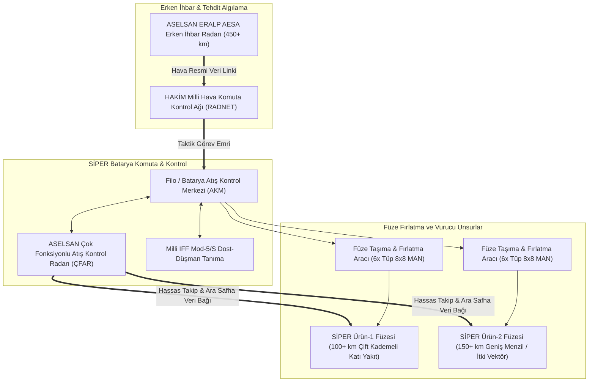

# 🛡️ Proje: ASELSAN & ROKETSAN SİPER (Uzun Menzilli Bölge Hava Savunma Sistemi)

  

> **Üretici Konsorsiyumu:** ASELSAN (Sensör, Haberleşme, C2) & ROKETSAN (Füze, Fırlatma Sistemi) & TÜBİTAK SAGE (Harp Başlığı, Arayıcı Başlık)  
> **Sınıf:** Uzun Menzilli Bölge Hava ve Füze Savunma Sistemi (HİSAR-U Fazı)  
> **Stratejik Önem:** Türkiye'nin "Çelik Kubbe" hava savunma mimarisinin stratejik üst katmanı; stratejik tesisleri, metropolleri ve ordu harekat merkezlerini standoff silahlara ve balistik füzelere karşı korur.

---

## 🛡️ Stratejik Tanım & Doktriner Öncelik
SİPER, Türkiye'nin katmanlı milli hava savunma doktrini olan **Çelik Kubbe**'nin en üst ve stratejik kademesini teşkil eden, batarya ve tabur seviyesinde teşkilatlanan bağımsız uzun menzilli bölge hava savunma sistemidir. S-400 ve Patriot PAC-3 platformlarının yerli muadili olan SİPER; düşman savaş uçakları, seyir füzeleri, havadan karaya atılan standoff mühimmatlar ve balistik füzeleri 100 ila 150+ km menzilde, 20 ila 30+ km irtifada imha etmek üzere dizayn edilmiştir. Çok fonksiyonlu ASELSAN ERALP Erken İhbar Radarı ve ASELSAN Çok Fonksiyonlu Atış Kontrol Radarı ile desteklenen SİPER bataryası, eşzamanlı onlarca hava hedefini takip edip dikey atış kabiliyetli füze fırlatma araçlarından salvo ateş açabilir.

---

## 📊 Kapsamlı Teknik Özellikler

| Parametre | SİPER Ürün-1 | SİPER Ürün-2 |
| :--- | :--- | :--- |
| **Önleme Menzili** | 100+ km | 150+ km |
| **Önleme İrtifası** | 100 m - 20.000+ m | 100 m - 30.000+ m |
| **Güdüm Mimarisi** | ANS / KKS + Çift Yönlü RF Veri Bağı + Aktif Radar Arayıcı (RF Seeker) | ANS / KKS + Çok Bantlı Veri Bağı + Gelişmiş RF Arayıcı & İtki Vektör Kontrolü |
| **Hedef Seti** | Avcı/Bombardıman Uçakları, Seyir Füzeleri, Havadan Karaya Füzeler, İHA | Genişletilmiş Taktik Balistik Füzeler, Seyir Füzeleri, Hipersonik/Standoff Tehditler |
| **Fırlatma Modu** | Dikey Fırlatma (360° Kapsama Açısı) | Dikey Fırlatma (360° Kapsama Açısı) |
| **Batarya Bileşeni** | 1x AKM, 1x Atış Kontrol Radarı, 1x Haberleşme İstasyonu, 4-6x Fırlatma Aracı | 1x Üst Komuta Aracı, Erken İhbar Radarı Entegrasyonu, Lojistik İkmal Araçları |
| **Hedef Takip Kapasitesi**| Tek bir bataryada eşzamanlı 100+ hava izi, çoklu füze güdümü | Eşzamanlı çoklu salvo angajmanı ve ağ merkezli bataryalar arası atış transferi |

---

## 🧩 Alt Sistemler ve Aviyonik/Elektronik Entegrasyonu
- **ERALP ve ÇFAR Entegrasyonu:** ASELSAN GaN tabanlı AESA radarlarıyla kilometrelerce öteden çok düşük radar kesit alanına (RCS) sahip hedeflerin milimetrik takibi.
- **KEMENT ve Sayısal Taktik Veri Bağı:** Uçuş sırasındaki füzeye hedef güncelleme komutları gönderme ve füzeler arası koordinasyon sağlama.
- **Çelik Kubbe & HAKİM C4I Entegrasyonu:** Tüm katmanlardaki hava savunma radarları ve silah sistemleri (KORKUT, HİSAR, GÖKSUR) ile müşterek tehdit kütüphanesi ve otomatik önceliklendirme paylaşımı.
- **Milli Arayıcı Başlık Teknolojisi:** TÜBİTAK SAGE tarafından geliştirilen Ku/Ka bant milimetrik aktif radar arayıcı başlık ile son yaklaşma (terminal safha) vuruş hassasiyeti (Hit-to-Kill / Yakın Patlama).

---

## 🎯 Görev Profili, Muharebe Senaryoları & Mühimmat Yelpazesi
- **Stratejik Tesis ve Metropol Koruması:** Başkent, nükleer santraller, barajlar ve askeri üslerin düşman seyir füzesi ve uçak taarruzlarına karşı koruma çemberine alınması.
- **Düşman Standoff Taarruzlarını Engelleme:** Düşman havadan karaya mühimmat bırakma noktalarına ulaşmadan düşman avcı/bombardıman uçaklarının angajman menzili dışında imhası.
- **SİPER Ürün Serisi:**
  - **SİPER Ürün-1:** İlk teslimatları başlayan, çift kademeli fırlatıcı roket motoruna sahip temel uzun menzil önleyicisi.
  - **SİPER Ürün-2:** Daha yüksek itki, aerodinamik kontrol kanatçıkları ve yüksek irtifa balistik önleme kapasitesine sahip genişletilmiş füze.
  - **SİPER Ürün-3:** Gelecek nesil hipersonik ve terminal faz anti-balistik savunma konsepti.

---

## 🚀 TRL Seviyesi ve Gelişim Yol Haritası
- **Mevcut Seviye:** **TRL 8 (Sistem Tamamlandı ve Kalifiye Edildi / Seri Üretim Başlangıcı)**
- [x] Sistem Seviyesi Tasarım ve Alt Sistem Kalifikasyonları (2020-2022)
- [x] SİPER Ürün-1 ile 100+ km Menzilde Yüksek Hızlı Hedef Uçak İmhası (2023)
- [x] SİPER Ürün-2 İlk Test Atışı Başarısı (2023-2024)
- [x] Seri Üretim Sözleşmesi İmzalanması ve Hava Kuvvetleri Envanterine Kabul Testleri
- [ ] Çelik Kubbe Tam Müşterek Konuşlandırması ve Ürün-3 Fazına Geçiş

---

[⬅️ Üst Dizine](../README.md) | [🏛️ Dominion Hub](../../README.md) | [🏠 Ana Sayfa](../../../README.md)
