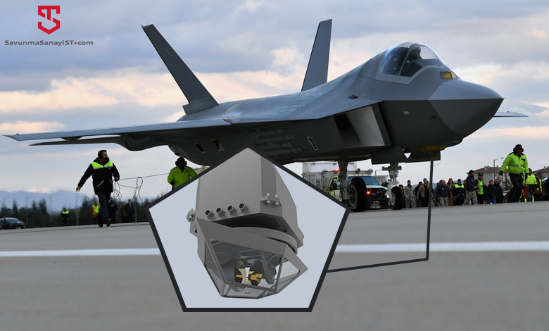
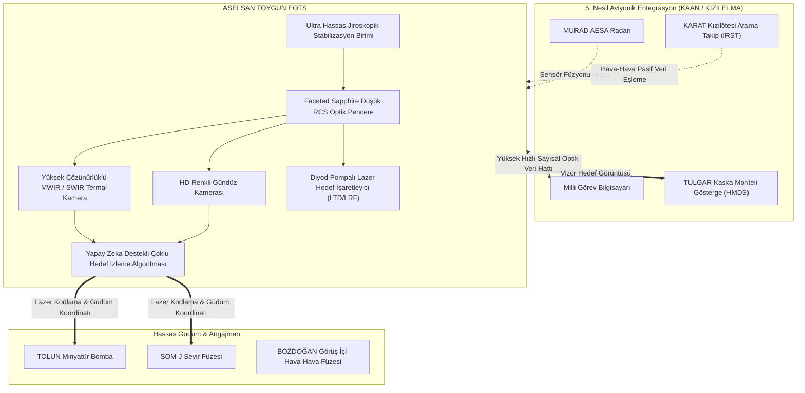

# 🦅 Proje: ASELSAN TOYGUN (5. Nesil Elektro-Optik Hedefleme Sistemi - EOTS)

  

  

> **Geliştirici:** ASELSAN  
> **Sınıf:** 5. Nesil Düşük Görünürlüklü Entegre Elektro-Optik Hedefleme Sistemi (EOTS)  
> **Stratejik Önem:** KAAN Milli Muharip Uçak, KIZILELMA ve insansız jet muhariplerinin gövde içine gömülü, radar izini bozmayan ve pasif olarak yüzlerce kilometre ötedeki hava ve kara hedeflerini lazerle işaretleyen optik kalbi.

---

## 🛡️ Stratejik Tanım & Doktriner Öncelik
ASELSAN TOYGUN, 5. nesil stealth (düşük radar kesit alanına sahip) savaş uçaklarının harici pod taşımaksızın hava-hava ve hava-yer hedeflerini tespit, teşhis, otomatik takip ve lazerle işaretleme yapabilmesi için tasarlanmış gövde içi entegre Elektro-Optik Hedefleme Sistemidir (EOTS). F-35'in Lockheed Martin EOTS sistemine doğrudan yerli ve bağımsız bir alternatif olan TOYGUN; safir yüzeyli çok açılı optik penceresi sayesinde uçağın radar kesit alanını (RCS) artırmadan yüksek çözünürlüklü termal ve gündüz görüntüleme sağlar. Radar suskunluğu (EMCON) durumunda bile uçağın pasif kalarak düşman unsurlarını fark edilmeden vurmasına olanak tanır.

---

## 📊 Kapsamlı Teknik Özellikler

| Parametre | Değer / Detay |
| :--- | :--- |
| **Konfigürasyon** | Gövde Altı Gömülü (Conformal / Internal EOTS Mimarisi) |
| **Optik Pencere** | Çok Yüzeyli Safir Cam (Düşük RCS ve Aerodinamik Sürtünme Koruması) |
| **Kızılötesi Sensör** | 3. Nesil Megapiksel MWIR (Orta Dalga Kızılötesi) ve SWIR Sensör |
| **Gündüz Görüntüleme** | Geniş Dinamik Aralıklı (HDR) Yüksek Çözünürlüklü Renkli TV |
| **Lazer Birimleri** | Göz Güvenli Lazer Mesafe Ölçer (ELRF), 1064 nm NATO Uyumlu Lazer İşaretleyici ve Aydınlatıcı |
| **Stabilizasyon Hassasiyeti** | < 5 mikro-radyan seviyesinde ultra hassas çok eksenli yalpa sönümleme |
| **Görüş Açıları** | Sürekli 360° azimut tarama ve derin irtifa elevasyon kapsaması |
| **Ağırlık & Hacim** | Hafifletilmiş titanyum/berilyum alaşım gövde, gövde içi kompakt hacim |

---

## 🧩 Alt Sistemler ve Aviyonik/Elektronik Entegrasyonu
- **Sensör Füzyon İşlemcisi:** MURAD AESA radarı, KARAT IRST ve elektronik harp süiti ile entegre çalışarak uçağın taktik ekranına tek ve net bir hedef resmi aktarır.
- **TULGAR Kask Uyumu:** TOYGUN kamerasından alınan kızılötesi görüntü, pilotun kask vizörüne gerçek zamanlı bindirilerek gece şartlarında dahi pilotun uçağın altını saydam biçimde görmesini sağlar.
- **Dahili Lazer Aydınlatma & Nokta Takibi (Spot Tracker):** Dost unsurların (JTAC / Taktik İHA) yer işaretlediği lazer spotunu anında algılayıp silah sistemine hedef gösterir.
- **Milli Mühimmat Entegrasyonu:** SOM-J, TOLUN, TEBER, MAM serisi ve lazer güdümlü mühimmatların terminal safha hedefe kilitlenmesi için milimetrik koordinat üretir.

---

## 🎯 Görev Profili, Muharebe Senaryoları & Mühimmat Yelpazesi
- **Derin Darbe ve Stealth Hava-Yer Görevi:** Düşman radar sahasına görünmeden sızıp hedef yerleşkesini, sığınakları ve kritik komuta merkezlerini pasif optik ile işaretleyip imha etme.
- **Radar Suskunluğunda (Passive Air-to-Air) Av:** AESA radarını açmadan düşman uçaklarının motor ısısını ve aerodinamik sürtünme sıcaklığını tespit edip hava-hava füzesi fırlatma.
- **Deniz Yüzey Hedeflerine Taarruz:** Deniz araçlarının silüetini optik olarak tanıma ve kıyı savunma füzelerini doğrudan köprüüstü veya mühimmat deposu gibi zayıf noktalara yönlendirme.

---

## 🚀 TRL Seviyesi ve Gelişim Yol Haritası
- **Mevcut Seviye:** **TRL 7/8 (Prototip Laboratuvar ve Platform Kalifikasyon Testleri Aşamasında)**
- [x] Kritik Tasarım Fazı (CDR) ve Optomekanik Doğrulama
- [x] Zemin ve Aviyonik Sistem Entegrasyon Laboratuvar (SIL) Testleri
- [x] Lazer ve FLIR Sensör Kalifikasyonu
- [ ] KAAN Prototip Uçakları Üzerinde Uçuş Testleri
- [ ] Seri Üretim ve KIZILELMA Blok-3 Konfigürasyonuna Entegrasyon

---

[⬅️ Üst Dizine](../README.md) | [🏛️ Dominion Hub](../../README.md) | [🏠 Ana Sayfa](../../../README.md)
