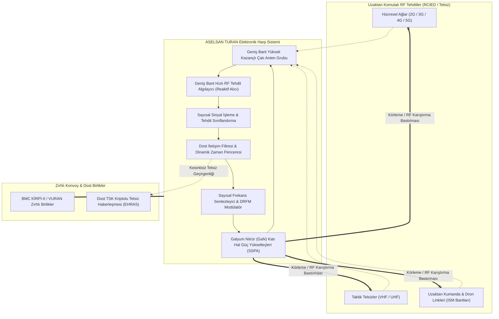

# 🛡️ Proje: ASELSAN TURAN (Taktik Elektronik Harp ve Konvoy Koruma Sistemi)

[

  

](https://www.aselsan.com)

  

> **Geliştirici:** ASELSAN  
> **Sınıf:** Zırhlı Konvoy ve Taktik Birlik Koruma / Reaktif Elektronik Karıştırma (RCIED Jammer) Sistemi  
> **Stratejik Önem:** Askeri konvoyları, üst düzey VIP heyetleri ve sınır birliklerini uzaktan komutalı el yapımı patlayıcılara (RCIED), düşman telsizlerine, dron tehditlerine ve hücresel ağ tetikleyicilerine karşı tam koruyan reaktif elektronik kalkan.

---

## 🛡️ Stratejik Tanım & Doktriner Öncelik
ASELSAN TURAN, asimetrik tehdit ortamlarında ve yüksek riskli intikal hatlarında birliklerin bekasını sağlamak amacıyla tasarlanmış, çok bantlı ve yüksek güçlü bir taktik elektronik harp koruma sistemidir. Terör unsurlarının el yapımı patlayıcıları (EYP) uzaktan ateşlemek için kullandığı tüm RF spektrumunu (HF/VHF/UHF telsizler, hücresel GSM/3G/4G/5G şebekeleri, Wi-Fi, ISM bantları, uydu telefonları ve uzaktan kumanda frekansları) milisaniyeler mertebesinde dinleyip bastırır. Reaktif (akıllı) karıştırma mimarisi sayesinde dost telsiz haberleşmesine zarar vermeden ("iletişim pencereleri" açarak) yalnızca tehdit sinyallerine odaklanır ve aracın akü/jeneratör gücünü optimum verimle kullanır.

---

## 📊 Kapsamlı Teknik Özellikler

| Parametre | Değer / Detay |
| :--- | :--- |
| **Kapsama Frekans Bandı** | 20 MHz - 6.000 MHz (HF, VHF, UHF, L/S/C Bantları, GSM, ISM, GNSS) |
| **Çalışma Modları** | Reaktif (Akıllı Dinle-Karıştır), Aktif (Geniş Alan Süpürme), Hibrit Mod |
| **Reaksiyon Zamanı** | Mikrosaniyeler seviyesinde sinyal algılama ve anında karşı RF yayını |
| **Çıkış Gücü** | Çoklu RF güç modülleri ile yüzlerce Watt RF çıkışı (Galyum Nitrür GaN teknolojisi) |
| **Haberleşme Uyumluluğu** | Dost telsizler için "Communication Windowing" (Zaman/Frekans Boşluğu) yeteneği |
| **Güç Beslemesi** | 24-28 VDC araç şebekesi + akıllı lityum yedek güç bataryası |
| **Çalışma Sıcaklığı** | -40°C ila +55°C (MIL-STD-810G Askeri Çevre Koşulları) |
| **Platform Uyumluluğu** | BMC KİRPİ, KİRPİ-II, VURAN, OTOKAR COBRA II, FNSS PARS, VIP Zırhlı Araçlar |

---

## 🧩 Alt Sistemler ve Aviyonik/Elektronik Entegrasyonu
- **Akıllı Reaktif Dinleme Birimi:** Spektrumu sürekli izleyerek ortamda aktif bir tetikleme sinyali yokken gereksiz RF ışıması yapmaz; araç termal ve RF izini düşük tutar.
- **Kriptolu Araç İçi Kontrol Paneli:** Operatör ve araç sürücüsünün tek dokunuşla karıştırma profillerini, koruma yarıçapını ve görev modlarını değiştirmesini sağlayan dokunmatik konsol.
- **Dahili GNSS Aldatma & Karıştırma Koruması:** Kendi GPS/seyrüsefer antenini izole ederek kendi sinyalinden etkilenmeden konvoy konum doğruluğunu muhafaza etme.
- **ASELSAN Taktik Telsizleri ile Senkronizasyon:** ASELSAN 9661 V/UHF yazılım tabanlı telsizlerle anlık senkronize olarak dost telsiz paketlerinin jammer yayını aralarından geçmesini sağlama.

---

## 🎯 Görev Profili, Muharebe Senaryoları & Mühimmat Yelpazesi
- **Sınır Hattı ve İntikal Koruması:** Terör örgütlerinin yol kenarlarına tuzakladığı kablosuz/cep telefonu tetiklemeli EYP düzeneklerini konvoy yaklaşırken etkisizleştirme.
- **VIP & Devlet Büyükleri Koruma Konvoyları:** Yüksek riskli diplomatik seyahatlerde olası uzaktan kumandalı suikast ve sabotaj girişimlerini engelleme.
- **Taktik İHA/Kamikaze Dron Savunması:** Düşmanın ticari veya modifiye FPV kamikaze dronlarının kumanda ve video aktarım linklerini keserek kontrolsüz düşüşe zorlama.

---

## 🚀 TRL Seviyesi ve Gelişim Yol Haritası
- **Mevcut Seviye:** **TRL 9 (Saha Kanıtlanmış Seri Üretim)**
- [x] Zorlu Çevre ve Patlama/Şok Kalifikasyon Testleri
- [x] TSK, Jandarma Genel Komutanlığı ve Emniyet Teşkilatı Envanterine Katılım
- [x] Sınır Ötesi Operasyonlarda (Fırat Kalkanı, Zeytin Dalı, Pençe Serisi) Aktif Muharebe Kullanımı
- [x] Dost ve Müttefik Ülkelere Geniş Çaplı İhracat Başarısı
- [ ] 5G NR ve Yeni Nesil Wi-Fi 6E/7 Frekans Bantlarına Yönelik Yazılımsal Dalga Formu Güncellemeleri

---

[⬅️ Üst Dizine](../README.md) | [🏛️ Dominion Hub](../../README.md) | [🏠 Ana Sayfa](../../../README.md)
