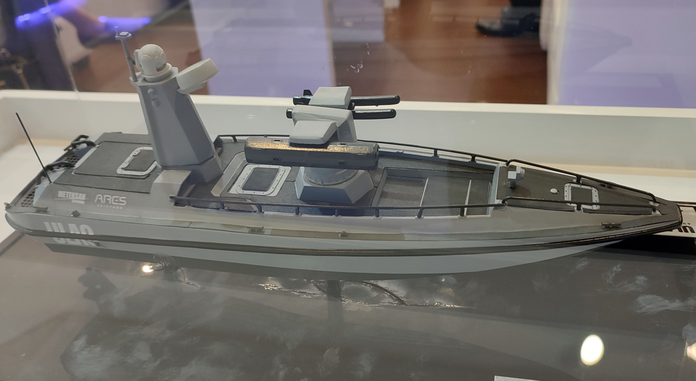
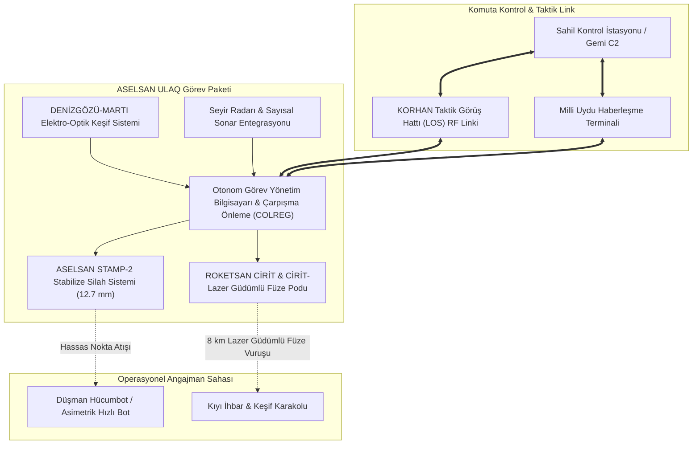

# 🌊 Proje: ASELSAN ULAQ Görev Faydalı Yük & Muharebe Paketi

  

  

> **Geliştirici:** ASELSAN (Aviyonik, Sensör ve Silah İstasyonları) & ARES Tersanesi (Gövde ve Platform)  
> **Sınıf:** İnsansız Deniz Aracı (İDA/SİDA) Sensör, Aviyonik ve Taktik Silah Faydalı Yük Paketi  
> **Stratejik Önem:** Mavi Vatan sınırlarında otonom su üstü harbi, liman/üs savunması ve asimetrik tehditlere müdahale kabiliyetini sıfır personel riskiyle kazandıran milli otonom deniz mimarisi.

---

## 🛡️ Stratejik Tanım & Doktriner Öncelik
ASELSAN ULAQ Görev Paketi, Türkiye'nin ilk muharip silahlı insansız deniz aracı olan ULAQ platformuna elektro-optik keşif, radar gözetleme, kriptolu veri bağı haberleşmesi ve uzaktan komutalı stabilize silah kontrol yeteneklerini kazandıran entegre görev sistemidir. Yüksek deniz durumlarında (Sea State 5) dahi hedefe kilitlenen stabilize taretler (STAMP / SARP-DUAL) ve yüksek çözünürlüklü DENİZGÖZÜ termal kameraları ile donatılmıştır. Yapay zeka tabanlı otonom seyrüsefer ve görüntü işleme algoritmaları sayesinde sahil kontrol merkezinden veya harp gemisi köprüüstünden yüzlerce mil öteden güvenle idare edilir.

---

## 📊 Kapsamlı Teknik Özellikler

| Parametre | Değer / Detay |
| :--- | :--- |
| **Entegre Silah Sistemleri** | ASELSAN STAMP-2 (12.7 mm / 7.62 mm MT), ROKETSAN 4x CİRİT & 2x UMTAS/L-UMTAS |
| **Elektro-Optik Sensör** | DENİZGÖZÜ-MARTI / ASELFLIR Termal Kamera, HD TV ve Lazer Mesafe Ölçer |
| **Seyrüsefer & Algılama** | X-Bant / Solid-State Seyir Radarı, Lidar, AIS Transponder, GPS/GNSS ve Yedekli IMU |
| **Haberleşme Menzili** | Görüş Hattı (LOS): 150+ km / TÜRKSAT Uydusu (SATCOM) ile Kesintisiz Küresel Kontrol |
| **Stabilizasyon Doğruluğu** | Deniz Durumu 5'e kadar < 0.5 mrad gyroskopik hat stabilizasyonu |
| **Otonomi Yetenekleri** | COLREG (Denizde Çatışmayı Önleme Tüzüğü) uyumlu otonom rota çizme ve engelden kaçınma |
| **Görev Süresi & Menzil** | 400+ Deniz Mili operasyonel menzil, 24+ saat kesintisiz devriye |

---

## 🧩 Alt Sistemler ve Aviyonik/Elektronik Entegrasyonu
- **ADVENT SYS Uyumluluğu:** Deniz Kuvvetleri'nin ADVENT Savaş Yönetim Sistemi'ne tam entegrasyon; ana savaş gemisinden bir silah/sensör istasyonu gibi doğrudan sevk ve idare.
- **Otomatik Video Hedef Takibi (AVTT):** Deniz yüzeyinde dalga köpükleri arasında hareket eden küçük deniz unsurlarını termal kontrastla anında yakalayarak silahı hedefe kilitli tutma.
- **Elektronik Harp Koruması:** GNSS karıştırmalarına karşı ASELSAN KORHAN kriptolu RF veri hattı ve harici yön bulucu antenler ile güvenli iletişim.
- **Sürü Zekası Haberleşmesi:** Birden fazla ULAQ SİDA'nın sürü halinde ortak kurtarma, ablukaya alma veya çok açılı torpido/füze taarruzu icra edebilmesi.

---

## 🎯 Görev Profili, Muharebe Senaryoları & Mühimmat Yelpazesi
- **Kritik Üs ve Liman Koruması:** Boğaz geçişleri, deniz üsleri ve stratejik körfezlerde devriye atarak yabancı dalgıç veya sürat teknesi sızmalarını engelleme.
- **Su Üstü Harbi (DSH / ASuW):** Düşman korvet veya lojistik gemilerine standoff menzilden (CİRİT/KUZGUN/ÇAKIR füzeleri ile) gece baskını yapma.
- **Elektronik İstihbarat ve Aldatma:** Düşman kıyı radar istasyonlarına yakın seyrüsefer yaparak sahte radar izleri yayma ve kıyı radar frekanslarını haritalama.

---

## 🚀 TRL Seviyesi ve Gelişim Yol Haritası
- **Mevcut Seviye:** **TRL 9 (Saha Kanıtlanmış Seri Üretim)**
- [x] Deniz Kalifikasyonu ve Canlı Atışlı CİRİT Testleri Başarısı
- [x] Sahil Güvenlik Komutanlığı ve Deniz Kuvvetleri Envanterine Katılım
- [x] Farklı Silah Kuleleri (12.7 mm STAMP, DSH Torpidoları) ile Modüler Görev Paketleri
- [x] Dost ve Müttefik Ülkelere İhracat Sözleşmeleri
- [ ] Denizaltı Savunma Harbi (DSH) Sonobuoy ve Hafif Torpido Entegrasyon Fazı

---

[⬅️ Üst Dizine](../README.md) | [🏛️ Dominion Hub](../../README.md) | [🏠 Ana Sayfa](../../../README.md)
