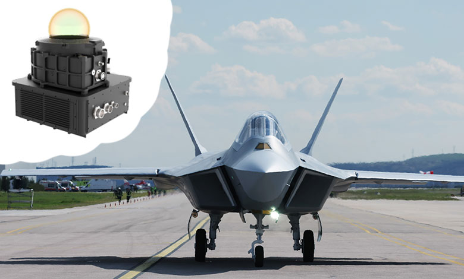
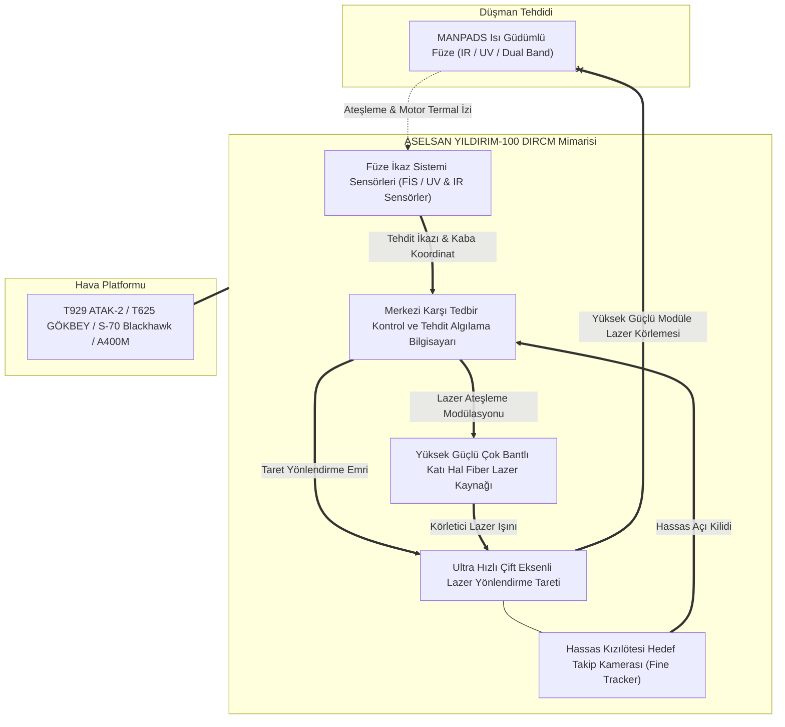

# ⚡ Proje: ASELSAN YILDIRIM-100 (Yönlendirilmiş Kızılötesi Karşı Tedbir Sistemi - DIRCM)

  

  

> **Geliştirici:** ASELSAN  
> **Sınıf:** Havadan Yönlendirilmiş Kızılötesi Karşı Tedbir Sistemi (DIRCM - Directed Infrared Countermeasure)  
> **Stratejik Önem:** Helikopterleri, nakliye ve VIP uçaklarını alçak irtifada ölümcül tehdit oluşturan omuzdan atılan kızılötesi arayıcı başlıklı füzelere (MANPADS) karşı yüksek güçlü yönlendirilmiş lazer ışınıyla körleyerek bertaraf eden milli savunma kalkanı.

---

## 🛡️ Stratejik Tanım & Doktriner Öncelik
ASELSAN YILDIRIM-100, hava araçlarının beka kabiliyetini en üst seviyeye çıkarmak amacıyla tasarlanmış yeni nesil bir DIRCM (Yönlendirilmiş Kızılötesi Karşı Tedbir) sistemidir. Geleneksel koruma sağlayan piroteknik işaret fişekleri (flare) modern çok spektrumlu akıllı füze arayıcı başlıklarına karşı yetersiz kalabilmekte ve sınırlı sayıda taşınabilmektedir. YILDIRIM-100; elektro-optik füze ikaz sensörlerinden aldığı uyarı ile füzeyi mikrosaniyeler içinde tespit edip kilitlenir ve taretindeki çok bantlı lazer ışınını doğrudan füzenin optik arayıcı başlığına odaklar. Arayıcı başlık detektörünü "körleştirip" sahte hedef açıları üreterek füzenin hava aracından tamamen sapmasını sağlar. Uçakta elektrik gücü bulunduğu sürece sınırsız sayıda füzeye karşı kesintisiz savunma sunar.

---

## 📊 Kapsamlı Teknik Özellikler

| Parametre | Değer / Detay |
| :--- | :--- |
| **Lazer Tipi** | Çok Bantlı Katı Hal Lazer / Modüle Fiber Lazer Kaynağı |
| **Hedef Seti** | 1., 2., 3. ve 4. Nesil Kızılötesi (IR / UV / Görüntüleyici IIR) Arayıcı Başlıklı MANPADS ve SAM Füzeleri |
| **Reaksiyon Süresi** | Füze fırlatılışından itibaren < 1 saniye içinde lazer kilitlenmesi ve angajman |
| **Kapsama Alanı** | 360° Azimut, -90° ila +45° Elevasyon (Gövde altı ve üstü çift taret opsiyonu) |
| **Taret Hızı ve Hassasiyeti** | Çok yüksek açısal ivmelenme, mikro-radyan seviyesinde optik nişan hassasiyeti |
| **Mühimmat Kapasitesi**| Sınırsız (Hava aracının elektrik jeneratöründen beslenir, flare gerektirmez) |
| **Soğutma Mimarisi** | Kapalı devre sıvı veya hava soğutmalı kompakt termal yönetim |
| **Platform Uyumluluğu** | ATAK-2 (T929), GÖKBEY (T625), C-130, A400M, Helikopter ve VIP Nakliye Filosu |

---

## 🧩 Alt Sistemler ve Aviyonik/Elektronik Entegrasyonu
- **Füze İkaz Sistemi (FİS) Entegrasyonu:** ASELSAN elektro-optik/ultraviyole füze ikaz sensörleriyle milisaniye düzeyinde tam veri paylaşımı.
- **Akıllı Karıştırma Kodları (Jamming Codes):** Füzenin tarama retikülünü ve dedektör frekansını bozan özel dalga formu modülasyonları ile sahte manevra yaptırma.
- **Çift Taretli Mimari Desteği:** Büyük gövdeli uçaklar (A400M, C-130 vb.) için gövde altı ve üstüne konuşlandırılan taretlerin ortak kontrolü ile tam küresel koruma küresi.
- **RWR ve Chaff/Flare Dispenseri ile Entegre Karşı Tedbir:** DIRCM sistemi çalışırken gereksinim duyulduğunda eşzamanlı RF karşı tedbirlerle karma savunma koordinasyonu.

---

## 🎯 Görev Profili, Muharebe Senaryoları & Mühimmat Yelpazesi
- **Alçak İrtifa İndirme ve Yakın Hava Desteği:** Taarruz ve genel maksat helikopterlerinin sıcak temas bölgelerine personel indirmesi sırasında pusu kuran MANPADS timlerini etkisizleştirme.
- **Taktik Nakliye ve İntikal Koruma:** Stratejik nakliye uçaklarının iniş ve kalkış tırmanış safhalarında havaalanı çevresinden gelebilecek omuzdan atılan füze tehditlerine karşı tam koruma.
- **VIP ve Hükümet Uçakları Kalkanı:** Uluslararası riskli hava sahalarında devlet başkanlığı ve diplomatik uçakların füze sabotajlarına karşı caydırıcı güvenliği.

---

## 🚀 TRL Seviyesi ve Gelişim Yol Haritası
- **Mevcut Seviye:** **TRL 8 (Platform Seviyesi Kalifikasyon ve Uçuş Testleri Başarılı)**
- [x] Yüksek Güçlü Lazer Kaynağı ve Hassas Taret Mekaniği Kalifikasyonu
- [x] Laboratuvar Donanım-Çevrim İçi (HWIL) Simülatör Testlerinde Başarılı Körleme
- [x] Helikopter Üzerinde Yer ve Uçuş Dinamiği Entegrasyon Doğrulaması
- [ ] T929 ATAK-2 Ağır Taarruz Helikopteri Seri Üretim Paketine Entegrasyon
- [ ] A400M ve TUSAŞ C-130 Erciyes Filolarına Yaygın Donatım

---

[⬅️ Üst Dizine](../README.md) | [🏛️ Dominion Hub](../../README.md) | [🏠 Ana Sayfa](../../../README.md)
