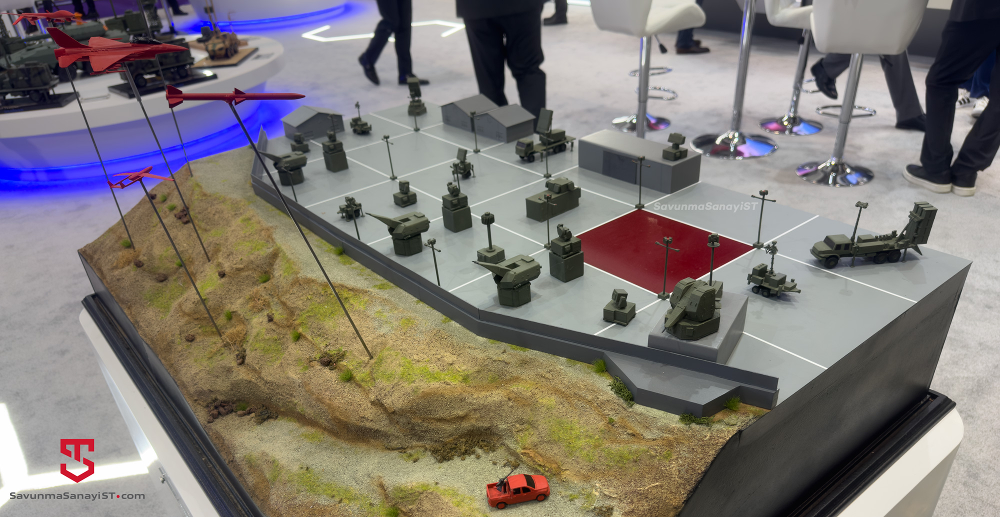
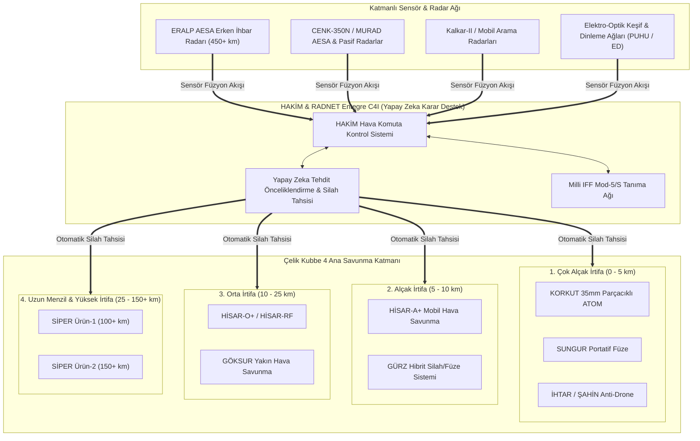

# 🛡️ Proje: ÇELİK KUBBE (Steel Dome - Çok Katmanlı Entegre Hava Savunma Şemsiyesi)

  

  

> **Koordinatör / Ana Yüklenici:** Savunma Sanayii Başkanlığı (SSB) liderliğinde ASELSAN, ROKETSAN, TÜBİTAK SAGE ve MKE Konsorsiyumu  
> **Sınıf:** Çok Katmanlı Ağ Merkezli Entegre Hava ve Füze Savunma Mimarisi (System of Systems)  
> **Stratejik Önem:** Türkiye'nin tüm kara, deniz ve hava tabanlı radar, sensör, elektronik harp, komuta kontrol ve silah sistemlerini tek bir yapay zeka destekli müşterek resimde birleştiren "Gök Vatan Kalkanı".

---

## 🛡️ Stratejik Tanım & Doktriner Öncelik
ÇELİK KUBBE, Türkiye Cumhuriyeti hava sahasının en alçak irtifadan (mikro İHA ve kamikaze dronlar) uzay sınırındaki balistik tehditlere kadar 4 temel katmanda 360 derece kesintisiz korunmasını sağlayan milli "Sistemler Sistemi" (System of Systems) doktrinidir. 6 Ağustos 2024 tarihli Savunma Sanayii İcra Komitesi (SSİK) kararıyla resmileştirilen bu mimari; hava savunma toplarından (KORKUT, GÖKDENİZ), alçak ve orta irtifa füzelerine (HİSAR-A+, HİSAR-O+, GÖKSUR, GÜRZ), uzun menzilli füze sistemlerine (SİPER) ve AESA radarlarına (ERALP, CENK, MURAD) kadar bütün unsurları HAKİM ve RADNET komuta kontrol ağı üzerinde buluşturur. Yapay zeka algoritmaları, gelen tehdidin türüne (dron sürüsü, seyir füzesi, balistik füze, jet) milisaniyeler içinde en maliyet-etkin ve isabet oranı en yüksek karşı silahı otomatik tahsis eder.

---

## 📊 Kapsamlı Katman ve Teknik Mimari Tablosu

| Katman | İrtifa & Menzil | Entegre Vurucu Sistemler | Tehdit ve Görev Profili |
| :--- | :--- | :--- | :--- |
| **Çok Alçak İrtifa** | 0 - 5 km İrtifa / 0 - 8 km Menzil | KORKUT (35mm ATOM Parçacıklı Mühimmat), SUNGUR, İHTAR Lazer/RF, ŞAHİN | Mikro/Mini İHA'lar, Kamikaze Dronlar, Seyir Füzeleri, Helikopterler |
| **Alçak İrtifa** | 5 - 10 km İrtifa / 0 - 15 km Menzil | HİSAR-A+, GÜRZ Hibrit Tekerlekli Sistem, BOZDOĞAN/GÖKDOĞAN Türevleri | Alçaktan Uçan Taarruz Uçakları, SİHA Filoları, Havadan Karaya Mühimmatlar |
| **Orta İrtifa** | 10 - 20 km İrtifa / 0 - 35+ km Menzil | HİSAR-O+, HİSAR-RF, GÖKSUR, Kalkan-II Radarları | Savaş Uçakları, Geniş Menzilli Seyir Füzeleri, Güdümlü Bombalar |
| **Uzun Menzil / Stratejik** | 20 - 30+ km İrtifa / 100 - 150+ km Menzil | SİPER Ürün-1, SİPER Ürün-2, ERALP AESA Erken İhbar Radarı | Yüksek İrtifa Bombardıman Uçakları, Balistik Tehditler, Standoff Platformlar |

---

## 🧩 Alt Sistemler ve Aviyonik/Elektronik Entegrasyonu
- **HAKİM C4I ve Milli Sayısal Veri Ağı:** Tüm bataryaların birbiriyle konuştuğu, tek bir radarın gördüğü hedefin diğer batarya tarafından görülmeden de vurulabildiği "Sensörden Silaha Ağ" mimarisi.
- **Yapay Zeka Tabanlı Karar Destek:** Düşman salvo taarruzlarında pahalı SİPER füzesini ucuz drona harcamayan, mikro hedefleri KORKUT parçacıklı mühimmata veya lazer sistemine yönlendiren maliyet optimizasyonu.
- **Elektronik Harp ve Karşı-Karşı Tedbir (ECCM):** KORAL, SANCAK ve PUHU elektronik istihbarat sistemleri ile ortak çalışarak düşman radar bastırma ve aldatmalarına karşı dirençli frekans atlama altyapısı.
- **Milli IFF Mod-5/S:** Hava sahasındaki dost hava araçlarının (KAAN, F-16, TB2, AKINCI) dost ateşi kurbanı olmasını önleyen kriptolu milli sorgulayıcı mimarisi.

---

## 🎯 Görev Profili, Muharebe Senaryoları & Mühimmat Yelpazesi
- **Doyurma (Saturation) Saldırılarını Püskürtme:** Düşmanın yüzlerce kamikaze dron, seyir füzesi ve balistik füzeyle aynı anda yaptığı asimetrik saldırıları katmanlar arasında paylaştırarak imha etme.
- **Stratejik Tesislerin 360° Nokta Koruması:** Savunma sanayii tesisleri, enerji altyapısı ve karargahların çok alçak irtifadan sızan seyir füzelerine karşı KORKUT ve HİSAR-A+ ile yakın çevrelenmesi.
- **Geniş Bölge Hava Sahası İnkârı (A2/AD):** SİPER bataryaları ve ERALP radarlarıyla hasım unsurlara yüzlerce kilometrelik yaklaşma yasağı sahası kurma.

---

## 🚀 TRL Seviyesi ve Gelişim Yol Haritası
- **Mevcut Seviye:** **TRL 8 (Tüm Katman Bileşenleri Sahada Doğrulandı / Üst Sistem Entegrasyonu Aktif)**
- [x] Katman Bileşenlerinin (KORKUT, HİSAR, SİPER, ERALP) Ayrı Ayrı Başarılı Kalifikasyonu
- [x] 6 Ağustos 2024 SSİK Kararı ile Ortak Entegrasyon Protokolünün İmzalanması
- [x] HAKİM Ağı Üzerinde Canlı Atışlı Bataryalar Arası Veri Paylaşım ve Müşterek Angajman Testleri
- [ ] Ülke Genelinde Tüm Radar ve Füze Bataryalarının Çelik Kubbe Ağına Bağlanması
- [ ] Uzay ve Üst Balistik Katman Önleyicilerinin (Anti-Ballistic Exo-Atmospheric) Entegrasyonu

---

### 📸 Taktik ve Operasyonel Görseller / Saha Galerisi

  

---

[⬅️ Üst Dizine](../README.md) | [🏛️ Dominion Hub](../../README.md) | [🏠 Ana Sayfa](../../../README.md)
