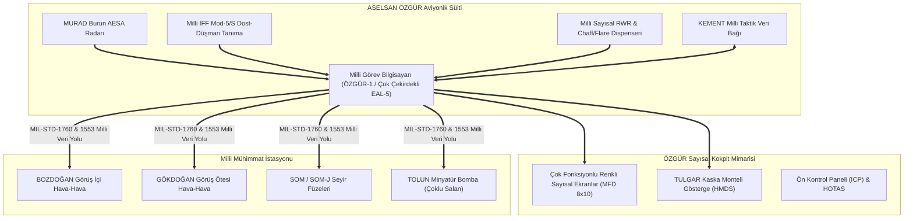

# 🦅 Proje: ASELSAN & TUSAŞ F-16 ÖZGÜR (Milli Aviyonik Modernizasyon Projesi)

  

> **Geliştirici:** ASELSAN (Milli Görev Bilgisayarı, AESA Radar, Aviyonik) & TUSAŞ (Yapısal & Entegrasyon)  
> **Sınıf:** 4.5 Nesil Çok Rollü Muharip Uçak Milli Aviyonik ve Görev Sistemi Paketi  
> **Stratejik Önem:** F-16 savaş uçaklarının yabancı kaynak kodlarına ve ambargolarına bağımlılığını tamamen ortadan kaldıran, milli AESA radarı (MURAD) ve yerli füzelerin (BOZDOĞAN, GÖKDOĞAN, SOM, TOLUN) entegrasyonunu mümkün kılan milli aviyonik devrim.

---

## 🛡️ Stratejik Tanım & Doktriner Öncelik
F-16 ÖZGÜR Projesi, Türk Hava Kuvvetleri envanterindeki F-16 Blok-30 (ve devamında Blok-40 / Blok-50) savaş uçaklarının görev bilgisayarı, kokpit göstergeleri, seyrüsefer ve elektronik harp sistemlerinin tamamen milli donanım ve yazılımlarla değiştirilmesi projesidir. Yabancı üretici kaynak kodlarının kilitli olması sebebiyle yerli füze ve podların uçağa entegre edilememesi sorununu kökten çözen ÖZGÜR Projesi; uçakları 4.5 nesil gelişmiş muharebe uçağı seviyesine yükseltmiştir. ASELSAN MURAD AESA radarı, milli IFF Mod-5/S sorgulayıcısı ve TULGAR kaska monteli gösterge sistemiyle donatılan ÖZGÜR filoları, KAAN ve KIZILELMA devreye girene kadar gökyüzündeki milli caydırıcılığın omurgasını oluşturmaktadır.

---

## 📊 Kapsamlı Teknik Özellikler

| Parametre | Değer / Detay |
| :--- | :--- |
| **Görev Bilgisayarı** | ASELSAN Milli Görev Bilgisayarı (ÖZGÜR Core, Yedekli Donanım Mimarisi) |
| **Radar Entegrasyonu** | ASELSAN MURAD GaN Tabanlı Burun AESA Radarı (Çok Fonksiyonlu Hava-Hava / Hava-Yer) |
| **Kokpit Göstergeleri** | 8x10 inç Çok Fonksiyonlu Renkli Ekranlar (MFD), Sayısal Yedek Uçuş Göstergesi |
| **IFF Sistemi** | ASELSAN Milli IFF Mod-5 Seviye 2 Kriptolu Dost-Düşman Tanıma |
| **Veri Yolu Mimarisi** | Sayısal MIL-STD-1553B, MIL-STD-1760 Akıllı Silah Arayüzü, Ethernet ve Optik Link |
| **Seyrüsefer** | Milli Ataletsel Seyrüsefer Sistemi (ANS) + KKS / GPS Karıştırma Koruması |
| **Haberleşme** | Kriptolu Milli Yazılım Tabanlı V/UHF Telsiz ve KEMENT Taktik Veri Bağı |
| **Yapısal Ömür** | TUSAŞ tarafından yapılan yapısal iyileştirmelerle 8.000 saatten 12.000 uçuş saatine artış |

---

## 🧩 Alt Sistemler ve Aviyonik/Elektronik Entegrasyonu
- **Milli Silah Yönetim Sistemi (SMS):** ABD kaynak koduna ihtiyaç duymadan yeni geliştirilen herhangi bir yerli mühimmatın haftalar içinde sisteme tanımlanabilmesi.
- **MURAD AESA Radar Gücü:** Eşzamanlı hava-hava taraması, hava-yer haritalaması (SAR) ve hedef takibi; mekanik radarlara göre 2 kat artırılmış tespit menzili.
- **KEMENT Veri Bağı ile Müşterek Ağ:** AKINCI, TB2, HAVA SOJ ve Deniz Kuvvetleri unsurları ile radar resminin ve hedef koordinatlarının anlık telsiz sessizliğinde paylaşılması.
- **Dahili Sayısal Elektronik Harp:** Sayısal Radar İkaz Alıcısı (RWR) ve gelişmiş karıştırma tespit algoritmalarıyla düşman radar kilitlenmelerine anında otomatik karşı tedbir.

---

## 🎯 Görev Profili, Muharebe Senaryoları & Mühimmat Yelpazesi
- **Görüş Ötesi (BVR) Hava Muharebesi:** MURAD AESA radarı ve GÖKDOĞAN füzeleriyle düşman avcı uçaklarını radar menzili dışından tespit edip ilk atış üstünlüğüyle imha etme.
- **Hassas Stratejik Yer Taarruzu:** Tek bir sortide 8 adet TOLUN Minyatür Bomba veya SOM seyir füzesi taşıyarak düşman hava savunma şemsiyesini delme.
- **Hava Savunmasını Bastırma (SEAD/DEAD):** Akbaba anti-radyasyon füzeleri ve pod entegrasyonu ile düşman radar mevzilerini imha etme.

---

## 🚀 TRL Seviyesi ve Gelişim Yol Haritası
- **Mevcut Seviye:** **TRL 9 (Saha Kanıtlanmış Seri Üretim ve Envanter Teslimatları)**
- [x] F-16 Blok-30 İlk Prototip Uçuşu ve Sistem Doğrulaması
- [x] Hava Kuvvetleri Komutanlığı'na İlk Seri ÖZGÜR F-16 Uçaklarının Teslimatı (2023+)
- [x] Milli Füzeler (BOZDOĞAN, GÖKDOĞAN, SOM) ile Başarılı Canlı Atış Testleri
- [x] ÖZGÜR-2 Projesi ile Blok-40 ve Blok-50 Filolarının Modernizasyonuna Başlanması
- [ ] MURAD AESA Radarı ile Tam Donatılmış Filoların Müşterek Harekât Faaliyetleri

---

[⬅️ Üst Dizine](../README.md) | [🏛️ Dominion Hub](../../README.md) | [🏠 Ana Sayfa](../../../README.md)
