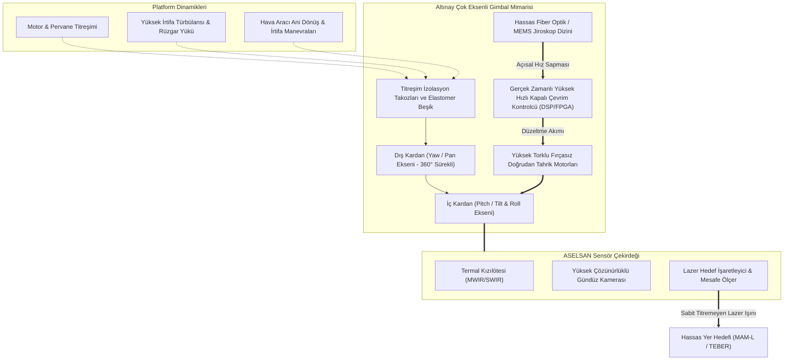

# 📷 Proje: Altınay Savunma & ASELSAN GİMBAL SİSTEMLERİ (Hassas Elektro-Optik Stabilizasyon)

  

> **Üretici:** Altınay Savunma (Hassas Mekatronik, Tork Motorları & Stabilizasyon) & ASELSAN (Optik, Lazer & Dedektör Sensörleri)  
> **Sınıf:** Çok Eksenli Jiroskopik Stabilize Elektro-Optik Gimbal ve Yönlendirme Platformu  
> **Stratejik Önem:** İHA ve SİHA'ların (Bayraktar TB2, ANKA, AKSUNGUR, AKINCI) Kanada Wescam ambargosu sonrası yerlileştirilen, kilometrelerce uzaktan titremeyen optik görüş ve lazer işaretleme sağlayan en kritik mekatronik alt sistemi.

---

## 🛡️ Stratejik Tanım & Doktriner Öncelik
Modern insansız hava araçlarının muharebe etkinliği, yüksek irtifada şiddetli rüzgar ve motor titreşimleri altındayken bile yerdeki küçük hedefleri milimetrik hassasiyetle lazerle aydınlatabilmelerine bağlıdır. Altınay Savunma ve ASELSAN iş birliğiyle geliştirilen Gimbal Sistemleri mimarisi; fırçasız doğrudan tahrikli (direct-drive) tork motorları, ultra hassas fiber optik jiroskoplar (FOG) ve dinamik titreşim sönümleme beşiklerinden oluşur. Bu sistem, CATS ve yeni nesil ASELFLIR-500/600 optik keşif ve hedefleme podlarının dış çevreden tamamen izole olarak hedefe kilitli kalmasını sağlar; milli SİHA filolarımızın yurt dışı tedarik kısıtlamalarına karşı bağımsız operasyonel güvencesidir.

---

## 📊 Kapsamlı Teknik Özellikler

| Parametre | Değer / Detay |
| :--- | :--- |
| **Kardan Eksen Sayısı** | 2 Eksenli Dış Kardan + 2 Eksenli İç Kardan (4 Eksenli Tam İzolasyon) |
| **Açısal Kapsama** | Azimut: 360° Sürekli (Kayar Bilezik / Slip-Ring ile), Elevasyon: -120° ila +30° |
| **Stabilizasyon Doğruluğu** | < 10 ila 15 mikro-radyan RMS (Sınıfının en yüksek sönümleme hassasiyeti) |
| **Tahrik Mekanizması** | Doğrudan Tahrikli (Direct Drive) Fırçasız Tork Motorları (Sıfır Dişli Boşluğu) |
| **Sensör Ağırlık Kapasitesi**| 35 kg - 60 kg (Gimbal sınıfına göre modüler pod taşıma mimarisi) |
| **Sönümleme Teknolojisi** | Çok kademeli ayarlanabilir visko-elastik titreşim izolatörleri |
| **Açısal Hız & İvme** | Azami Açısal Hız > 60°/saniye, Açısal İvme > 100°/saniye² |
| **Çalışma Çevre Şartları** | -40°C ila +60°C, 45.000 feet irtifa basınç ve buzlanma dayanımı |

---

## 🧩 Alt Sistemler ve Aviyonik/Elektronik Entegrasyonu
- **Sıfır Histerezis Fırçasız Motorlar:** Dişli veya kayış kullanmaksızın doğrudan optik yükü çevirerek mikroskobik düzeyde hassas nişan alma imkanı.
- **Kriptolu Slip-Ring Mimarisi:** Sürekli 360 derece dönme kabiliyetinde bile yüksek çözünürlüklü video ve lazer kontrol sinyallerini kablo dolanması olmadan aktaran döner bilezik teknolojisi.
- **Oto-Kalibrasyon ve Sıcaklık Telafisi:** İrtifa değişimlerinde yaşanan aşırı sıcaklık farklarından kaynaklanan optik eksen kaymalarını dinamik olarak düzelten mekanik yapı.
- **SİHA Otopilot Entegrasyonu:** Platform otopilotuyla koordineli çalışarak "Hedef Kilidi (Target Lock)" modunda SİHA dönüş yapsa dahi kameranın yerde sabit bir koordinata odaklanması.

---

## 🎯 Görev Profili, Muharebe Senaryoları & Mühimmat Yelpazesi
- **SİHA Lazer Güdümlü Taarruz:** 30.000 feet irtifadan hareket halindeki düşman zırhlı aracının tavanına MAM-L veya CİRİT füzesini tam isabetle yönlendiren lazer noktalama.
- **Geniş Alan Keşif ve İstihbarat:** Sınır hatlarında ve deniz karakol görevlerinde yüksek büyütmeli optiklerle saatlerce titremesiz sınır gözetleme.
- **Arama Kurtarma ve Doğal Afet:** Gece şartlarında deprem ve sel bölgelerinde enkaz altındaki termal izleri titreşimsiz görüntüleme.

---

## 🚀 TRL Seviyesi ve Gelişim Yol Haritası
- **Mevcut Seviye:** **TRL 9 (Saha Kanıtlanmış Seri Üretim)**
- [x] Kanada Ambargosunu Kıran Yerli Gimbal Tasarımı ve Kalifikasyonu
- [x] Bayraktar TB2 ve ANKA Üzerinde CATS Podu Entegrasyonu ve Muharebe Görevleri
- [x] ASELFLIR-500 Yeni Nesil Süper Hafif Gimbal Mimarisinin Seri Üretime Geçmesi
- [x] AKINCI ve AKSUNGUR SİHA'larında Aktif Saha Kullanımı
- [ ] 5. Nesil Uçaklar (KAAN) İçin Süper Hızlı İç Mekanizma Entegrasyon Geliştirmeleri

---

[⬅️ Üst Dizine](../README.md) | [🏛️ Dominion Hub](../../README.md) | [🏠 Ana Sayfa](../../../README.md)
