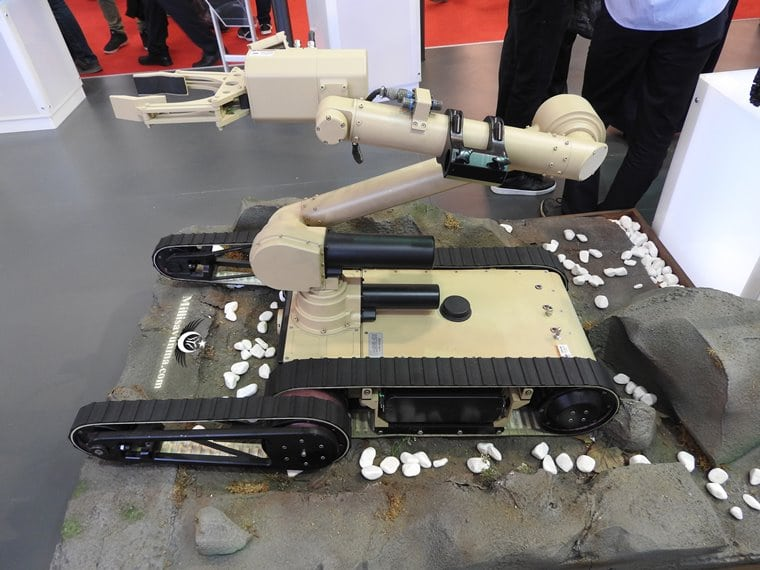
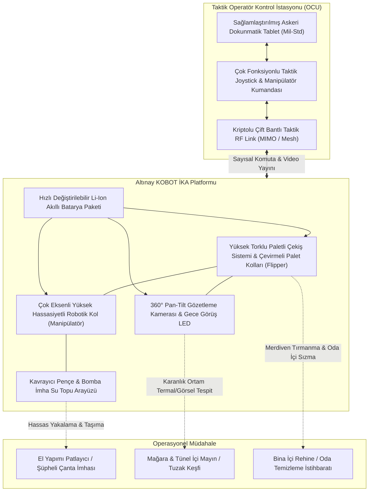

# 🤖 Proje: Altınay Savunma KOBOT (Taktik Hafif Sınıf İnsansız Kara Aracı)

  

  

> **Üretici:** Altınay Savunma Teknolojileri  
> **Sınıf:** Hafif Sınıf Taktik İnsansız Kara Aracı (İKA) & Bomba İmha Robotu  
> **Stratejik Önem:** Meskun mahal, dar bina içi, tünel, mağara ve şüpheli paket incelemelerinde askeri ve emniyet timlerinin hayati tehlikesini sıfırlayan, sırtta taşınabilir yüksek çeviklikte taktik robotik platform.

---

## 🛡️ Stratejik Tanım & Doktriner Öncelik
Altınay Savunma KOBOT, zorlu arazi ve kapalı alan koşullarında güvenlik güçlerinin keşif, gözetleme, patlayıcı madde imhası (EOD) ve asimetrik tehdit müdahale görevlerini uzaktan güvenle icra etmesi amacıyla üretilmiş hafif sınıf bir insansız kara platformudur. Modüler mafsallı robotik kolu, paletli hareket mimarisi ve yüksek torklu elektrik motorları sayesinde merdiven tırmanabilir, dik engelleri aşabilir ve enkaz altında ilerleyebilir. Taşınabilir dayanıklı operatör kontrol ünitesi (OCU) üzerinden çift yönlü şifreli veri ve HD görüntü aktarımı gerçekleştirerek askerin can güvenliğini ön planda tutar.

---

## 📊 Kapsamlı Teknik Özellikler

| Parametre | Değer / Detay |
| :--- | :--- |
| **Araç Ağırlığı** | ~20 - 35 kg (Modüler zırh ve robot kol donanımına göre sırtta taşınabilir) |
| **Tahrik Sistemi** | Çift Bağımsız Palet + Ön/Arka Açı Ayarlı Yardımcı Palet Kolları (Flippers) |
| **Engel ve Merdiven Tırmanma**| 45° Eğim Tırmanma, 25-30 cm Dik Engel Aşma, Standart Merdiven İnip Çıkabilme |
| **Azami Hız** | 5 - 8 km/s (Operasyonel Taktik Hız) |
| **Çalışma Süresi** | 3 ila 5 Saat Kesintisiz Görev (Hızlı değiştirilebilir Lityum-İyon batarya) |
| **Robotik Kol Taşıma Gücü** | Tam açık kolda 5+ kg, gövdeye yakın tutuşta 15+ kg kaldırma kapasitesi |
| **Haberleşme Menzili** | Açık Arazide 1.000+ metre / Şehir İçi ve Bina İçi 300+ metre Kriptolu Link |
| **Çevre Koruma Sınıfı** | IP67 Su, Toz ve Çamur Geçirmezlik; MIL-STD-810H Askeri Şok/Düşme Dayanımı |

---

## 🧩 Alt Sistemler ve Aviyonik/Elektronik Entegrasyonu
- **6 Eksenli Robotik Manipülatör Kol:** Kapı kolu açma, araba bagajı kaldırma ve şüpheli paketlerin hassas biçimde incelenmesini sağlayan mikro pozisyonlama motorları.
- **Entegre Bomba İmha Donanımları:** Robotik kola takılabilen su jeti (disruptor), fünye yerleştirici ve X-ray görüntüleme cihazı entegrasyonu.
- **Karanlık Alan ve Gece Görüşü:** Gövde ön/arka ve kol üzerinde kızılötesi aydınlatıcılar, yüksek çözünürlüklü gündüz/gece kameraları.
- **Düşme / Ters Dönme Kurtarma (Self-Righting):** Robot takla attığında flipper kolları vasıtasıyla kendi kendini doğrultarak göreve devam edebilme.

---

## 🎯 Görev Profili, Muharebe Senaryoları & Mühimmat Yelpazesi
- **Şüpheli Paket ve Bomba İmhası:** Kalabalık şehir meydanlarında veya araç altlarında tespit edilen patlayıcıları güvenli mesafeden inceleme ve su jetiyle patlatmadan etkisizleştirme.
- **Mağara ve Tünel Operasyonları:** Terör unsurlarının sığındığı dar mağara ağızlarına ve tuzaklı tünellere asker girmeden önce gönderilerek bubi tuzaklarını tespit etme.
- **KBRN Keşif Görevi:** Kimyasal, biyolojik ve radyasyon algılayıcı sensörler takılarak tehlikeli gaz sızıntısı olan binalara girip ortam ölçümü yapma.

---

## 🚀 TRL Seviyesi ve Gelişim Yol Haritası
- **Mevcut Seviye:** **TRL 9 (Saha Kanıtlanmış Seri Üretim)**
- [x] Zorlu Arazi ve Şok Kalifikasyon Testleri Tamamlandı
- [x] TSK ve Emniyet Genel Müdürlüğü (Bomba İmha Şubeleri) Envanterine Giriş
- [x] Meskun Mahal ve İç Güvenlik Operasyonlarında Aktif Kullanım
- [ ] Otonom Geri Dönüş ve Lidar Destekli Kapalı Alan 3D Haritalama Entegrasyonu
- [ ] BARKAN ve Diğer İnsansız Kara Araçlarıyla Müşterek Ağ Koordinasyonu

---

[⬅️ Üst Dizine](../README.md) | [🏛️ Dominion Hub](../../README.md) | [🏠 Ana Sayfa](../../../README.md)
