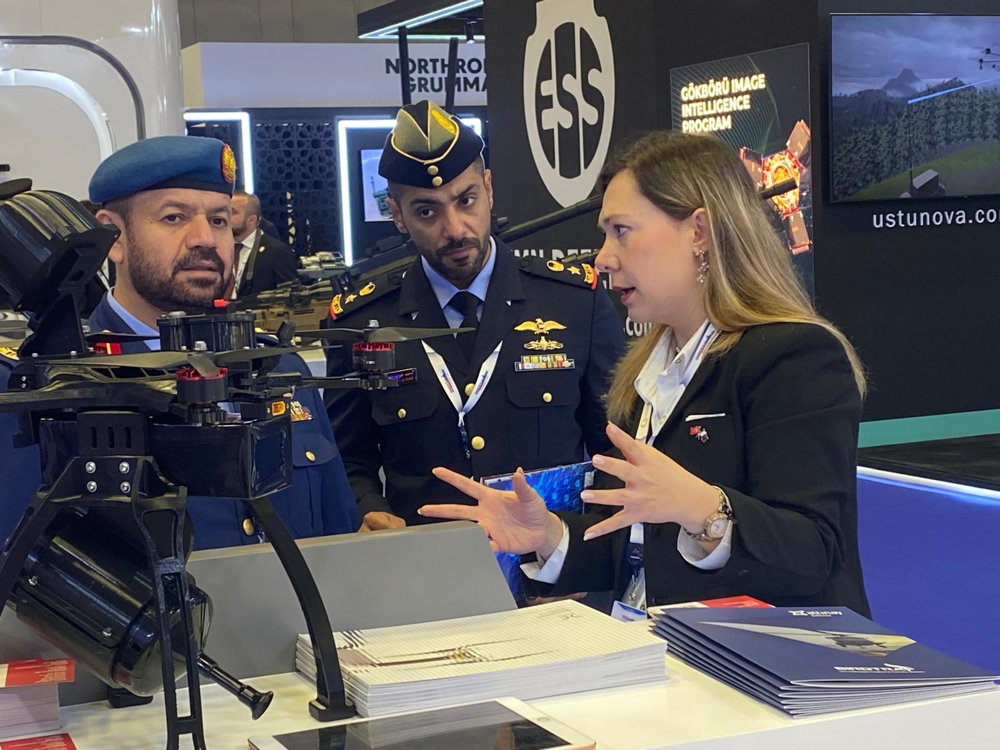
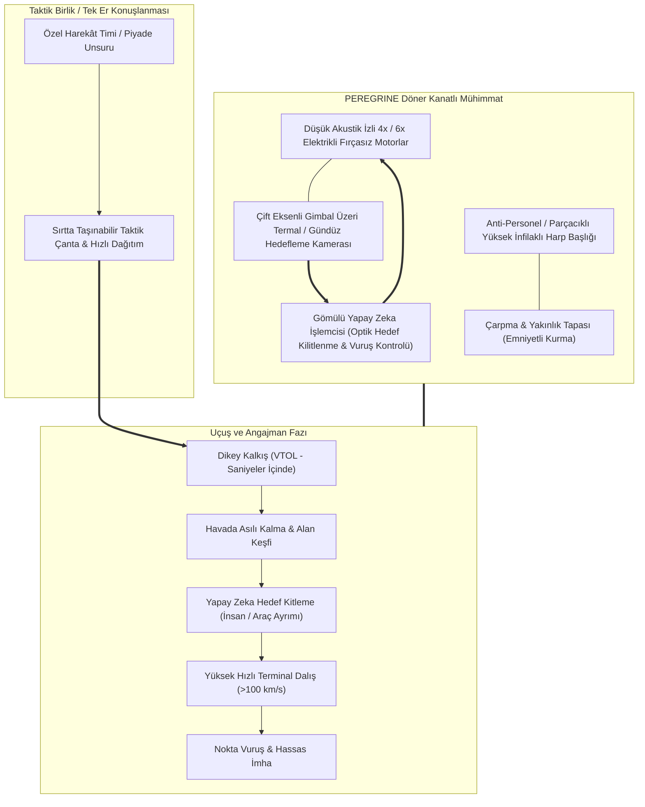

# 🦅 Proje: Altınay Savunma PEREGRINE (Döner Kanatlı Taktik Kamikaze İHA)

  

  

> **Üretici:** Altınay Savunma Teknolojileri  
> **Sınıf:** Döner Kanatlı Kamikaze İHA / Taktik Dolanan Mühimmat (Loitering Munition)  
> **Stratejik Önem:** Meskun mahal, siper, mağara girişi ve bina içindeki korunaklı terör hedeflerine pencereden veya kapı aralığından yüksek hassasiyetle nokta dalışı yaparak sıfır sivil zayiatla imha kabiliyeti sunan tek er taşınabilir mikro kamikaze hava aracı.

---

## 🛡️ Stratejik Tanım & Doktriner Öncelik
Altınay Savunma PEREGRINE, özel kuvvetler ve piyade mangalarının anlık ateş desteği ihtiyacını karşılamak üzere geliştirilmiş, sessiz elektrik motorlu ve dikey kalkış yapabilen döner kanatlı bir kamikaze insansız hava aracıdır. Sabit kanatlı kamikazelerin aksine havada sabit durabilme (hover), dar sokaklarda manevra yapabilme ve hedefin çevresinde keşif uçuşu gerçekleştirme yeteneklerine sahiptir. Yapay zeka destekli görüntü işleme algoritmaları sayesinde hedefi görsel olarak kilitler; GNSS sinyali karıştırılsa (GPS-Denied) dahi otonom optik takiple dalış yaparak hedefi infilak ettirir.

---

## 📊 Kapsamlı Teknik Özellikler

| Parametre | Değer / Detay |
| :--- | :--- |
| **Platform Tipi** | Döner Kanatlı (Multirotor) Dikey Kalkış/İniş (VTOL) Kamikaze Platformu |
| **Azami Kalkış Ağırlığı** | ~3 - 5 kg (Harp başlığı dahil tek er taşınabilir kompakt mimari) |
| **Harp Başlığı** | 0.5 - 1.2 kg Parçacık Tesirli / Şekilli Çukur İmla (Anti-Personel & Hafif Zırh) |
| **Uçuş Süresi & Havada Kalış**| 15 - 25 Dakika (Hedef arama ve havada pusu modu) |
| **Operasyonel Menzil** | 5 - 10 km (Görüş hattı sayısal taktik RF linki) |
| **Dalış / Vuruş Hızı** | 100 - 130 km/s (Hedefe dik veya açılı yüksek hızlı dalış) |
| **Hedefleme & Güdüm** | Yapay Zeka Destekli Nesne Tanıma, Optik Akış Takibi (Optical Flow) ve GNSS |
| **Akustik İz** | < 100 metre mesafeden duyulamayan ultra sessiz fırçasız motor tasarımı |

---

## 🧩 Alt Sistemler ve Aviyonik/Elektronik Entegrasyonu
- **Gömülü Uç Yapay Zeka (Edge AI):** Yerdeki operatörün temas kaybolsa dahi daha önceden işaretlediği düşman hedefini optik konturlardan takip ederek sapmadan vurma kabiliyeti.
- **Güvenli Tapa Mekanizması:** Hava aracı hedefe ulaşmadan veya görev iptal edildiğinde mühimmatı patlatmadan güvenli bölgeye dönmesini sağlayan elektronik emniyet devresi.
- **Kriptolu Mesh Telsiz Linki:** Karıştırmaya dirençli frekans atlamalı telemetri ve canlı video aktarımı.
- **KOBOT ve BARKAN ile Ortak Operasyon:** İnsansız kara araçları üzerinden fırlatılabilen ve kara aracının göremediği tepe arkası hedefleri vuran entegrasyon.

---

## 🎯 Görev Profili, Muharebe Senaryoları & Mühimmat Yelpazesi
- **Pencere ve Siper İçi Vuruş:** Binanın çatısına konuşlanmış keskin nişancı veya roketatar mevzilerini pencere boşluğundan içeri dalarak etkisiz kılma.
- **Görüş Dışı (Non-Line-of-Sight) Pusu:** Tepe veya bina arkasında mevzilenmiş düşman zırhlı personel taşıyıcılarını havadan dolanarak motor kompartımanından vurma.
- **Sürü Halinde Kamikaze Taarruzu:** Birden fazla PEREGRINE'in aynı anda havalanıp koordineli olarak hava savunma mevzilerini doymaya uğratarak çökertmesi.

---

## 🚀 TRL Seviyesi ve Gelişim Yol Haritası
- **Mevcut Seviye:** **TRL 7 (Sistem Prototipi Operasyonel Ortamda Doğrulandı)**
- [x] Aerodinamik Gövde ve Tahrik Sistemi Testleri
- [x] Canlı Harp Başlığı Patlatma ve Parçacık Saçılım Testleri
- [x] Sabit ve Hareketli Hedeflere Optik Kilitlenme ve Vuruş Denemeleri
- [ ] Özel Kuvvetler Komutanlığı Saha Kabul ve Kalifikasyon Süreci
- [ ] Seri Üretim Hattı Kurulumu ve İhraç Pazarına Açılım

---

[⬅️ Üst Dizine](../README.md) | [🏛️ Dominion Hub](../../README.md) | [🏠 Ana Sayfa](../../../README.md)
