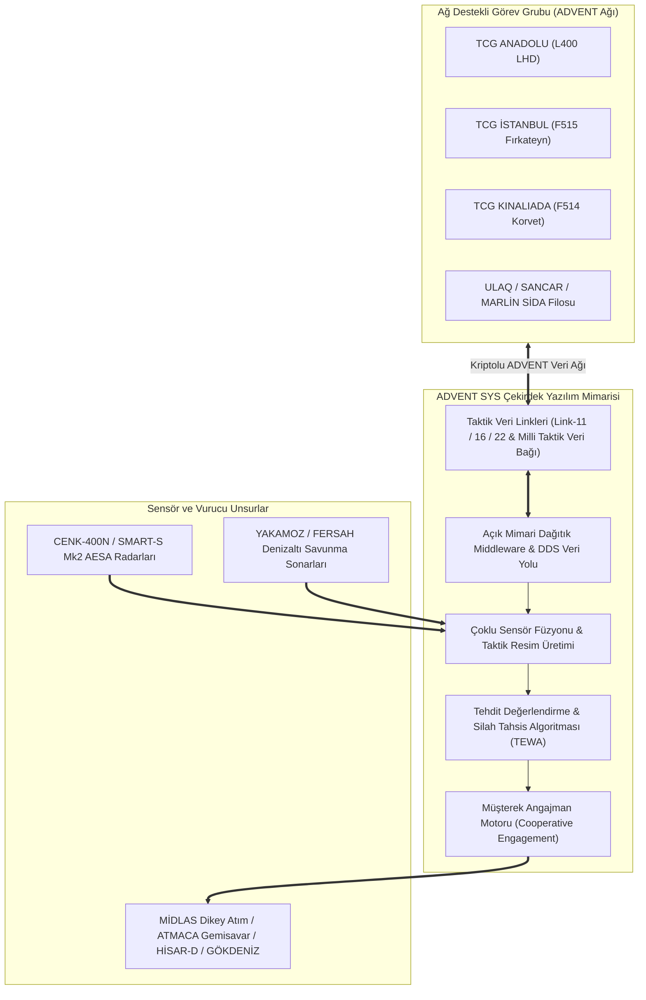

# 💻 Proje: HAVELSAN ADVENT (Ağ Destekli Veri Entegre Savaş Yönetim Sistemi)

  

> **Geliştirici:** HAVELSAN & Deniz Kuvvetleri Komutanlığı (ARMERKOM / DzKK)  
> **Sınıf:** Yeni Nesil Ağ Destekli Veri Entegre Savaş Yönetim Sistemi (CMS - Combat Management System)  
> **Stratejik Önem:** Türk Deniz Kuvvetleri'nin tüm fırkateyn, korvet, LHD (TCG ANADOLU), denizaltı ve insansız deniz araçlarının ortak "Harp Beyni". Dünyada sadece birkaç ülkenin sahip olduğu "Ağ Destekli Yetenek (CEC - Cooperative Engagement Capability)" mimarisi.

---

## 🛡️ Stratejik Tanım & Doktriner Öncelik
ADVENT SYS, Türk Deniz Kuvvetleri Araştırma Merkezi Komutanlığı (ARMERKOM) ve HAVELSAN mühendisliğiyle geliştirilen, tekil bir geminin sınırlarını aşarak görev grubundaki tüm yüzen, dalan ve uçan unsurları tek bir müşterek taktik organizmaya dönüştüren yeni nesil Savaş Yönetim Sistemidir (CMS). Gemideki tüm radar, sonar, elektro-optik ve elektronik harp sensörlerinden gelen verileri mikrosaniyeler içinde füzyona tabi tutarak tek bir hava, su üstü ve su altı taktik resmi oluşturur. ADVENT'in en devrimci yeteneği olan Müşterek Angajman Kabiliyeti (CEC) sayesinde; bir geminin radarıyla gördüğü hedefe, o hedefi hiç görmeyen başka bir gemi veya SİDA kendi füzesini ateşleyerek angaje olabilir.

---

## 📊 Kapsamlı Teknik Özellikler

| Parametre | Değer / Detay |
| :--- | :--- |
| **Yazılım Mimarisi** | Dağıtık, Modüler, Nesne Yönelimli, Platform Bağımsız Açık Sistem Mimarisi (SOA) |
| **İşletim Sistemi & Veri Ağı**| Güvenli Gerçek Zamanlı Milli İşletim Sistemi Altyapısı, DDS (Data Distribution Service) |
| **Sensör Entegrasyonu** | 3B/4B AESA Arama Radarları, Atış Kontrol Radarları, Gövde/Çekili Sonarlar, FLIR, ESM/ECM |
| **Silah Entegrasyonu** | MİDLAS Dikey Atım Sistemi, ATMACA, AKYA Ağır Torpido, GÖKDENİZ CIWS, 76mm Baş Topu |
| **Taktik Link Desteği** | Milli Link, Link-11, Link-16, Link-22 ve VMF Sayısal Taktik Ağ Entegrasyonu |
| **Konsol Donanımı** | Çok Fonksiyonlu Operatör Konsolları (OPCON), Geniş Taktik Durum Ekranları (TDC) |
| **Platform Uyumluluğu** | TCG ANADOLU, İ-Sınıfı Fırkateynler, TF-2000, Ada Sınıfı Korvetler, MİLDEN Denizaltıları, SİDA'lar |

---

## 🧩 Alt Sistemler ve Aviyonik/Elektronik Entegrasyonu
- **Müşterek Angajman Kabiliyeti (CEC):** A gemisinin tespit ettiği ufuk ötesi hedefe, aradaki menzil avantajını kullanan B gemisinin ATMACA veya HİSAR füzesini fırlatıp havada güdülemesi.
- **İnsansız Deniz ve Hava Aracı Kontrolü (MUM-T):** TB3, KIZILELMA, ULAQ veya SANCAR gibi insansız sistemlerin doğrudan ADVENT konsolundan bir gemi sensörü/silahı gibi sevk edilmesi.
- **Otonom Tehdit Değerlendirme (TEWA):** Düşman füze saldırısında savunma salvosunu (GÖKDENİZ, dekoy fırlatıcıları, RF karıştırıcılar) insan reaksiyon süresinin çok ötesinde mikrosaniyede yönetme.
- **MİDLAS Dikey Atım Kontrolü:** Milli dikey atım lançerinden atılan füzelerin ara safha güdüm verilerini ADVENT üzerinden kesintisiz güncelleme.

---

## 🎯 Görev Profili, Muharebe Senaryoları & Mühimmat Yelpazesi
- **Su Üstü Harbi (SUH / ASuW):** Düşman konvoylarına yüzlerce mil uzaktan ATMACA füzeleriyle salvo taarruz planlama ve koordinasyonu.
- **Hava Savunma Harbi (HSH / AAW):** Düşman seyir füzesi ve anti-gemi füzelerine karşı çok katmanlı savunma şemsiyesi kurma.
- **Denizaltı Savunma Harbi (DSH / ASW):** Sonar verilerini birleştirerek denizaltı temasını haritalama ve AKYA/ORKA torpidoları ile imha etme.

---

## 🚀 TRL Seviyesi ve Gelişim Yol Haritası
- **Mevcut Seviye:** **TRL 9 (Saha Kanıtlanmış Seri Üretim ve Envanter Standardı)**
- [x] TCG KINALIADA (F-514) Korvetinde İlk Seyir ve Atış Kalifikasyonu
- [x] Amiral Gemisi TCG ANADOLU (L-400) ve TCG İSTANBUL (F-515) Platformlarında Operasyonel Görev
- [x] Pakistan MILGEM (Babür Sınıfı) ve Endonezya/Ukrayna İhracat Projelerine Entegrasyon
- [x] Denizaltı Versiyonu (MÜREN / ADVENT-MİLDEN) Deniz Kabul Testleri
- [ ] TF-2000 Hava Savunma Harbi Muhribi ve Milli Uçak Gemisi Sürüm Geliştirmeleri

---

[⬅️ Üst Dizine](../README.md) | [🏛️ Dominion Hub](../../README.md) | [🏠 Ana Sayfa](../../../README.md)
