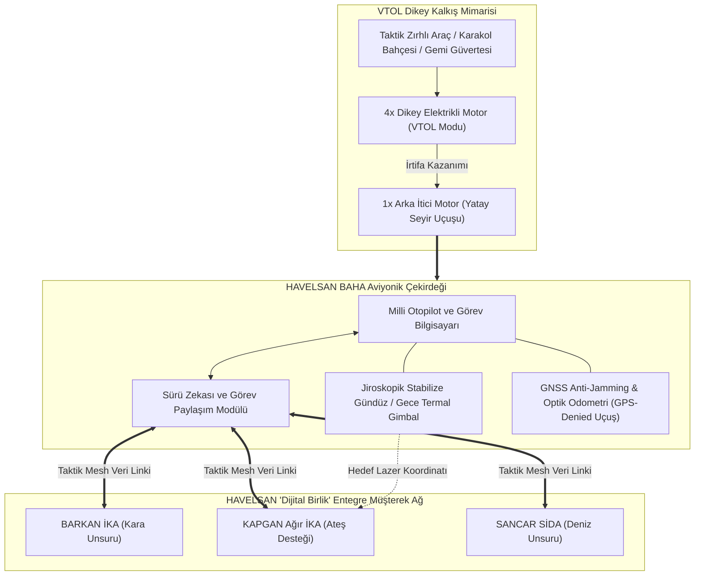

# 🦅 Proje: HAVELSAN BAHA (Bulut Altı Dikey Kalkışlı Otonom İHA)

  

> **Geliştirici:** HAVELSAN  
> **Sınıf:** Bulut Altı Taktik İnsansız Hava Aracı (B-İHA) / Dikey Kalkış ve İniş (VTOL)  
> **Stratejik Önem:** HAVELSAN'ın "Dijital Birlik" karma sürü konseptinin hava ayağı; pist ihtiyacı olmaksızın en sarp arazilerden dikey havalanan, bulut tabakasının altından kesintisiz elektro-optik keşif ve hedef koordinatı aktaran taktik istihbarat platformu.

---

## 🛡️ Stratejik Tanım & Doktriner Öncelik
HAVELSAN BAHA, taktik sahadaki öncü birliklerin, karakolların ve sınır gözetleme unsurlarının olumsuz hava şartlarında ve yoğun bulutlu günlerde dahi hava keşfi yapabilmesi amacıyla dizayn edilmiş hibrit tahrikli bir Bulut Altı İnsansız Hava Aracıdır (B-İHA). Dikey kalkış ve iniş (VTOL) mimarisi sayesinde pist veya fırlatma mancınığı gerektirmeden bir aracın arkasından, gemi güvertesinden veya dar bir dağ patikasından havalanabilir. Düz uçuşta benzinli veya elektrikli itici motorunu kullanarak saatlerce havada kalır. HAVELSAN'ın sürü zekası algoritmalarıyla donatılan BAHA; karadaki BARKAN ve denizdeki SANCAR insansız araçlarıyla canlı taktik veri alışverişi yaparak müşterek harekat icra eder.

---

## 📊 Kapsamlı Teknik Özellikler

| Parametre | Değer / Detay |
| :--- | :--- |
| **Kalkış / İniş Mimarisi**| Dikey Kalkış ve İniş (VTOL) - 4 Elektrikli Kaldırma Motoru + 1 İtici Motor |
| **Azami Kalkış Ağırlığı** | ~30 - 35 kg |
| **Faydalı Yük Kapasitesi**| 5 kg (Elektro-optik kamera, lazer mesafe ölçer, sinyal istihbarat kiti) |
| **Havada Kalış Süresi** | Benzinli Hibrit Motor ile 6+ Saat / Tam Elektrikli Konfigürasyonda 2+ Saat |
| **Operasyonel İrtifa** | 10.000 - 15.000 Feet (Bulut altı uçuş tavanı) |
| **Görev Yarıçapı (Menzil)**| 80+ km (Görüş hattı LOS kriptolu veri bağı) |
| **Azami Seyir Hızı** | 50 - 75 Knot (~100 - 140 km/s) |
| **Rüzgar Dayanımı** | 25 Knot şiddetli rüzgarda dikey iniş/kalkış ve stabil uçuş |

---

## 🧩 Alt Sistemler ve Aviyonik/Elektronik Entegrasyonu
- **GPS Olmayan Ortamda Uçuş:** Düşman elektronik karıştırma (spoofing/jamming) yaptığında yer şekillerini kameralarla eşleştiren optik akış algoritmalarıyla rotasını koruma.
- **Dijital Birlik Sürü İletişimi:** Karadaki robot köpek, BARKAN veya zırhlı birliklerin göremediği tepe ardı tehditleri havadan tespit edip otomatik olarak kara araçlarının atış kontrol sistemine iletme.
- **Dahili KBRN ve Sinyal Algılama Podu:** Tehlikeli gaz sızıntılarını ve düşman telsiz yayınlarını havadan koklayarak haritalama kabiliyeti.
- **Gemi Güvertesine Otonom İniş:** Hareket halindeki korvet veya sahil güvenlik botu güvertesine optik işaretçiyi takip ederek tek tuşla dikey iniş.

---

## 🎯 Görev Profili, Muharebe Senaryoları & Mühimmat Yelpazesi
- **Sınır Karakolu Keşif ve Güvenliği:** Sarp dağlık arazideki karakolların çevresini sisli ve bulutlu havalarda 360 derece gözetleyerek sızmaları önleme.
- **Topçu İleri Gözetleyiciliği:** Fırtına obüsleri veya ÇNRA bataryaları için hedef tespiti yapıp atış tanzimi ve isabet düzeltme koordinatları sağlama.
- **Arama Kurtarma & Orman Yangını Tespiti:** Gece yangın odaklarını termal kamerayla tespit etme ve kayıp personelin yerini belirleme.

---

## 🚀 TRL Seviyesi ve Gelişim Yol Haritası
- **Mevcut Seviye:** **TRL 9 (Saha Kanıtlanmış Seri Üretim ve İhracat)**
- [x] Zorlu İklim ve Yüksek İrtifa Dağ Koşulları Uçuş Kalifikasyonu
- [x] TSK ve Jandarma Genel Komutanlığı Birliklerine Teslimat
- [x] Dijital Birlik Müşterek Tatbikatlarında Canlı Görev İcrası
- [x] Afrika ve Asya Ülkelerine İhracat Başarısı
- [ ] Lazer Güdümlü Mikro Mühimmat (METE vb.) Entegrasyonu ile Vurucu B-İHA Fazı

---

[⬅️ Üst Dizine](../README.md) | [🏛️ Dominion Hub](../../README.md) | [🏠 Ana Sayfa](../../../README.md)
