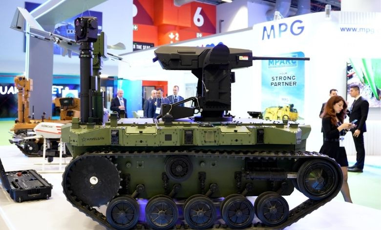
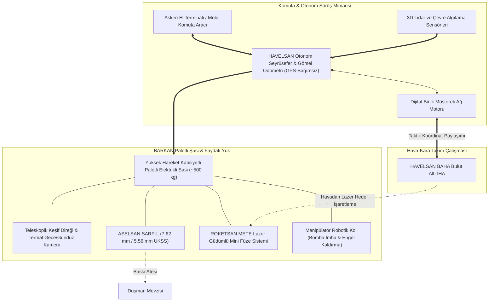

# 🤖 Proje: HAVELSAN BARKAN (Orta Sınıf Muharip İnsansız Kara Aracı)

  

  

> **Geliştirici:** HAVELSAN  
> **Sınıf:** Orta Sınıf Paletli Çok Maksatlı İnsansız Kara Aracı (İKA-2)  
> **Stratejik Önem:** HAVELSAN "Dijital Birlik" konseptinin kara muharebe omurgası; piyadenin yanında yürüyerek ağır silah desteği veren, yaralı tahliyesi ve mühimmat ikmali yapan, lazer güdümlü mini füzelerle hedefleri imha eden otonom taktik robot platform.

---

## 🛡️ Stratejik Tanım & Doktriner Öncelik
HAVELSAN BARKAN, modern asimetrik ve meskun mahal çatışmalarında Mehmetçiğin hayati riskini en aza indirmek ve ateş gücünü çarpan etkisiyle katlamak için tasarlanmış orta sınıf paletli bir insansız kara aracıdır. Zorlu arazi koşullarında yüksek torklu elektrik tahrik mimarisiyle hareket eden BARKAN; ASELSAN SARP-L Uzaktan Komutalı Silah Sistemi, ROKETSAN METE lazer güdümlü mini füze podu ve keşif/gözetleme direği gibi çok amaçlı faydalı yükleri bünyesinde taşır. Lidar, stereo kameralar ve GNSS-bağımsız görsel seyrüsefer algoritmalarıyla donatılan araç; lider asker takibi, otonom devriye ve sürü halinde çoklu robot koordinasyonu yeteneklerine sahiptir.

---

## 📊 Kapsamlı Teknik Özellikler

| Parametre | BARKAN 1 | BARKAN 2 (Gelişmiş Versiyon) |
| :--- | :--- | :--- |
| **Toplam Ağırlık** | ~500 kg | ~900 kg |
| **Tahrik Sistemi** | Elektrik Motorlu Paletli Yürüyüş Grubu | Gelişmiş Hibrit / Elektrikli Paletli Şasi |
| **Azami Hız** | 12 - 15 km/s | 15 - 20 km/s |
| **Operasyonel Süre** | 5+ Saat Kesintisiz Görev | 8+ Saat Genişletilmiş Görev Süresi |
| **Faydalı Yük Kapasitesi**| 100 kg | 250+ kg (Ağır silah ve sedye taşıma) |
| **Silah Donanımı** | 7.62 mm SARP-L UKSS | 7.62 mm / 12.7 mm UKSS + 4x ROKETSAN METE Füzesi |
| **Haberleşme Menzili** | Görüş Hattı (LOS) 2-5 km / Röle ile 10+ km | 5+ km Taktik Mesh Telsiz Linki |
| **Otonomi Yetenekleri** | Lider Asker Takibi, Engel Aşma, Eve Dönüş | Dinamik Rota Planlama, Hedef Tanıma, Sürü Zekası |

---

## 🧩 Alt Sistemler ve Aviyonik/Elektronik Entegrasyonu
- **ROKETSAN METE Mini Füze Entegrasyonu:** Dünyanın en küçük güdümlü füzelerinden biri olan 40 mm çapındaki METE ile 1+ km mesafedeki keskin nişancı mevzilerini nokta atışıyla imha.
- **GPS Karıştırmasına Dirençli Seyrüsefer:** Elektronik harp ortamında uydudan konum alamasa dahi palet tur sayacı ve kameralardan alınan optik akışla santimetrik rota hesabı.
- **Lider Asker Takip Modu ("Follow Me"):** Devriye atan askerin peşinden sessizce yürüyerek askerin sırt çantasını, ağır makineli mühimmatını ve roketlerini taşıma.
- **Acil Yaralı Tahliye Kiti:** Muharebe alanında vurulan personeli kurşun geçirmez zırhlı sedye aparatına alarak ateş altından otonom geri çekme.

---

## 🎯 Görev Profili, Muharebe Senaryoları & Mühimmat Yelpazesi
- **Öncü Keşif ve Pusu Tespiti:** Bir sokak veya vadiye birlikler girmeden önce en önden ilerleyerek pusu kuran terör unsurlarını termal kameralarıyla açığa çıkarma.
- **Karakol ve Üs Bölgesi Çevre Savunması:** Gece boyunca sınır hattında sessiz otonom devriye atarak tel örgü ihlallerini anında komuta merkezine bildirme ve gerekirse ateş açma.
- **Sürü Operasyonları:** Birden fazla BARKAN'ın ve BAHA İHA'nın tek bir ekrandan eşzamanlı yönlendirilerek düşman mevzisini kıskaca alması.

---

## 🚀 TRL Seviyesi ve Gelişim Yol Haritası
- **Mevcut Seviye:** **TRL 9 (Saha Kanıtlanmış Seri Üretim)**
- [x] TSK ve Kara Kuvvetleri Saha Kabul ve Dayanıklılık Testleri Başarılı
- [x] Güvenlik Güçleri Envanterine Giriş ve Operasyonel Dağıtım
- [x] BARKAN 2 Konfigürasyonu ile Ağır Silah ve Füze Atış Testleri İcrası
- [x] Dijital Birlik Müşterek Harekât Gösterimleri
- [ ] Yapay Zeka ile Otomatik Hedef Tanıma (ATR) ve Tehdit Derecelendirme Güncellemesi

---

[⬅️ Üst Dizine](../README.md) | [🏛️ Dominion Hub](../../README.md) | [🏠 Ana Sayfa](../../../README.md)
