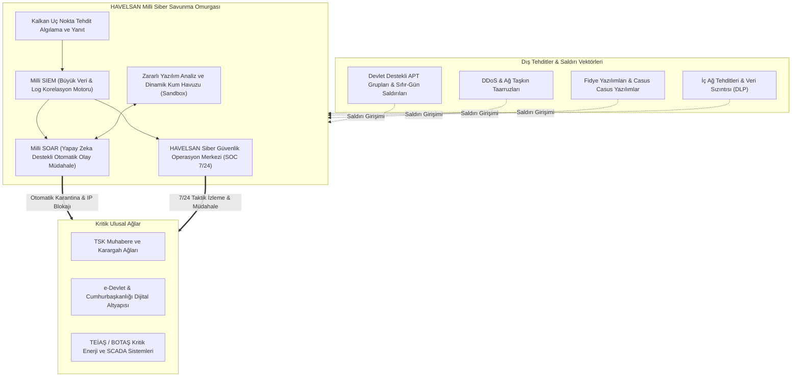

# 🛡️ Proje: HAVELSAN SİBER GÜVENLİK SÜİTİ (Milli Siber Savunma Mimarisi)

  

> **Geliştirici:** HAVELSAN  
> **Sınıf:** Askeri Düzey Kurumsal ve Kritik Altyapı Siber Güvenlik Süiti (SIEM, SOAR, EDR, Malware Analizi)  
> **Stratejik Önem:** Cumhurbaşkanlığı, TSK askeri veri hatları, bakanlıklar, bankacılık ve kritik enerji şebekelerini yabancı siber güvenlik yazılımlarına (Splunk, QRadar, CrowdStrike) bağımlı kalmadan koruyan %100 milli siber savunma kalkanı.

---

## 🛡️ Stratejik Tanım & Doktriner Öncelik
HAVELSAN Siber Güvenlik Süiti, siber uzayın modern harp doktrinlerinde 5. harekât alanı haline gelmesi doğrultusunda Türkiye'nin stratejik dijital varlıklarını gelişmiş kalıcı tehditlere (APT), fidye yazılımlarına (ransomware) ve devlet destekli siber saldırılara karşı korumak amacıyla geliştirilmiştir. Yabancı menşeili güvenlik ürünlerinin arka kapı (backdoor) barındırma riskini tamamen elimine eden sistem; gerçek zamanlı log yönetimi (SIEM), yapay zeka destekli siber olay müdahalesi (SOAR), uç nokta tehdit algılama (EDR) ve otomatik zararlı yazılım analiz laboratuvarını tek bir çatı altında birleştirir.

---

## 📊 Kapsamlı Teknik Özellikler

| Parametre | Değer / Detay |
| :--- | :--- |
| **Yazılım Mimarisi** | Mikroservis Tabanlı, Yüksek Erişilebilir Dağıtık Büyük Veri Mimarisi |
| **Log İşleme Kapasitesi**| Saniyede 1.000.000+ EPS (Events Per Second) anlık korelasyon ve indeksleme |
| **Tehdit İstihbaratı** | Milli Tehdit İstihbarat Veri Tabanı + Global STIX/TAXII Entegrasyonu |
| **Analiz Yöntemleri** | Statik Kod Analizi, Dinamik Kum Havuzu (Sandbox) Davranış Analizi, Bellek Adli Bilişimi |
| **Yapay Zeka Yeteneği** | Anomali Tespiti, Kullanıcı ve Varlık Davranış Analizi (UEBA), Otomatik Oyun Kitabı (Playbook) |
| **Uyumluluk Standartları**| ISO 27001, Common Criteria EAL4+, Askeri Kripto ve Gizlilik Seviyeleri |
| **Dağıtım Modeli** | %100 Kurum İçi (On-Premise / Air-Gapped) & Güvenli Kamu Bulut Desteği |

---

## 🧩 Alt Sistemler ve Aviyonik/Elektronik Entegrasyonu
- **Milli SIEM / SOAR Korelasyonu:** Milyarlarca log satırı arasından saniyeler içinde anomaliyi tespit edip insan müdahalesi beklemeden saldırgan sunucuları güvenlik duvarlarında izole etme.
- **SCADA ve Endüstriyel Ağ Güvenliği:** Barajlar, nükleer/termik santraller ve boru hatlarının PLC cihazlarını hedef alan siber-fiziksel saldırıları protokol bazında ayrıştırma.
- **Askeri Platform Entegrasyonu:** Harp gemileri (ADVENT) ve hava araçlarının komuta kontrol ağlarının siber dayanıklılığını denetleyen uç nokta sensörleri.
- **Zararlı Yazılım Analiz Platformu (Sandbox):** Şüpheli e-posta ekleri ve dosyaları izole sanal makinelerde çalıştırarak sıfır-gün açıklarını deşifre etme.

---

## 🎯 Görev Profili, Muharebe Senaryoları & Mühimmat Yelpazesi
- **Kritik Kurum Savunması:** Devlet kurumlarına yönelik kimlik avı (phishing), fidye yazılımı ve veri hırsızlığı girişimlerinin gerçek zamanlı engellenmesi.
- **NATO ve Ulusal Siber Tatbikatlar:** Kilitli Kalkan (Locked Shields) ve Cyber Coalition tatbikatlarında Türkiye milli siber savunma kalkanı olarak birincil rol alma.
- **Siber İstihbarat ve Tehdit Avcılığı:** Düşman hacker gruplarının taktik, teknik ve prosedürlerini (TTP) önceden modelleyerek saldırı başlamadan önlem alma.

---

## 🚀 TRL Seviyesi ve Gelişim Yol Haritası
- **Mevcut Seviye:** **TRL 9 (Saha Kanıtlanmış Hizmet ve Geniş Ölçekli Kullanım)**
- [x] Tüm Kritik Modüllerin Geliştirilmesi ve Güvenlik Sertifikasyonları
- [x] Cumhurbaşkanlığı, Bakanlıklar ve TSK Ağlarında Aktif 7/24 Koruma
- [x] Uluslararası NATO Siber Tatbikatlarında Üstün Başarı ve Doğrulama
- [x] Kritik Enerji ve Ulaştırma SCADA Ağlarına Tam Entegrasyon
- [ ] Kuantum Sonrası Kriptografi (PQC) ve LLM Destekli Otonom Siber Savunma Botları

---

[⬅️ Üst Dizine](../README.md) | [🏛️ Dominion Hub](../../README.md) | [🏠 Ana Sayfa](../../../README.md)
