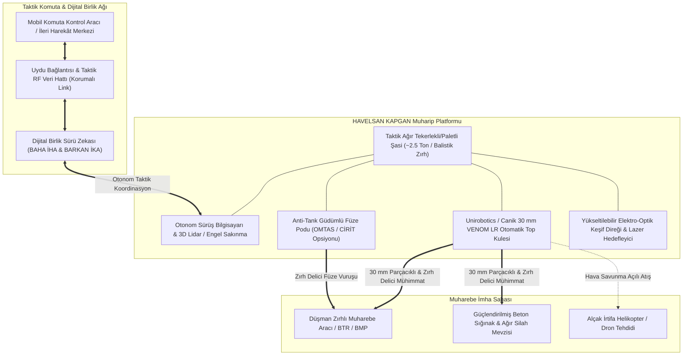

# 🚜 Proje: HAVELSAN KAPGAN (Ağır Sınıf Muharip İnsansız Kara Aracı)

[

  

](https://www.havelsan.com.tr)

  

> **Geliştirici:** HAVELSAN  
> **Sınıf:** Ağır Sınıf Çok Maksatlı İnsansız Kara Aracı (A-İKA)  
> **Stratejik Önem:** "Dijital Birlik" konseptinin en yüksek ateş gücüne sahip zırhlı kara vurucusu; 30 mm otomatik top ve tanksavar füzeleri taşıyarak düşman zırhlılarını, beton sığınaklarını ve siperlerini insansız olarak imha eden otonom taarruz canavarı.

---

## 🛡️ Stratejik Tanım & Doktriner Öncelik
HAVELSAN KAPGAN, modern muharebe sahasında piyade ve mekanize birliklere doğrudan ağır ateş desteği sağlamak, tank ve zırhlı muharebe araçlarının giremediği dar ve mayın riski yüksek geçitlerde öncü taarruz unsuru olarak görev yapmak üzere geliştirilmiş ağır sınıf bir insansız kara aracıdır. Yaklaşık 2.5 ton ağırlığındaki platform; bünyesine entegre edilen 30 mm Canik VENOM LR otomatik topu, tanksavar füze podları ve gelişmiş sensör kulesiyle tekerlekli/paletli zırhlı muharebe araçlarının ateş gücünü yakalamıştır. HAVELSAN otonom sürüş yazılımları, elektro-optik hedef takip algoritmaları ve GPS-bağımsız konumlandırma sistemleri ile sınır ötesi harekâtlarda yüksek beka kabiliyeti sunar.

---

## 📊 Kapsamlı Teknik Özellikler

| Parametre | Değer / Detay |
| :--- | :--- |
| **Toplam Ağırlık** | ~2.500 kg (2.5 Ton Sınıfı) |
| **Faydalı Yük Kapasitesi**| 1.000+ kg (Ağır silah taretleri, mühimmat ve ek zırh paketleri) |
| **Azami Hız** | 25 - 30+ km/s |
| **Çalışma Süresi** | Hibrit motor seçeneğiyle 6+ saat kesintisiz operasyonel menzil |
| **Ana Silah Sistemi** | 30x113 mm Canik VENOM LR Düşük Tepmeli Otomatik Top |
| **İkincil / Ek Silahlar** | 12.7 mm Eşeksenli Ağır Makineli Tüfek, 4x ROKETSAN CİRİT veya OMTAS Lançeri |
| **Gözetleme & Sensörler** | 5 Metreye Kadar Yükseltilebilir Mast, Gece/Gündüz Termal Kamera, Lidar, Akustik Atış Tespiti |
| **Haberleşme & Menzil** | Görüş Hattı (LOS) 5+ km / Uydu Haberleşmesi (SATCOM) ile Sınırsız Kontrol |

---

## 🧩 Alt Sistemler ve Aviyonik/Elektronik Entegrasyonu
- **30 mm Canik VENOM LR Silah Kulesi:** Düşük geri tepmeli yapısıyla hafif ve orta zırhlı hedefleri 2.000 metre mesafeden etkisizleştiren yüksek tahrip gücü.
- **Akustik Atış Yönü Tespit Sistemi:** Düşman keskin nişancı veya piyadesi ateş açtığında silah sesinin geliş açısını mikrosaniyede hesaplayıp kuleyi otomatik düşmana çevirme.
- **Dijital Birlik Entegrasyonu:** Gökyüzündeki BAHA İHA'nın lazerle işaretlediği hedefi tepe arkasından doğrudan 30 mm top veya tanksavar füzesiyle vurma.
- **Yüksek Balistik ve Mayın Koruma:** STANAG standartlarında kompozit zırh ve V-tabanlı gövde ile el yapımı patlayıcılara karşı şasi dayanımı.

---

## 🎯 Görev Profili, Muharebe Senaryoları & Mühimmat Yelpazesi
- **Zırhlı Birlik Öncüsü:** Tank ve piyade birlikleri mayınlı veya pusu riski yüksek vadiye girmeden önce en önde ilerleyerek temas sağlama ve düşman zırhlılarını imha etme.
- **Meskun Mahal Ağır Ateş Desteği:** Binalara yerleşmiş düşman keskin nişancı mevzilerini 30 mm yüksek infilaklı mermilerle duvar arkasından delerek yok etme.
- **Üs Bölgesi ve Sınır Hattı Güvenliği:** Ağır silah kulesiyle sınır hattında devriye gezerek düşman araçlı sızmalarını kilometrelerce öteden püskürtme.

---

## 🚀 TRL Seviyesi ve Gelişim Yol Haritası
- **Mevcut Seviye:** **TRL 7 (Sistem Prototipi Canlı Atış ve Saha Testlerinde Doğrulandı)**
- [x] Prototip Şasi ve Hibrit Tahrik Sistemi Üretimi
- [x] 30 mm Silah Kulesi ile Canlı Atışlı Hedef İmha Testleri Başarısı
- [x] Dijital Birlik Müşterek Tatbikatlarında Otonom Sürüş Gösterimi
- [ ] TSK Kabul ve Dayanıklılık Testleri Fazı
- [ ] Seri Üretim Hattının Kurulması ve Zırhlı Birliklere Dağıtımı

---

[⬅️ Üst Dizine](../README.md) | [🏛️ Dominion Hub](../../README.md) | [🏠 Ana Sayfa](../../../README.md)
