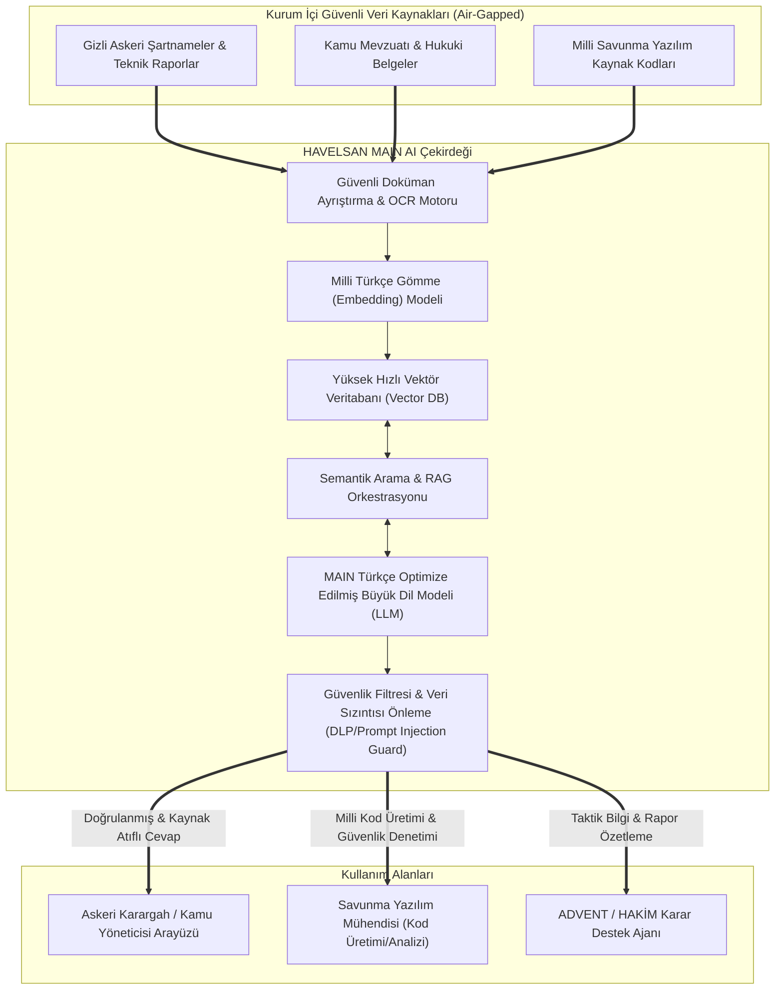

# 🧠 Proje: HAVELSAN MAIN AI (Milli Kurumsal Büyük Dil Modeli)

[

  

](https://www.havelsan.com.tr)

  

> **Geliştirici:** HAVELSAN  
> **Sınıf:** Güvenli ve Kapalı Devre Kurumsal Büyük Dil Modeli (LLM) & Üretken Yapay Zeka (GenAI) Platformu  
> **Stratejik Önem:** Türkiye'nin kamu kurumları, askeri karargahları ve savunma sanayii kuruluşlarının "Çok Gizli" dereceli verilerini yabancı bulut ve yapay zeka sunucularına (OpenAI, Microsoft, Google) göndermeksizin, tamamen kurum sunucularında (On-Premise / Air-Gapped) çalıştıran milli yapay zeka asistanı ("Türkiye'nin Savunma GPT'si").

---

## 🛡️ Stratejik Tanım & Doktriner Öncelik
HAVELSAN MAIN (Multifunctional Artificial Intelligence Network), ulusal veri egemenliği doktrini doğrultusunda kurumların stratejik bilgi birikimini koruyarak üretken yapay zeka devriminden güvenle faydalanmalarını sağlamak amacıyla tasarlanmış milli kurumsal büyük dil modelidir. Şubatı 2024'te kamuoyuna tanıtılan sistem; Türkçenin zengin morfolojik ve eklemeli yapısına tam uyumlu olarak milyarlarca tokenlik Türkçe veri kümesiyle eğitilmiştir. Gelişmiş Bilgi Getirimi ile Zenginleştirilmiş Üretim (RAG) mimarisi sayesinde kurumların binlerce sayfalık gizli şartnamelerini, askeri doktrinlerini, hukuki mevzuatlarını ve yazılım kaynak kodlarını indeksleyerek halüsinasyonsuz, kaynak göstererek anında analiz eder ve özetler.

---

## 📊 Kapsamlı Teknik Özellikler

| Parametre | Değer / Detay |
| :--- | :--- |
| **Model Mimarisi** | Transformer Tabanlı Derin Öğrenme / Causal Decoder LLM Mimarisi |
| **Dil Uzmanlığı** | Türkçe (Öncelikli Yüksek Morfolojik Doğruluk) ve İngilizce |
| **Dağıtım Modeli** | %100 Kurum İçi Donanım (On-Premise), İzole Ağ (Air-Gapped) ve Güvenli Özel Bulut |
| **Bağlam Penceresi (Context)**| 8K - 32K+ Token (Geniş doküman ve kitapçık analiz kapasitesi) |
| **Arama & Geri Çağırma (RAG)**| Hibrit Arama (Dense Vector Search + Sparse BM25) ile Sıfır Halüsinasyon Prensibi |
| **Donanım Uyumluluğu** | NVIDIA Tensor Core GPU Sunucuları (A100, H100, L40S) & Yerli Hızlandırıcı Kartlar |
| **Veri Güvenliği Seviyesi** | İnternet bağlantısı gerektirmez, veri dışarı sızmaz, loglar kurumda kalır |

---

## 🧩 Alt Sistemler ve Aviyonik/Elektronik Entegrasyonu
- **RAG (Retrieval-Augmented Generation) Motoru:** Kullanıcının sorduğu soruya karşılık kurum içi belgelerden birebir alıntı yaparak cevabın altına sayfa numarası ve paragraf referansı ekleme.
- **Askeri Kod Üretimi ve Güvenlik Denetimi:** C/C++, Python, Ada ve Java dillerinde savunma yazılımları geliştirilirken güvenlik açıklarını (Buffer Overflow, SQLi) tespit eden dahili model.
- **Komuta Kontrol (C4I) Entegrasyonu:** Taktik harekat merkezlerinde gelen yüzlerce sayfalık istihbarat ve durum raporunu tek paragraflık yönetici özetine dönüştürme.
- **Prompt Enjeksiyon Koruması:** Kullanıcı tarafından gelebilecek manipülatif ve güvenlik duvarlarını delmeye yönelik "Jailbreak" girişimlerini engelleyen emniyet katmanı.

---

## 🎯 Görev Profili, Muharebe Senaryoları & Mühimmat Yelpazesi
- **Kamu Kurumlarında Karar Destek:** Bakanlıklar ve devlet dairelerinde kanun ve yönetmeliklere uygunluk denetimlerini saniyeler içinde tamamlama.
- **Askeri Doktrin ve İstihbarat Analizi:** Uydu fotoğrafları raporları ve saha keşif tutanaklarını ilişkilendirerek düşman birlik hareketlerini sentezleme.
- **Gizli AR-GE Desteği:** ASELSAN, TUSAŞ, ROKETSAN ve HAVELSAN mühendislerine patent ve tasarım aşamalarında internete çıkmadan yapay zeka asistanlığı sağlama.

---

## 🚀 TRL Seviyesi ve Gelişim Yol Haritası
- **Mevcut Seviye:** **TRL 7/8 (Sistem Operasyonel Ortamda Kanıtlandı / Pilot Kurulumlar Aktif)**
- [x] Temel Model Eğitimi ve Türkçe Dil Yetenekleri Kalifikasyonu (Şubat 2024 Lansmanı)
- [x] Kamu Kurumları ve Savunma Şirketlerinde Kapalı Devre Pilot Dağıtımlar
- [x] Güvenli RAG ve Kurumsal Arama Modüllerinin Entegrasyonu
- [ ] Çok Modlu (Multimodal - Ses, Görüntü, Radar Sinyali İşleme) Yeteneklerin Eklenmesi
- [ ] Taktik Sahada Askeri Araç Üstü Kompakt Donanımlarda Çalışabilen Hafif Sürüm (Edge MAIN)

---

[⬅️ Üst Dizine](../README.md) | [🏛️ Dominion Hub](../../README.md) | [🏠 Ana Sayfa](../../../README.md)
