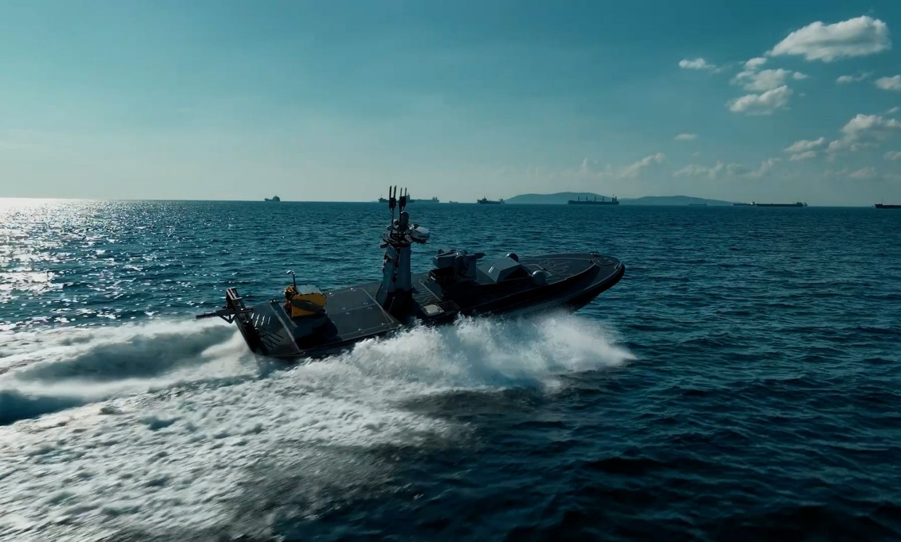
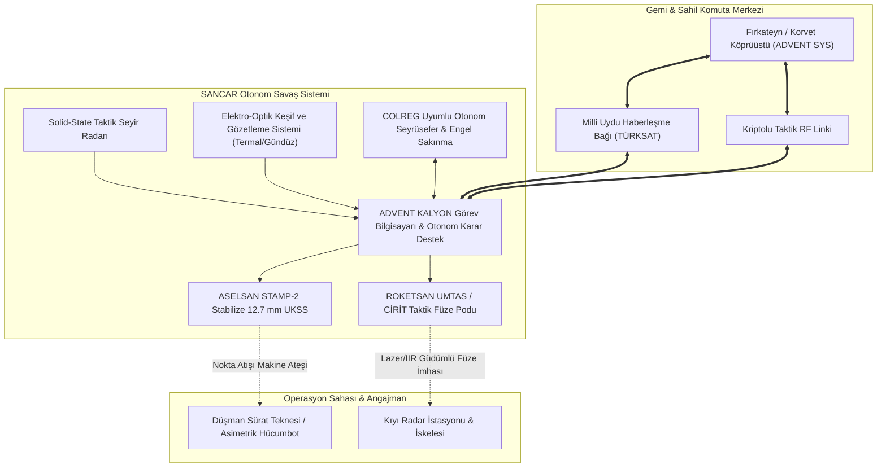

# 🛥️ Proje: HAVELSAN & Yonca-Onuk SANCAR (Silahlı İnsansız Deniz Aracı - SİDA)

  

  

> **Geliştirici:** HAVELSAN (Görev Bilgisayarı, ADVENT KALYON C2, Otonomi) & Yonca-Onuk Tersanesi (Gelişmiş Kompozit Gövde & Sevk)  
> **Sınıf:** Taktik Sınıf Silahlı İnsansız Deniz Aracı (SİDA)  
> **Stratejik Önem:** ADVENT Savaş Yönetim Sistemi'ne doğrudan entegre olan, Yonca-Onuk'un dünyaca ünlü derin-V gövde mimarisi sayesinde 40+ knot süratle dalgalı denizlerde asimetrik taarruz, üs koruması ve mayın tarama icra eden otonom deniz savaşçısı.

---

## 🛡️ Stratejik Tanım & Doktriner Öncelik
HAVELSAN & Yonca-Onuk iş birliğiyle geliştirilen SANCAR SİDA, Türk Deniz Kuvvetleri'nin "Mavi Vatan" stratejisi kapsamında deniz harekât alanında personelsiz vurucu güç çarpanı oluşturmak üzere tasarlanmıştır. Savunma Sanayii Başkanlığı koordinesinde yürütülen projede; Yonca-Onuk'un ileri kompozit malzeme teknolojisi ve yüksek denizcilik kabiliyetine sahip platformu, HAVELSAN'ın geliştirdiği ADVENT KALYON İnsansız Savaş Yönetim Sistemi ile birleştirilmiştir. Ağ merkezli harp mimarisi sayesinde ana muharip gemilerden yüzlerce mil uzakta dahi bir fırkateynin sensör veya silah istasyonu gibi vazife görür; asimetrik hücumbot akınlarına ve su üstü hedeflerine karşı 12.7 mm stabilize taret ve güdümlü füzelerle ölümcül karşılık verir.

---

## 📊 Kapsamlı Teknik Özellikler

| Parametre | Değer / Detay |
| :--- | :--- |
| **Gövde Tipi ve Malzeme** | Derin-V Formlu İleri Teknoloji Kompozit Gövde (Düşük Radar İzi) |
| **Tam Boy / Genişlik** | ~12.7 Metre Boy / ~3.3 Metre En |
| **Deplasman (Ağırlık)** | ~9 - 10 Ton |
| **Azami Sürat** | 40+ Knot (~75 km/s) |
| **Seyir Siası (Menzil)** | 400+ Deniz Mili (Ekonomik seyir hızıyla) |
| **Operasyonel Süre** | 40 Saat Kesintisiz Devriye ve Pusu Kabiliyeti |
| **Denizcilik Kabiliyeti** | Deniz Durumu 4'te tam operasyonel görev, Deniz Durumu 5'te beka |
| **Haberleşme Menzili** | Görüş Hattı (LOS) Taktik Link ile 150+ km / SATCOM ile Sınırsız |

---

## 🧩 Alt Sistemler ve Aviyonik/Elektronik Entegrasyonu
- **ADVENT KALYON Görev Sistemi:** Ana savaş gemisindeki ADVENT sistemiyle "tek bir taktik resim" paylaşarak hedef bilgilerini anlık aktarma ve gemiden verilen emirle salvo atış yapabilme.
- **Telsiz Sessizliği (EMCON) ve Otonom Pusu:** Düşman radarından gizlenmek için tüm RF yayınlarını kapatıp belirlenen koordinatta sessizce bekleyerek pusu kurma.
- **Otomatik Deniz Trafiği Kuralları (COLREG):** Balıkçı tekneleri, ticari gemiler ve şamandıraları radarı ve kamerasıyla tanıyıp uluslararası kurallara göre yol hakkı verme ve çarpışmayı önleme.
- **Modüler Faydalı Yük Entegrasyonu:** Görev ihtiyacına göre mayın tespit sonarı, hafif torpido lançeri veya elektronik harp karıştırma podu takılabilme esnekliği.

---

## 🎯 Görev Profili, Muharebe Senaryoları & Mühimmat Yelpazesi
- **Kritik Boğaz ve Üs Savunması:** Çanakkale ve İstanbul Boğazları ile Aksaz/Gölcük deniz üslerinin girişlerinde 7/24 devriye gezerek sızmaları önleme.
- **Yüzey Harbi ve Hızlı Hücum:** Düşman çıkarma filolarına veya korvetlerine sürü halinde yaklaşarak 40 knot süratle şaşırtmaca yapma ve füze atışıyla savunmayı yarma.
- **İstihbarat, Gözetleme ve Keşif (ISR):** Düşman kıyı şeridine gece vakti yaklaşarak termal kameralarla liman hareketliliğini kaydetme ve uydu üzerinden karargaha aktarma.

---

## 🚀 TRL Seviyesi ve Gelişim Yol Haritası
- **Mevcut Seviye:** **TRL 8 (Deniz Kalifikasyon ve Entegrasyon Testleri Başarıyla Tamamlandı)**
- [x] Kompozit Gövde İmalatı ve Yüksek Hızlı Deniz Seyir Testleri
- [x] ADVENT KALYON Görev Sistemi ile Sahil Kontrol İstasyonundan Tam Otonom İdare
- [x] STAMP-2 Silah İstasyonu ile Denizde Canlı Atışlı Hedef Vurma Testleri
- [ ] Türk Deniz Kuvvetleri Filosuna İlk Parti Seri Teslimatlar
- [ ] Denizaltı Savunma Harbi (DSH) Sonarı ve Mini Torpido Entegrasyon Fazı

---

[⬅️ Üst Dizine](../README.md) | [🏛️ Dominion Hub](../../README.md) | [🏠 Ana Sayfa](../../../README.md)
