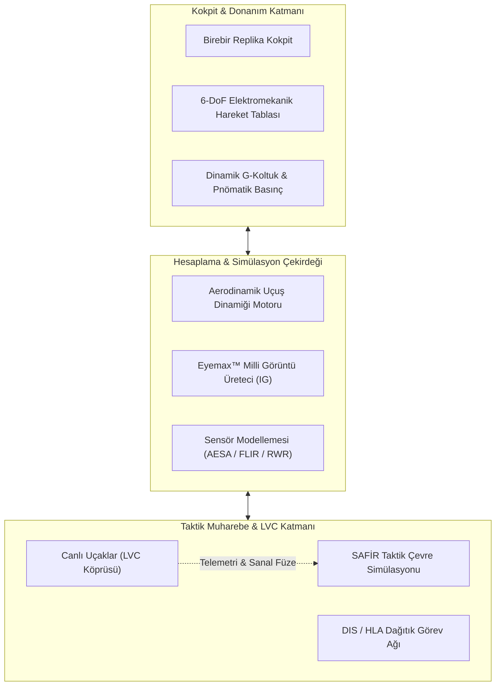

# 🎮 Proje: SİMÜLATÖRLER (Eğitim ve Simülasyon Sistemleri)

  
  
  
  

  

---

## 🛡️ Stratejik Tanım & Doktriner Öncelik
HAVELSAN Simülatör ve Eğitim Teknolojileri, Türk Silahlı Kuvvetleri'nin ve müttefik ülkelerin pilot, tankçı, gemi personeli ve özel operasyon timlerinin eğitim süreçlerinde sıfır risk ve azami operasyonel hazırlık seviyesi sağlayan kritik stratejik altyapılardır. Modern harekat ortamında gerçek mühimmat, yakıt ve platform yıpranma maliyetlerini %90'ın üzerinde düşüren simülasyon sistemleri; karmaşık muharebe senaryolarının, elektronik harp tehditlerinin ve ekstrem arıza koşullarının güvenle tecrübe edilmesine olanak tanır. 

HAVELSAN, Live-Virtual-Constructive (LVC) doktrini kapsamında gerçek platformlar ile simülatörleri tek bir müşterek sentetik muharebe ağında birleştirebilen dünyadaki nadir üreticilerden biridir. Hem askeri hem de uluslararası sivil havacılıkta (EASA Level D Full Flight Simulator) en üst sertifikasyon düzeyine ulaşan teknoloji, Türkiye'yi küresel bir eğitim merkezi konumuna yükseltmiştir.

---

## 📊 Kapsamlı Teknik Özellikler

| Parametre | Askeri Tam Görev Simülatörleri (FMS) | Sivil Tam Uçuş Simülatörleri (FFS) | Taktik & Prosedür Eğiticileri |
| :--- | :--- | :--- | :--- |
| **Sertifikasyon Düzeyi** | TSK Seviye 1 Askeri Uçuş / Taktik Akreditasyon | EASA / FAA Level D (En Yüksek Seviye) | Askeri Görev & Sensör Yeterlilik |
| **Görsel Sistem (Visual)** | 360° x 135° Kesintisiz Küresel Görsel Sistem | 200° x 40° Kolimatörlü Optik Projeksiyon | Yüksek Çözünürlüklü Çoklu Monitör / VR |
| **Görüntü Üreteci (IG)** | HAVELSAN Eyemax™ Milli Sentetik IG | Foto-gerçekçi 8K Coğrafi Veritabanı | Sentetik Taktik Çevre Üreteci |
| **Gecikme Süresi (Latency)** | < 15 ms (Görsel ve Hareket Senkronizasyonu) | < 20 ms EASA Regülasyon Standardı | < 25 ms |
| **Hareket Sistemi (Motion)** | 6-DoF Elektromekanik Yüksek Dinamikli Sistem | 6-DoF Elektrikli Aktüatörlü Hareket Tablası | Sabit Kaide / Titreşimli Taktik Koltuk |
| **G-Koltuk / G-Elbise** | Dinamik G-Koltuk ve Pnömatik G-Tulum Modülü | Standart Kokpit Konfigürasyonu | Entegre Taktik Geri Bildirim |
| **Ağ Mimarisi** | DIS / HLA / LVC Dağıtık Simülasyon Ağları | Sivil Havacılık Veri Ağı | Taktik Telsiz ve Veri Link Ağı |

---

## 🧩 Alt Sistemler ve Elektronik Entegrasyonu
- **HAVELSAN Eyemax™ Görüntü Üreteci:** Türkiye'nin sayısal arazi ve yükseklik modellerini, FLIR, NVG (Gece Görüş) ve radar sensör görüntülerini fizik tabanlı olarak eşzamanlı üretir.
- **Taktik Çevre Simülasyonu (SAFİR / ATEŞ):** Muharebe sahasındaki dost ve düşman hava savunma unsurlarını, yapay zeka güdümlü sürü dronları ve angajman doktrinlerini sanal ortamda simüle eder.
- **Taktik Veri Bağı Entegrasyonu:** Link-16 ve Milli Veri Bağı protokolleri simülatör kokpitine entegre edilerek pilotların gerçek zamanlı taktik resim yönetimini öğrenmesi sağlanır.
- **ADVENT & Çelik Kubbe Arayüzü:** Denizaltı ve gemi simülatörlerinde ADVENT Savaş Yönetim Sistemi doğrudan çalıştırılarak mürettebat gerçek yazılım üzerinde eğitilir.

---

## 🎯 Görev Profili ve Ürün Ailesi
- **F-16 & HÜRJET Tam Görev Simülatörleri:** İt dalaşı (dogfight), havada yakıt ikmali, gece taarruzu, SEAD/DEAD (hava savunma baskılama) ve acil durum prosedürleri.
- **T129 ATAK Helikopter Simülatörü (ATAKSİM):** Ormanlık ve dağlık arazide alçak irtifa seyrüseferi, MİLDAR radar kullanımı, UMTAS ve CİRİT atış senaryoları.
- **MİLDEN / Denizaltı Dalış ve Taktik Simülatörü:** Sualtı akustik profilleri, torpido kaçma manevraları ve periskop operatör eğitimleri.
- **Sivil Uçuş Simülatörleri (A320 / B737 MAX):** THY Uçuş Akademisi bünyesinde ticari havayolu pilotlarının tip eğitimi ve lisans yenileme uçuşları.
- **Keskin Nişancı ve Paraşütçü (Hezarfen):** Sanal gerçeklik destekli meskun mahal ve serbest paraşüt süzülüş eğitimleri.

---

## 🌐 Sistem Mimarisi ve Entegrasyon Akışı

---

## 🚀 TRL Seviyesi ve Gelişim Yol Haritası (TRL 9)
- [x] TSK Envanterindeki tüm ana platformlar için tam görev simülatörlerinin teslimatı
- [x] EASA Level D uluslararası sivil havacılık sertifikasyonunun başarıyla alınması
- [x] Katar, Malezya ve müttefik hava kuvvetlerine geniş ölçekli simülatör ihracatı
- [x] LVC (Live-Virtual-Constructive) müşterek harekat altyapısının operasyonel kullanımı
- [/] KAAN (MMU) mühendislik geliştirme ve uçuş simülatörlerinin nihai faz entegrasyonu

---

## 🔗 İç Dizin Navigasyonu
[⬅️ Üst Dizine](../README.md) | [🏛️ Dominion Hub](../../README.md) | [🏠 Ana Sayfa](../../../README.md)
