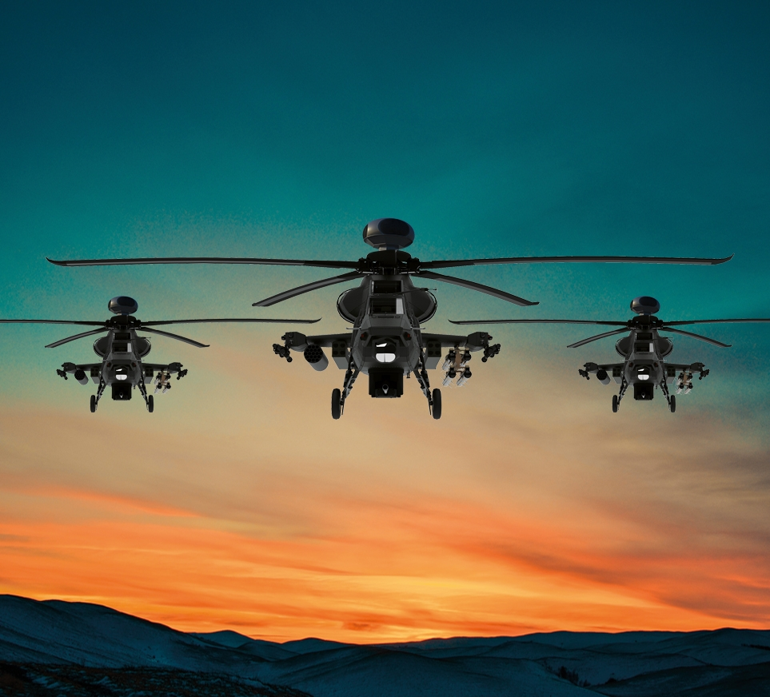
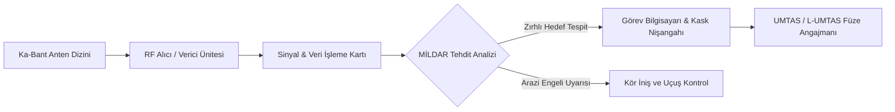

# 🚁 Proje: MİLDAR (Milimetre Dalga Radarı)

  
  
  
  

  

---

## 🛡️ Stratejik Tanım & Doktriner Öncelik
MİLDAR (Milimetre Dalga Radarı), taarruz helikopterleri (T129 ATAK, ATAK-II) ve insansız hava araçları için METEKSAN Savunma tarafından milli imkanlarla geliştirilmiş yüksek çözünürlüklü bir atış kontrol ve seyrüsefer destek radarıdır. Modern muharebe sahasında sis, pus, yoğun toz bulutu, şiddetli yağmur ve duman gibi elektro-optik ve termal görüş sistemlerinin körleştiği sıfır görüş koşullarında helikopter mürettebatına kesintisiz muharebe kabiliyeti kazandırır.

Dünyada yalnızca ABD (Longbow radarı) gibi birkaç ülkenin sahip olduğu bu teknoloji, MİLDAR sayesinde Türk Silahlı Kuvvetleri'ne tam milli bağımsızlıkla kazandırılmıştır. Radar, düşman zırhlı unsurlarını milimetre dalga bandında saniyeler içinde tarayıp sınıflandırırken, UMTAS ve OMTAS gibi tanksavar füzelerine hedefin hassas koordinatlarını aktararak "At-Unut" ve çoklu hedef angajmanı sağlar.

---

## 📊 Kapsamlı Teknik Özellikler

| Parametre | Değer / Karakteristik | Operasyonel Notlar |
| :--- | :--- | :--- |
| **Çalışma Frekansı** | Ka-Bant (Milimetre Dalga Boyu: ~35 GHz) | Atmosferik pencere optimizasyonu |
| **Azami Tespit Menzili** | 12+ km (Ana Muharebe Tankı ve Zırhlı Araç) | Çoklu hedef takip modu |
| **Kapsama Alanı (Azimut)** | 360° Mekanik Tarama / ±60° Sektör Taraması | Göreve göre yapılandırılabilir |
| **Kapsama Alanı (Yükseliş)** | ±15° Dinamik Elevasyon | Düşük irtifa yer taraması |
| **Ağırlık** | < 45 kg (Kompakt gövde mimarisi) | Pilon veya rotor üstü montaj |
| **Hedef Kapasitesi** | Eşzamanlı 50+ Hareketli/Sabit Hedef Tespiti | Tehdit önceliklendirme algoritması |
| **Güç Tüketimi** | < 1.2 kW | Helikopter elektrik barası uyumlu |
| **Soğutma** | Sıvı / İletimli Pasif Hibrit Soğutma | Yüksek termal direnç |

---

## 🧩 Alt Sistemler ve Aviyonik Entegrasyonu
- **Ka-Bant RF Alıcı-Verici Ünitesi:** Yüksek çözünürlüklü darbe-doppler radar dalga formları üreten düşük gürültülü mikrodalga modülü.
- **Sayısal Sinyal İşlemci (DSP):** SAR (Sentetik Açıklıklı Radar) haritalaması ve MTI (Hareketli Hedef Göstergesi) algoritmalarını gerçek zamanlı koşturur.
- **Rotor ve Pilon Montaj Kiti:** T129 ATAK pilon altına veya ATAK-II rotor üstüne dengeli entegrasyon sağlayan titreşim yalıtımlı yapı.
- **Aviyonik Görev Bilgisayarı Entegrasyonu:** MIL-STD-1553 ve Ethernet veri yolları üzerinden kaska monteli nişangah (AVCI) ve görev bilgisayarıyla anlık veri paylaşımı.

---

## 🎯 Görev Profili ve Muharebe Senaryoları
- **Zırhlı Birlik Avı (Search & Track):** Gizlenmiş, kamuflaj ağı altındaki veya duman perdesi ardındaki zırhlı hedefleri milisaniyeler içinde sınıflandırma (Tank, ZMA, Kamyon).
- **Hassas Güdüm Desteği:** Ka-bant RF güdümlü füzeler için hedef aydınlatma ve atış kontrol parametresi üretme.
- **Arazi Profili Takibi (Terrain Following):** Gece ve kör uçuş şartlarında yeryüzü engellerini (yüksek gerilim hatları, tepeler) tespit ederek pilotu uyarma.
- **Helikopter Kör İniş Desteği:** Çöl fırtınası veya toz kaldırma koşullarında güvenli iniş koridoru haritalama.

---

## 🌐 Sistem Mimarisi ve Angajman Döngüsü

---

## 🚀 TRL Seviyesi ve Gelişim Yol Haritası (TRL 8)
- [x] Ka-Bant radar mimarisi tasarımı ve laboratuvar testleri
- [x] Kara aracı ve kule entegrasyon testlerinin icrası
- [x] T129 ATAK prototipi üzerinde uçuş testleri ve hedef takibi
- [x] MİLDAR kılavuzluğunda UMTAS tanksavar füzesi atış testi doğrulaması
- [/] T929 ATAK-II ve Ağır Sınıf Taarruz Helikopteri rotor-üstü kalifikasyonu

---

## 🔗 İç Dizin Navigasyonu
[⬅️ Üst Dizine](../README.md) | [🏛️ Dominion Hub](../../README.md) | [🏠 Ana Sayfa](../../../README.md)
